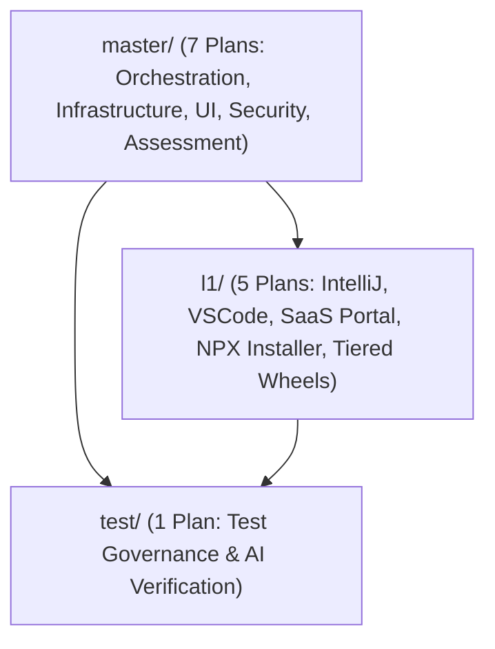

# Human-Readable Plan Guide & Architecture Reference

## Purpose

This guide provides a human-friendly and agentic overview of all active context engineering plans in the Percipience framework.

---

## Organization Principles

### 1. Dual-Format Documentation
Every plan is provided in two complementary formats:
- **`concise.md`** (~60–200 lines): Optimized for LLM agentic context windows, fast scanning, and prompt efficiency.
- **`detailed.md`** (~250–1650 lines): Comprehensive implementation blueprint containing code samples, sequence diagrams, failure recovery, and verification suites.

### 2. Plan-Centric Directory Convention (4-File Pattern)
Every plan folder contains exactly 4 standard files:
1. `MANIFEST.yaml`: Cryptographic SHA-256 hashes, line counts, versioning, canonical Schema v3.0 metadata, and capability dependencies.
2. `README.md`: Quick navigation and human overview.
3. `concise.md`: Agentic context specification.
4. `detailed.md`: Extended technical implementation guide.

### 3. Canonical Manifest Schema v3.0
All 13 active plans conform to Canonical Schema v3.0 (`.nb/plan/MANIFEST_SCHEMA.json`), featuring:
- **Unified Root**: `schema_version: "3.0.0"`, `plan_id`, `plan_name`, `version`, `layer`, `status`.
- **Maturity Lifecycle**: `stage` (`PLANNED`, `ACTIVE_DRAFT`, `IMPLEMENTATION_READY`, `COMPLETED`, `DEPRECATED`), `implementation_status`, `test_coverage`, `production_ready`.
- **Semantic Parity Gate**: 6-vector composite score ($S_{SP} \ge 0.950$) covering AST, contract, behavior, handover, doc, and supply-chain parity.
- **Acyclic Dependency Hierarchy**: `requires` and `enables` lists strictly validated via Kahn's algorithm (`.nb/plan/scripts/validate_dag.py`).
- **Cryptographic File Tracking**: `file_versions` with SHA-256 digests and line counts for `concise.md`, `detailed.md`, and `README.md`.

---

## Plan Hierarchy



### Master Plans (`master/`)
Governs the core platform runtime, 38 execution engines, Merkle state ledgers, AST token compression, and autonomous CI/CD (CAP-01 through CAP-35).
- **`parent-master-plan`**: Comprehensive enterprise context engineering framework.
- **`parent-master-free-plan`**: Free community single-seat edition.
- **`cloud-agnostic-infrastructure-substrate`**: Multi-cloud deployment mesh (OpenShift, GKE, EKS, AKS).
- **`enterprise-ui-design-system`**: Corporate Light / Enterprise Dark atomic design tokens.
- **`security-mesh`**: Multi-tenant RBAC, JWT validation, and PostgreSQL RLS.
- **`plan-assessment`**: Multi-agent workflow gatekeeping and plan scoring.
- **`sequential-plan-orchestrator`**: Zero-drift sequential dependency execution engine.

### L1 Foundation (`l1/`)
Implements concrete runtime spaces:
- **`intellij-pycharm-plugin`**: JetBrains Platform SDK & PSI AST Analysis.
- **`vscode-plugin`**: VSCode Extension API & LSP 3.17.
- **`saas-portal-domain`**: Modular portal, RBAC, PostgreSQL RLS, and pipeline visualizer drawer.
- **`npx-installer`**: Zero-Install Instant Onboarding & Ephemeral CI/CD Gatekeeper.
- **`tiered-wheel-packaging`**: Multi-Tier Python Wheel Packaging across Free, Team, Business & Enterprise Tiers.

### Test Governance (`test/`)
- **`test`**: Authoritative 18-subsystem automated test governance, Pytest test runner, and GenAI evaluation metrics.

---

## Verification & Automation Suite

Run the full verification suite before committing any changes to `.nb/plan/`:

```bash
# 1. Synchronize cryptographic file hashes and line counts
python3 .nb/plan/sync_plan_versions.py

# 2. Run automated validation gates (DAG, Schema v3.0, Content Hashes, Capability Matrix)
bash .nb/plan/scripts/validate.sh
```

---

## How to Use This Guide

### For Developers
1. Start with [PLAN_INDEX.md](./PLAN_INDEX.md) for top-level navigation.
2. Check [CAPABILITY_MATRIX.md](./CAPABILITY_MATRIX.md) for capability-to-plan cross-references.
3. Consult `detailed.md` when writing code or implementing features.
4. Run `bash .nb/plan/scripts/validate.sh` after editing plan files.

### For AI Agents
1. Load [PLAN_INDEX.md](./PLAN_INDEX.md) into context to locate the relevant domain plan.
2. Load the target plan's `concise.md` to conserve token budget while retaining core rules.
3. Reference `MANIFEST.yaml` for dependency verification and schema constraints.
