# 🧭 Percipience Context Engineering Plans (`.nb/plan/`)

Welcome to the **Percipience Plan Space**. This directory contains the authoritative architectural blueprints, domain layer specifications, and verification guidelines governing the entire Percipience autonomous context engineering platform.

---

## 1. Architectural Hierarchy

The plan space is organized into a clean **2-Layer Foundation Hierarchy** plus Master Test Governance, supported by reusable templates, synchronization tooling, and migration archives:

```mermaid
graph TD
    Root[".nb/plan/"] --> Master["master/ (Tier 0: Orchestration)"]
    Root --> L1["l1/ (Tier 1: Foundation Domains)"]
    Root --> Test["test/ (Test Governance)"]
    Root --> Templates["templates/ (Domain Scaffolding)"]
    Root --> Scripts["scripts/ (Version Sync Tooling)"]
    Root --> Archive["archive/ (Historical Architecture)"]

    Master --> PMP["parent-master-plan (Enterprise Master)"]
    Master --> PMF["parent-master-free-plan (Free Community)"]
    Master --> CAI["cloud-agnostic-infrastructure-substrate"]
    Master --> UIDS["enterprise-ui-design-system"]
    Master --> SEC["security-mesh"]
    Master --> PA["plan-assessment"]
    Master --> SPO["sequential-plan-orchestrator"]

    L1 --> IJ["intellij-pycharm-plugin (JetBrains SDK & PSI)"]
    L1 --> VS["vscode-plugin (VSCode & LSP 3.17)"]
    L1 --> SP["saas-portal-domain (Next.js & Multi-Tenant)"]
    L1 --> NPX["npx-installer (Zero-Install CI & Scaffolding)"]
    L1 --> TWP["tiered-wheel-packaging (Multi-Tier Wheel Distribution)"]

    Test --> TP["test (18-Subsystem Test Plan)"]
```



---

## 2. Standard 4-File Plan Pattern

Every active plan directory adheres strictly to the **Percipience 4-File Convention**:

| File | Purpose | Audience / Consumer |
| :--- | :--- | :--- |
| [`MANIFEST.yaml`](file:///Users/lakhwinder/PycharmProjects/nb_fairyfly/.nb/plan/master/parent-master-plan/MANIFEST.yaml) | Cryptographic metadata, SHA-256 hashes, line counts, and capability mappings. | CI/CD gates, Merkle DAG sealer, automation scripts. |
| `README.md` | Executive summary, subsystem overview, and directory navigation. | Human engineers and high-level agentic orientation. |
| `concise.md` | High-density specification optimized for low token consumption. | LLM prompt injection and agentic attention budgeting. |
| `detailed.md` | Complete architectural specification, API contracts, and implementation blueprints. | Deep cognitive reasoning, code synthesis, and audit verification. |

> [!NOTE]
> **Line Count Invariant**: In accordance with the Percipience Context Engineering Invariants, `concise.md` is strictly more compact than `detailed.md` across all plans ($N_{\text{lines}}(\text{concise}) < N_{\text{lines}}(\text{detailed})$).

---

## 3. Plan Catalog

### 🏛️ Tier 0: Master Orchestration Plans (`master/`)
- **[Parent Master Framework (`parent-master-plan/`)](file:///Users/lakhwinder/PycharmProjects/nb_fairyfly/.nb/plan/master/parent-master-plan/detailed.md)**: Universal blueprint defining core capabilities (`CAP-01` through `CAP-35`), Quad-Space clean partitioning, Merkle DAG ledger engine, and multi-tier commercial models.
- **[Parent Master Free Community Edition (`parent-master-free-plan/`)](file:///Users/lakhwinder/PycharmProjects/nb_fairyfly/.nb/plan/master/parent-master-free-plan/detailed.md)**: Community edition tailored for single-seat local development with zero external dependencies and embedded IDE bootstrapping.
- **[Cloud-Agnostic Infrastructure Substrate (`cloud-agnostic-infrastructure-substrate/`)](file:///Users/lakhwinder/PycharmProjects/nb_fairyfly/.nb/plan/master/cloud-agnostic-infrastructure-substrate/detailed.md)**: Universal deployment substrate supporting OpenShift, Kubernetes, AWS EKS/Fargate, GCP Cloud Run/GKE, and Azure Container Apps.
- **[Enterprise UI Design System (`enterprise-ui-design-system/`)](file:///Users/lakhwinder/PycharmProjects/nb_fairyfly/.nb/plan/master/enterprise-ui-design-system/detailed.md)**: Corporate Light and Enterprise Dark design tokens, responsive typography, and navigation standards.
- **[Security Mesh (`security-mesh/`)](file:///Users/lakhwinder/PycharmProjects/nb_fairyfly/.nb/plan/master/security-mesh/detailed.md)**: Multi-tenant RBAC, JWT validation, PostgreSQL Row-Level Security (RLS), and zero-trust perimeter defense.
- **[Plan Assessment Framework (`plan-assessment/`)](file:///Users/lakhwinder/PycharmProjects/nb_fairyfly/.nb/plan/master/plan-assessment/detailed.md)**: Autonomous plan health evaluation, 6-vector semantic parity validation, and multi-agent workflow gatekeeping.
- **[Sequential Plan Orchestrator (`sequential-plan-orchestrator/`)](file:///Users/lakhwinder/PycharmProjects/nb_fairyfly/.nb/plan/master/sequential-plan-orchestrator/detailed.md)**: Zero-drift sequential execution engine enforcing strict layer-by-layer dependency progression.

### 🔌 Tier 1: Foundation Domain Layers (`l1/`)
- **[IntelliJ IDEA & PyCharm Plugin Space (`intellij-pycharm-plugin/`)](file:///Users/lakhwinder/PycharmProjects/nb_fairyfly/.nb/plan/l1/intellij-pycharm-plugin/detailed.md)**: JetBrains Platform SDK plugin, PSI multi-language AST token reduction, dockable ToolWindow control plane, and pipeline DAG visualizer.
- **[VSCode Extension Space (`vscode-plugin/`)](file:///Users/lakhwinder/PycharmProjects/nb_fairyfly/.nb/plan/l1/vscode-plugin/detailed.md)**: VSCode Extension API, Language Server Protocol (LSP 3.17), hierarchical pipeline stage/contract tree provider, and Webview DAG cards.
- **[SaaS Portal & Observability Domain (`saas-portal-domain/`)](file:///Users/lakhwinder/PycharmProjects/nb_fairyfly/.nb/plan/l1/saas-portal-domain/detailed.md)**: Next.js 14 / FastAPI modular web portal, RBAC, PostgreSQL RLS, FinOps token analytics, and interactive visual pipeline DAG & stage contract inspector drawer.
- **[NPX Instant Execution Space (`npx-installer/`)](file:///Users/lakhwinder/PycharmProjects/nb_fairyfly/.nb/plan/l1/npx-installer/detailed.md)**: Zero-installation ephemeral CI PR Gatekeeper validation, instant Quad-Space scaffolding, and platform binary resolution.
- **[Multi-Tier Python Wheel Packaging (`tiered-wheel-packaging/`)](file:///Users/lakhwinder/PycharmProjects/nb_fairyfly/.nb/plan/l1/tiered-wheel-packaging/detailed.md)**: Automated PEP 427 Python wheel compilation across all 4 commercial tiers (Free, Team, Business, Enterprise) with strict build-time engine exclusion boundaries.

### 🧪 test/ (Test Governance & Verification)
- **[Percipience Master Test Governance Framework (`test/detailed.md`)](file:///Users/lakhwinder/PycharmProjects/nb_fairyfly/.nb/plan/test/detailed.md)**: 18-subsystem automated test governance, Pytest test execution, DeepEval AI quantitative evaluations, Playwright E2E, and AI-assisted self-healing test orchestrator (`.nb/plan/test/test_runner.py`).

### 📐 Scaffolding Templates (`templates/`)
- **[Custom Domain Layer Template](file:///Users/lakhwinder/PycharmProjects/nb_fairyfly/.nb/plan/templates/custom_domain_layer_template.md)**: Standardized template for scaffolding custom enterprise domain layers.

---

## 4. Automation & Tooling

To maintain cryptographic synchronization and DAG validation across all plan manifests, use the automated verification suite:

```bash
# Verify synchronization of all plan manifests
python3 .nb/plan/sync_plan_versions.py

# Run automated validation suite (DAG, Schema v3.0, Content Hashes, Capability Matrix)
bash .nb/plan/scripts/validate.sh
```

---

## 5. Backward Compatibility & Integrity Invariants

- **Zero Symlinks Rule**: All files within `.nb/plan/` are physical files. No symbolic links or hard links are utilized, ensuring compatibility with all VCS, cloud build pipelines, and containerized enclaves.
- **Archival Integrity**: Prior monolithic drafts, legacy aliases, and retired L2 commercial OS plans are preserved under `archive/root_aliases/`, `archive/l2/`, `archive/legacy_plans/`, and `archive/migration/`.
