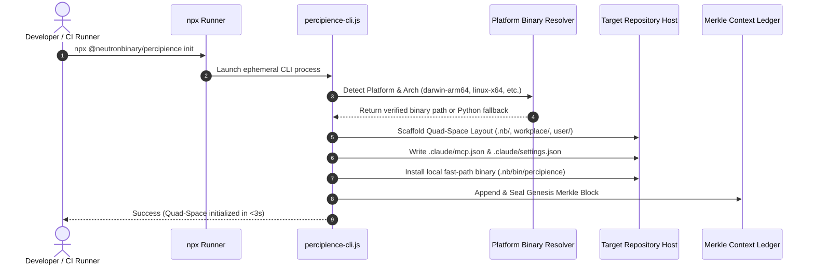
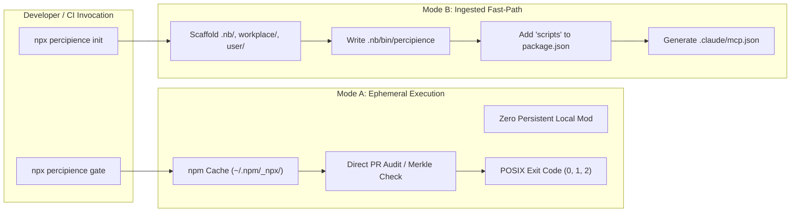

# NPX Instant Execution & Bootstrapping Architecture Plan (Detailed Specification)

> **Plan ID**: `domain_npx_installer`  
> **Capability Rating**: `L1` (Foundation Layer)  
> **Status**: `Active`  
> **Parent Master Plan**: [`master/parent-master-plan/detailed.md`](../../master/parent-master-plan/detailed.md)

---

## 1. Executive Summary & Strategic Rationale

The **Percipience NPX Instant Execution Subsystem** eliminates installation friction for developers and automated CI/CD runners. Rather than requiring developers to manually clone tool repositories, configure Python virtual environments, or manage native dependencies, `npx @neutronbinary/percipience` establishes an immediate entry point into the Percipience Context Engineering Operating System.



---

## 2. Package Architecture & Layout

### 2.1. NPM Package Hierarchy (`@neutronbinary/percipience`)
```text
@neutronbinary/percipience/
├── bin/
│   ├── percipience-cli.js            ← Universal Node.js wrapper & binary launcher
│   └── percipience-cli               ← Executable symlink (POSIX)
├── scripts/
│   ├── postinstall.js                ← Optional pre-fetcher for current platform
│   └── verify-checksums.js           ← Cryptographic SHA-256 binary verifier
├── templates/
│   ├── quad_space_scaffold/          ← Default Quad-Space seed files
│   │   ├── nb_config_seed.yaml
│   │   └── context_ledger_genesis.yaml
│   ├── mcp/
│   │   ├── claude_mcp.json
│   │   └── claude_settings.json
│   └── hooks/
│       └── pre-commit.sh
├── vendor/
│   ├── manifest.json                 ← Platform binary SHA-256 hashes & URLs
│   └── python_bridge/                ← Standalone fallback bridge if native binary missing
├── package.json
└── README.md
```

### 2.2. Package Manifest Configuration (`package.json`)
```json
{
  "name": "@neutronbinary/percipience",
  "version": "1.0.0",
  "description": "Enterprise Context Engineering OS & Autonomous CI/CD Gatekeeper",
  "main": "./bin/percipience-cli.js",
  "bin": {
    "percipience": "./bin/percipience-cli.js",
    "nb": "./bin/percipience-cli.js"
  },
  "repository": {
    "type": "git",
    "url": "https://github.com/neutronbinary/percipience.git"
  },
  "engines": {
    "node": ">=18.0.0"
  },
  "scripts": {
    "test": "node ./scripts/verify-checksums.js"
  },
  "keywords": [
    "context-engineering",
    "ai-agent",
    "ast-pruning",
    "merkle-tree",
    "ci-cd-gatekeeper",
    "finops",
    "mcp"
  ],
  "author": "Neutron Binary Engineering Team",
  "license": "Apache-2.0",
  "optionalDependencies": {
    "@neutronbinary/percipience-darwin-arm64": "1.0.0",
    "@neutronbinary/percipience-darwin-x64": "1.0.0",
    "@neutronbinary/percipience-linux-x64": "1.0.0",
    "@neutronbinary/percipience-linux-arm64": "1.0.0",
    "@neutronbinary/percipience-win32-x64": "1.0.0"
  }
}
```

---

## 3. Platform Binary Resolution & Execution Flow

### 3.1. Binary Resolution Algorithm (`bin/percipience-cli.js`)

```javascript
#!/usr/bin/env node

const fs = require('fs');
const path = require('path');
const { spawn } = require('child_process');

function resolveExecutable() {
  const cwd = process.cwd();

  // 1. Priority A: Local repository fast-path binary
  const localRepoBin = path.join(cwd, '.nb', 'bin', 'percipience');
  if (fs.existsSync(localRepoBin)) {
    return { type: 'native', path: localRepoBin };
  }

  // 2. Priority B: Platform-specific optional dependency binary
  const platform = process.platform;
  const arch = process.arch;
  const pkgName = `@neutronbinary/percipience-${platform}-${arch}`;

  try {
    const pkgPath = require.resolve(`${pkgName}/package.json`);
    const binPath = path.join(path.dirname(pkgPath), 'bin', platform === 'win32' ? 'percipience.exe' : 'percipience');
    if (fs.existsSync(binPath)) {
      return { type: 'native', path: binPath };
    }
  } catch (err) {
    // Optional dependency not installed or unsupported platform
  }

  // 3. Priority C: Embedded Python bridge fallback
  const pythonBridge = path.join(__dirname, '..', 'vendor', 'python_bridge', 'percipience_bridge.py');
  if (fs.existsSync(pythonBridge)) {
    return { type: 'python', path: pythonBridge };
  }

  throw new Error(`Unable to resolve Percipience binary for platform ${platform}-${arch}`);
}

function main() {
  const target = resolveExecutable();
  const args = process.argv.slice(2);

  let child;
  if (target.type === 'native') {
    child = spawn(target.path, args, { stdio: 'inherit' });
  } else {
    const pythonCmd = process.env.PYTHON || 'python3';
    child = spawn(pythonCmd, [target.path, ...args], { stdio: 'inherit' });
  }

  child.on('error', (err) => {
    console.error(`[percipience-npx] Execution failed: ${err.message}`);
    process.exit(1);
  });

  child.on('close', (code) => {
    process.exit(code ?? 0);
  });
}

main();
```

---

## 4. Dual Execution Modes: Ephemeral vs. Ingested Fast-Path



### 4.1. Mode A: Ephemeral Zero-Install (CI/CD Optimization)
- **Use Case**: Pull Request validation in GitHub Actions, GitLab CI, or pre-merge automation.
- **Workflow**:
  1. `npx` pulls package into temporary npm cache.
  2. Runs gatekeeper audit against changed files (`workplace/` and `.nb/context/contracts/`).
  3. Returns standard POSIX exit codes:
     - `0`: All contract tests, AST token thresholds, and Merkle continuity verified.
     - `1`: Syntax/runtime execution error.
     - `2`: PR Gatekeeper security policy violation or contract drift.
  4. Leaves zero node_modules or package.json drift in the repository.

### 4.2. Mode B: Ingested Fast-Path (Workstation Initialization)
- **Use Case**: Developer setting up a new repository or onboarding to an existing team.
- **Workflow**:
  1. Executes `npx @neutronbinary/percipience init`.
  2. Copies `.nb/bin/percipience` wrapper to local project.
  3. Updates project `package.json` with scripts:
     ```json
     "scripts": {
       "percipience": "percipience",
       "percipience:gate": "percipience gate",
       "percipience:audit": "percipience audit --enforce-merkle-chain"
     }
     ```
  4. Writes `.claude/mcp.json` and `.claude/settings.json` configured for Model Context Protocol agents.
  5. Subsequent developer commands execute via `./.nb/bin/percipience` or `npm run percipience:gate` in $<100\text{ms}$.

---

## 5. Automated Quad-Space Bootstrapping Specification

When `npx @neutronbinary/percipience init` executes, the following directory layout and initial state artifacts are constructed:

```text
Target Project Root/
├── .nb/
│   ├── bin/
│   │   └── percipience                ← Standalone CLI executable wrapper
│   ├── config/
│   │   ├── billing_plans.yaml         ← Pricing & quota definitions
│   │   └── token_compression_rules.yaml ← AST compression rules
│   ├── context/
│   │   ├── contracts/                 ← Wire schema contracts
│   │   │   ├── observability_contract.yaml
│   │   │   └── psi_ast_bridge_contract.yaml
│   │   └── ledger/
│   │       ├── context_ledger.yaml    ← Merkle chain state ledger (Block #RP_GENESIS_000)
│   │       └── token_savings_ledger.yaml ← FinOps token savings tracking
│   ├── core/                          ← Sealed runtime engine scripts
│   └── plan/
│       └── master/
│           └── parent-master-free-plan/ ← Seed Free Community Master Plan
├── workplace/
│   ├── modules/                       ← Micro-module workspaces
│   └── tests/                         ← Module test suites
├── user/
│   └── scratch/                       ← Ephemeral agent scratchpad
├── .claude/
│   ├── mcp.json                       ← Model Context Protocol server registrations
│   └── settings.json                  ← Agent context budget settings
└── .git/hooks/
    └── pre-commit                     ← Pre-commit hook blocking unverified commits
```

---

## 6. Enterprise Air-Gapped & Proxy Integration

### 6.1. Custom Registry Routing (`.npmrc`)
In air-gapped or regulated banking environments, npm package resolution is routed through internal artifact proxies:

```ini
# .npmrc
@neutronbinary:registry=https://nexus.corp.internal/repository/npm-group/
strict-ssl=true
cafile=/etc/ssl/certs/corp-internal-ca.pem
```

### 6.2. Standalone Tarball Deployment
If internet access is completely blocked:
```bash
# Copy pre-packaged tarball via secure media
scp neutronbinary-percipience-1.0.0.tgz build-server:/tmp/

# Run instant init directly from tarball
npx /tmp/neutronbinary-percipience-1.0.0.tgz init --mode multi_module
```

---

## 7. CI/CD Integration Blueprints

### 7.1. GitHub Actions Workflow
```yaml
name: Percipience Autonomous Gatekeeper

on:
  pull_request:
    branches: [main, master]
  push:
    branches: [main, master]

jobs:
  gatekeeper:
    runs-on: ubuntu-latest
    steps:
      - name: Checkout Repository
        uses: actions/checkout@v4
        with:
          fetch-depth: 0

      - name: Setup Node.js Runtime
        uses: actions/setup-node@v4
        with:
          node-version: '20'

      - name: Run Ephemeral Percipience Gatekeeper
        run: |
          npx @neutronbinary/percipience gate \
            --enforce-merkle-chain \
            --min-maturity 0.85 \
            --output $GITHUB_STEP_SUMMARY
```

### 7.2. GitLab CI Configuration
```yaml
percipience_pr_gate:
  stage: test
  image: node:20-bookworm-slim
  script:
    - npx @neutronbinary/percipience gate --enforce-merkle-chain --min-maturity 0.85
  rules:
    - if: $CI_PIPELINE_SOURCE == "merge_request_event"
```

---

## 8. Verification & Test Plan

1. **Test 01: Fresh Repository Initialization (`init`)**:
   - Executes `npx @neutronbinary/percipience init` in an empty directory.
   - Asserts creation of `.nb/`, `workplace/`, `.claude/mcp.json`, and Genesis Merkle block.
   - Total runtime $<3.0$ seconds.
2. **Test 02: Idempotent Bootstrapping (`bootstrap`)**:
   - Executes `bootstrap` twice on an existing repository; asserts zero state corruption and zero duplicate ledger blocks.
3. **Test 03: Ephemeral CI Execution (`gate`)**:
   - Executes `gate` in a dirty worktree with simulated AST contract errors; asserts exit code `2` with descriptive error report.
4. **Test 04: Air-Gapped Tarball Bootstrap**:
   - Packages `npm pack` and runs `npx ./neutronbinary-percipience-1.0.0.tgz init` without network connectivity.
