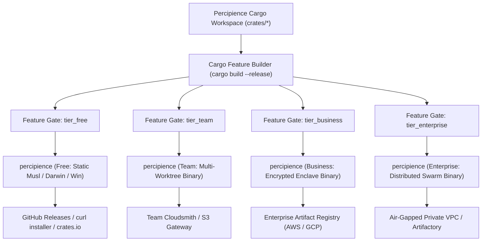

# Layerable Context Engineering Plan: Multi-Tier Rust Binary, Crate & Polyglot Packaging Space (Concise Plan)

### Executive Overview & Domain Grounding

This plan defines the **Multi-Tier Rust Binary, Crate and Polyglot Packaging Subsystem** for Percipience. It establishes automated compilation, build-time feature exclusion, cryptographic Merkle state sealing, and cross-platform distribution for single static binaries (`./percipience`), Cargo crates, and optional polyglot bindings (Python wheels via PyO3/maturin, Node via NAPI-RS) across the 4 commercial tiers: Free Community, Team, Business, and Enterprise Dedicated.



---

## 1. Tier Feature Exclusion & Capability Matrix

| Feature / Engine Capability | Free Community (`tier_free`) | Team Tier (`tier_team`) | Business Tier (`tier_business`) | Enterprise Dedicated (`tier_enterprise`) |
| :--- | :---: | :---: | :---: | :---: |
| **Cargo Feature Flag** | `--features tier_free` | `--features tier_team` | `--features tier_business` | `--features tier_enterprise` |
| **Binary Artifact Size** | $< 12\text{ MB}$ (Stripped) | $< 14\text{ MB}$ (Stripped) | $< 16\text{ MB}$ (Stripped) | $< 20\text{ MB}$ (Stripped) |
| **AST Token Pruner & Merkle Engine** | ✅ Included | ✅ Included | ✅ Included | ✅ Included |
| **Autonomous CI/CD & Gatekeeper** | ✅ Included | ✅ Included | ✅ Included | ✅ Included |
| **Basic Platform Tools Exposure** | ❌ Excluded (Gatekeeper only) | ❌ Excluded (Gatekeeper only) | ✅ Exposed | ✅ Exposed |
| **Worktree Leasing Engine** | ❌ Excluded | ✅ Included (5 leases) | ✅ Included (20 leases) | ✅ Unlimited Distributed |
| **Custom Agent Creation SDK** | ❌ Excluded | ✅ Included | ✅ Included | ✅ Included |
| **Encrypted NBPack Compiler** | ❌ Excluded | ❌ Excluded | ✅ Included (AES-256) | ✅ Included (RAM Enclave) |
| **Multi-Tenant Gateway Provisioner** | ❌ Excluded | ❌ Excluded | ✅ Included | ✅ Included |
| **Swarm Triad Orchestrator** | ❌ Excluded | ❌ Excluded | ❌ Excluded | ✅ Included (Redis Redlock) |
| **Private VPC Enclave & WORM Egress** | ❌ Excluded | ❌ Excluded | ❌ Excluded | ✅ Included (S3/GCS WORM) |
| **User Plan Storage Model** | Plaintext Only | Plaintext Only | AES-256 `.nbpack` | RAM Enclave Zero-Disk |

---

## 2. Binary Target Standards & Entry Points

### 2.1. Compilation Targets
- `aarch64-apple-darwin` (macOS Apple Silicon)
- `x86_64-apple-darwin` (macOS Intel)
- `x86_64-unknown-linux-musl` (Linux Static Musl - zero libc dependency)
- `aarch64-unknown-linux-musl` (Linux ARM64 / Graviton)
- `x86_64-pc-windows-msvc` (Windows Static Binary .exe)

### 2.2. Standard Entry Point
The single static executable `./percipience` serves as the universal command-line interface:
```bash
./percipience [gate|audit|cicd|validate|tokens|security|plan|layer]
```
The binary dynamically verifies its embedded license signature, quota limits, and active feature gates on startup.

---

## 3. Build & Packaging Architecture

### 3.1. Build & Release Pipeline
1. **Cargo Workspace Compilation**: `cargo build --release --target <target> --features <tier_feature>`.
2. **Binary Stripping & Optimization**: `strip target/<target>/release/percipience` with LTO enabled.
3. **Embedded Schema Verification**: `rust-embed` embeds verified wire contracts and default configs into the binary.
4. **Cryptographic Merkle Sealing**: Computes SHA-256 hash of output binaries and seals block into `context_ledger.yaml`.
5. **Polyglot Wheel Scaffolding**: Runs `maturin build --release` when Python interop bindings (`pyo3`) are requested.

---

## 4. Binary Installation & Distribution

```bash
# 1. One-line Native Installer (Auto-detects OS and Architecture)
curl -fsSL https://get.percipience.ai | sh

# 2. Cargo Install (Direct from crates.io)
cargo install percipience-cli

# 3. Download Platform Binary Release
curl -LO https://github.com/neutronbinary/percipience/releases/latest/download/percipience-$(uname -s | tr '[:upper:]' '[:lower:]')-$(uname -m)
chmod +x percipience-* && mv percipience-* /usr/local/bin/percipience

# 4. Optional Python Polyglot Wheel
pip install percipience
```
