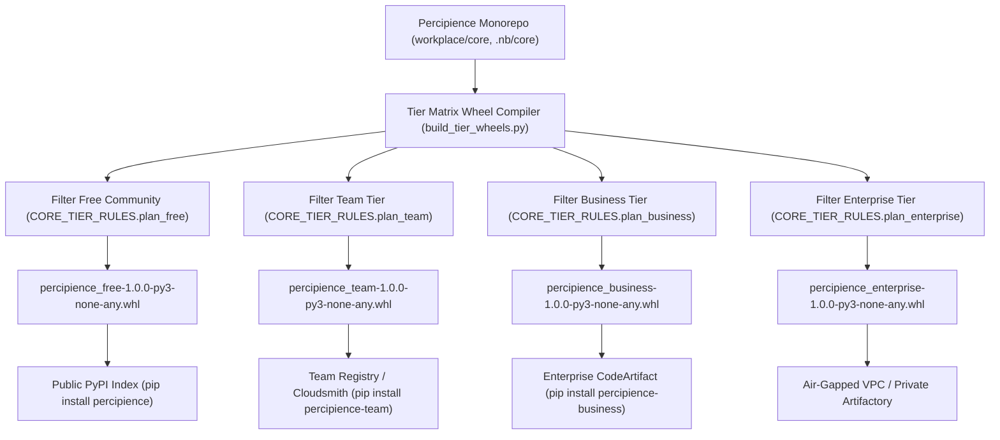

# Layerable Context Engineering Plan: Multi-Tier Python Wheel Packaging Space (Concise Plan)

### Executive Overview & Domain Grounding

This plan defines the **Multi-Tier Python Wheel Packaging and Distribution Subsystem** for Percipience. It establishes automated compilation, file-level code exclusion, cryptographic Merkle state sealing, and package repository routing for Python Wheels (`.whl` adhering to PEP 427, PEP 517, PEP 621) across the 4 commercial tiers: Free Community, Team, Business, and Enterprise Dedicated.



---

## 1. Tier Engine Exclusion & Capability Matrix

| Feature / Engine Module | Free Community (`plan_free`) | Team Tier (`plan_team`) | Business Tier (`plan_business`) | Enterprise Dedicated (`plan_enterprise`) |
| :--- | :---: | :---: | :---: | :---: |
| **Package Name** | `percipience-free` | `percipience-team` | `percipience-business` | `percipience-enterprise` |
| **AST Token Pruner & Merkle Engine** | ✅ Included | ✅ Included | ✅ Included | ✅ Included |
| **Autonomous CI/CD & Gatekeeper** | ✅ Included | ✅ Included | ✅ Included | ✅ Included |
| **Basic Platform Tools Exposure** | ❌ Excluded (Gatekeeper only) | ❌ Excluded (Gatekeeper only) | ✅ Exposed | ✅ Exposed |
| **Worktree Leasing Engine** (`worktree_engine.py`) | ❌ Excluded | ✅ Included | ✅ Included | ✅ Included |
| **Custom Agent Creation SDK** | ❌ Excluded | ✅ Included | ✅ Included | ✅ Included |
| **Encrypted NBPack Compiler** (`nbpack_envelope.py`) | ❌ Excluded | ❌ Excluded | ✅ Included | ✅ Included |
| **Multi-Tenant Gateway Provisioner** | ❌ Excluded | ❌ Excluded | ✅ Included | ✅ Included |
| **Swarm Triad Orchestrator** (`swarm_governor.py`) | ❌ Excluded | ❌ Excluded | ❌ Excluded | ✅ Included |
| **Private VPC Enclave & WORM Egress** | ❌ Excluded | ❌ Excluded | ❌ Excluded | ✅ Included |
| **User Plan Storage Model** | Plaintext Only | Plaintext Only | AES-256 `.nbpack` | RAM Enclave Zero-Disk |

---

## 2. Wheel Package Specifications & Metadata

### 2.1. Wheel Filename Standards (PEP 427)
- Free Community: `percipience_free-1.0.0-py3-none-any.whl` (or aliased `percipience-1.0.0-py3-none-any.whl`)
- Team Edition: `percipience_team-1.0.0-py3-none-any.whl`
- Business Edition: `percipience_business-1.0.0-py3-none-any.whl`
- Enterprise Dedicated: `percipience_enterprise-1.0.0-py3-none-any.whl`

### 2.2. Standard Entry Points (`entry_points.txt`)
All tier wheels register the identical standardized CLI commands:
```ini
[console_scripts]
percipience = percipience.cli:main
percipience-agent = percipience.agent_cli:main
```
The CLI dynamically reports its active tier identity, license quotas, and feature flags based on the installed wheel's `tier_manifest.json`.

---

## 3. Build & Packaging Architecture

### 3.1. Build Automation Script (`workplace/scripts/build_tier_wheels.py`)
1. **Directory Isolation**: Constructs ephemeral clean build roots in `.nb/workspaces/build_wheel_<tier>/`.
2. **Selective Asset Copy**: Reads `CORE_TIER_RULES` from `commercial_packager_provisioner.py`, copying only allowed Python modules.
3. **Manifest Injection**: Injects cryptographically signed `tier_manifest.json` and active tier identifier.
4. **Wheel Generation**: Executes `python -m build --wheel --outdir .nb/bundles/`.
5. **Merkle Sealing**: Computes SHA-256 hash of output `.whl` files and records state block into `context_ledger.yaml`.

---

## 4. Pip Installation & Index Routing

```bash
# 1. Free Community Edition (Public PyPI)
pip install percipience

# 2. Team Edition (Private / Cloudsmith Index)
pip install percipience-team --extra-index-url https://dl.cloudsmith.io/basic/neutronbinary/simple/

# 3. Business Edition (AWS CodeArtifact Index)
pip install percipience-business --extra-index-url https://neutronbinary-domain.d.codeartifact.us-east-1.amazonaws.com/pypi/business/simple/

# 4. Enterprise Dedicated Edition (Air-Gapped / Private Artifactory)
pip install percipience-enterprise --extra-index-url https://artifactory.corp.internal/artifactory/api/pypi/pypi-local/simple
# Or direct local wheel installation:
pip install .nb/bundles/percipience_enterprise-1.0.0-py3-none-any.whl --no-index
```
