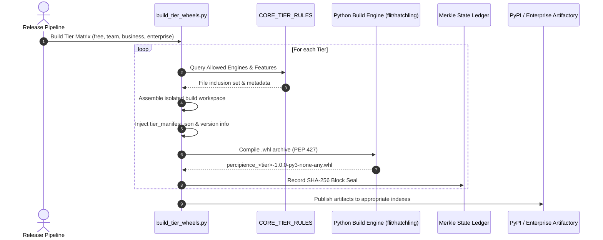
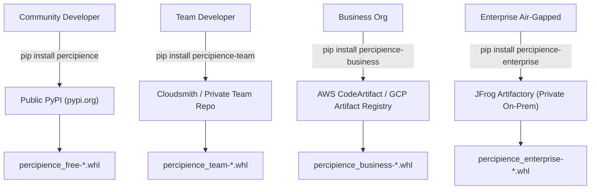

# Multi-Tier Python Wheel Packaging & Distribution Architecture Plan (Detailed Specification)

> **Plan ID**: `domain_tiered_wheel_packaging`  
> **Capability Rating**: `L1` (Foundation Layer)  
> **Status**: `Active`  
> **Parent Master Plan**: [`master/parent-master-plan/detailed.md`](../../master/parent-master-plan/detailed.md)

---

## 1. Executive Summary & Strategic Rationale

The **Multi-Tier Python Wheel Packaging Subsystem** provides standardized Python binary packaging (`.whl` adhering to PEP 427, PEP 517, PEP 621) across Percipience's commercial distribution tiers. It balances commercial intellectual property protection with seamless developer experience:

1. **Strict Code-Level Isolation**: Proprietary enterprise engines (e.g., encrypted `.nbpack` compilers, private VPC adapters, distributed Redis Redlock swarm orchestrators) are physically omitted from public Community and Team distributions at build time.
2. **Unified Command Surface**: Regardless of the tier installed (`percipience-free`, `percipience-team`, `percipience-business`, or `percipience-enterprise`), the user interacts via identical console entry points (`percipience` and `percipience-agent`).
3. **Cryptographic Supply-Chain Sealing**: Every wheel artifact generated has its SHA-256 hash appended to the immutable Merkle chain in `context_ledger.yaml` before release.



---

## 2. Tier Engine Exclusion & Boundary Architecture

The packaging system strictly enforces module-level filtering derived from `CommercialPackagerProvisioner` (`workplace/core/commercial_packager_provisioner.py`) and `billing_plans.yaml`:

### 2.1. Free Community Edition (`percipience-free`)
- **Package Slug**: `percipience-free` (aliased to `percipience` on public PyPI).
- **Included Core Modules**:
  - `ast_optimizer.py`, `token_tracker.py`, `token_optimizer_suite.py` (AST token skeletonization, 60-80% compression).
  - `merkle_engine.py` (SHA-256 cryptographic state verification).
  - `autonomous_cicd.py` (Single-attempt bounded self-repair).
  - `contract_compatibility_checker.py`, `dependency_cve_sentinel.py`, `flaky_test_detector.py`.
  - `terminal_agent_ast_proxy.py`, `attention_budgeter.py`, `living_doc_engine.py`.
- **Excluded Features & Modules**:
  - `nbpack_envelope.py` (No encrypted `.nbpack` compilation; user plans must remain plaintext).
  - `worktree_engine.py` (No multi-worktree concurrency; 1 worktree max).
  - `swarm_governor.py` (No distributed multi-agent swarm orchestration).
  - `basic_platform_tools_exposure`: Low-level platform internals remain hidden; only high-level gatekeeper actions exposed.

### 2.2. Team Edition (`percipience-team`)
- **Package Slug**: `percipience-team`.
- **Additions Over Free Tier**:
  - `worktree_engine.py` (Up to 5 concurrent Git worktree leases).
  - `agent_plugin_engine.py` (Specialist subagent creation SDK).
  - `prompt_drift_sentinel.py`, `doc_drift_synchronizer.py` (Real-time drift detection).

### 2.3. Business Edition (`percipience-business`)
- **Package Slug**: `percipience-business`.
- **Additions Over Team Tier**:
  - `nbpack_envelope.py` (AES-256 encrypted `.nbpack` compilation and in-memory hydration).
  - `cognitive_router.py` (Multi-LLM cognitive routing & parity reports).
  - Multi-tenant gateway provisioner and 20 concurrent worktree leases.
  - `basic_platform_tools_exposure = true` (Full unrestricted platform tool APIs).

### 2.4. Enterprise Dedicated Edition (`percipience-enterprise`)
- **Package Slug**: `percipience-enterprise`.
- **Additions Over Business Tier**:
  - `swarm_governor.py` (Distributed multi-container swarm fleet with Redis 7.x Redlock leases).
  - Private VPC air-gapped sync adapters.
  - Immutable WORM cloud egress export and compliance audit logs.
  - Unlimited concurrent worktrees, unlimited PR audits, and RAM Enclave zero-disk execution.

---

## 3. Wheel Package Specifications & Layout

### 3.1. Directory Structure of Built Wheel
```text
percipience_enterprise-1.0.0-py3-none-any.whl/
├── percipience/
│   ├── __init__.py
│   ├── cli.py                        ← Standard console entry point
│   ├── agent_cli.py                  ← Agent runner entry point
│   ├── tier_broker.py                ← In-package tier & feature entitlement broker
│   ├── tier_manifest.json            ← Signed build manifest with tier identity
│   ├── core/                         ← Tier-filtered core engines
│   │   ├── merkle_engine.py
│   │   ├── ast_optimizer.py
│   │   ├── swarm_governor.py         ← (Only present in Enterprise wheel)
│   │   └── ...
│   ├── context/                      ← Bundled schemas & rules
│   │   ├── contracts/
│   │   └── rules/
│   └── agentic/                      ← Tier-filtered workflow & prompt templates
├── percipience_enterprise-1.0.0.dist-info/
│   ├── METADATA                      ← PEP 621 package metadata
│   ├── WHEEL                         ← PEP 427 wheel metadata
│   ├── entry_points.txt              ← Console script registrations
│   ├── licenses/
│   │   └── LICENSE
│   └── RECORD                        ← Cryptographic SHA-256 hashes of all wheel files
```

### 3.2. PyProject Template (`pyproject.toml`)
```toml
[build-system]
requires = ["hatchling>=1.18.0"]
build-backend = "hatchling.build"

[project]
name = "percipience-enterprise"
version = "1.0.0"
description = "Percipience Enterprise Context Engineering OS (Enterprise Dedicated Tier)"
readme = "README.md"
requires-python = ">=3.10"
license = "Proprietary"
authors = [
    { name = "Neutron Binary Engineering", email = "engineering@neutronbinary.com" }
]
dependencies = [
    "pyyaml>=6.0",
    "pydantic>=2.0",
    "click>=8.1",
    "redis>=5.0.0",
    "cryptography>=41.0.0"
]

[project.scripts]
percipience = "percipience.cli:main"
percipience-agent = "percipience.agent_cli:main"

[tool.hatch.build.targets.wheel]
packages = ["percipience"]
```

---

## 4. Build Automation Pipeline (`build_tier_wheels.py`)

The automated packaging utility implements the following deterministic sequence:

```python
def build_tier_wheel(tier_id: str, output_dir: Path) -> Path:
    # 1. Normalize tier identifier
    norm_tier = CommercialPackagerProvisioner.TIER_NORMALIZATION.get(tier_id, "plan_free")
    rules = CommercialPackagerProvisioner.CORE_TIER_RULES[norm_tier]
    
    # 2. Create isolated build sandbox
    build_sandbox = Path(f".nb/workspaces/build_wheel_{norm_tier}")
    build_sandbox.mkdir(parents=True, exist_ok=True)
    
    # 3. Assemble package structure & filter allowed engines
    pkg_dir = build_sandbox / "percipience"
    pkg_dir.mkdir(parents=True, exist_ok=True)
    
    for engine_name in rules["allowed_engines"]:
        src = Path("workplace/core") / engine_name
        if src.exists():
            shutil.copy2(src, pkg_dir / "core" / engine_name)
            
    # 4. Generate tier_manifest.json with build timestamp and active features
    manifest = {
        "tier_id": norm_tier,
        "built_at": datetime.now(timezone.utc).isoformat(),
        "features": rules,
        "build_version": "1.0.0"
    }
    (pkg_dir / "tier_manifest.json").write_text(json.dumps(manifest, indent=2))
    
    # 5. Compile wheel using Python build engine
    subprocess.run([sys.executable, "-m", "build", "--wheel", "--outdir", str(output_dir)], cwd=str(build_sandbox), check=True)
    
    # 6. Cryptographically seal wheel hash in Merkle ledger
    wheel_file = list(output_dir.glob(f"*{norm_tier}*.whl"))[0]
    seal_wheel_in_merkle_ledger(wheel_file, norm_tier)
    
    return wheel_file
```

---

## 5. Enterprise Index Hosting & Pip Installation



### 5.1. Public vs. Private Repository Authentication
- **Public PyPI**:
  `pip install percipience` downloads the Free Community wheel.
- **AWS CodeArtifact**:
  ```bash
  aws codeartifact login --tool pip --domain neutronbinary --repository percipience-commercial
  pip install percipience-business
  ```
- **JFrog Artifactory / Air-Gapped Mirrors**:
  ```bash
  pip install percipience-enterprise \
    --index-url https://artifactory.corp.internal/artifactory/api/pypi/pypi-commercial/simple \
    --trusted-host artifactory.corp.internal
  ```
- **Local Wheel Air-Gap Direct Install**:
  ```bash
  pip install .nb/bundles/percipience_enterprise-1.0.0-py3-none-any.whl --no-index
  ```

---

## 6. End-to-End Delivery Flow Integration

The multi-tier wheel packaging workflow is registered directly inside:
[`.nb/agentic/custom/workflows/commercial_packaging_provisioning_flow.yaml`](file:///Users/lakhwinder/PycharmProjects/nb_fairyfly/.nb/agentic/custom/workflows/commercial_packaging_provisioning_flow.yaml)

```yaml
- id: step_build_tier_wheels
  name: Build Multi-Tier Python Wheel Artifacts
  agent: agent_commercial_packager_provisioner
  action: build_wheels
  inputs:
    target_tiers: [plan_free, plan_team, plan_business, plan_enterprise]
    output_dir: .nb/bundles/wheels/
  handled_contracts:
    - contract_id: commercial_provisioning_contract
      name: Commercial Provisioning & Asset Filter Contract
      path: .nb/context/contracts/commercial_provisioning_contract.yaml
      type: yaml_schema
      action: filter_and_bundle
    - contract_id: security_four_eyes_contract
      name: Cryptographic Merkle State Seal Contract
      path: .nb/context/contracts/security_four_eyes_contract.json
      type: json_schema
      action: seal_wheel_release
```

---

## 7. Verification & Smoke Testing Strategy

1. **Test 01: Tier Module Exclusion Verification**:
   - Compiles `percipience-free` wheel.
   - Inspects wheel ZIP archive contents; asserts `swarm_governor.py` and `nbpack_envelope.py` are strictly absent.
2. **Test 02: Enterprise Wheel Integrity**:
   - Compiles `percipience-enterprise` wheel.
   - Asserts inclusion of Redis Redlock swarm components, encrypted NBPack handlers, and WORM egress modules.
3. **Test 03: Virtual Environment Installation & CLI Invocation**:
   - Installs compiled wheel into clean virtual environment (`python -m venv test_env`).
   - Executes `percipience --version` and `percipience status`; validates exit code `0` and correct tier identification.
4. **Test 04: Merkle State Ledger Continuity**:
   - Asserts that all 4 compiled wheel SHA-256 hashes are recorded in `context_ledger.yaml`.
