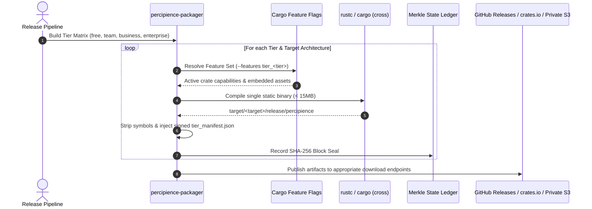
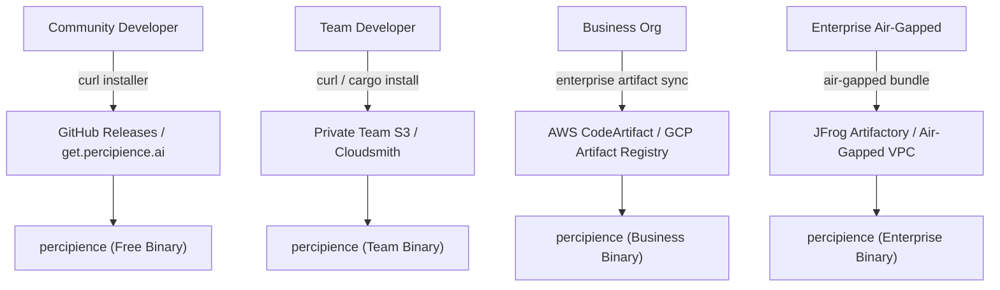

# Multi-Tier Rust Binary, Crate & Polyglot Packaging Architecture Plan (Detailed Specification)

> **Plan ID**: `domain_tiered_wheel_packaging`  
> **Capability Rating**: `L1` (Foundation Layer)  
> **Status**: `Active`  
> **Parent Master Plan**: [`master/parent-master-plan/detailed.md`](../../master/parent-master-plan/detailed.md)

---

## 1. Executive Summary & Strategic Rationale

The **Multi-Tier Rust Binary, Crate and Polyglot Packaging Subsystem** provides standardized native binary packaging, Cargo crate publishing, and optional polyglot bindings (Python wheels via PyO3/maturin, Node via NAPI-RS) across Percipience's commercial distribution tiers:

1. **Zero-Dependency Native Binaries**: Compiles into a single portable static binary (`./percipience`) across macOS, Linux (musl), and Windows (.exe), eliminating Python runtime dependencies, virtual environments, and package manager incompatibilities.
2. **Compile-Time Feature Isolation**: Proprietary enterprise modules (e.g., encrypted `.nbpack` compilers, private VPC adapters, distributed Redis Redlock swarm orchestrators) are physically omitted from public Community and Team binaries at compile time via Cargo feature gates (`#[cfg(feature = "enterprise")]`).
3. **Unified Command Surface**: Regardless of the tier compiled (`tier_free`, `tier_team`, `tier_business`, or `tier_enterprise`), the user interacts via an identical executable command surface (`./percipience`).
4. **Cryptographic Supply-Chain Sealing**: Every binary and package artifact generated has its SHA-256 hash appended to the immutable Merkle chain in `context_ledger.yaml` before release.



---

## 2. Tier Feature Exclusion & Boundary Architecture

The packaging system strictly enforces compile-time feature gating derived from `crates/percipience-packager` and `billing_plans.yaml`:

### 2.1. Free Community Edition (`tier_free`)
- **Compilation Flag**: `cargo build --release --features tier_free`
- **Binary Footprint**: $< 12\text{ MB}$ stripped.
- **Included Core Crates & Modules**:
  - `percipience-core` (AST token skeletonization, 60-80% compression, Merkle hash engine).
  - `percipience-orchestrator` (Single-attempt bounded self-repair, local DAG execution).
  - Wire contracts, living documentation engine, and basic gatekeeper commands (`gate`, `audit`, `cicd`, `tokens`, `validate`).
- **Excluded Features**:
  - `percipience-security/nbpack` (No encrypted `.nbpack` compilation; user plans must remain plaintext).
  - Multi-worktree concurrent leases (1 local worktree max).
  - Distributed multi-agent swarm orchestration.
  - Low-level internal developer utilities unexposed.

### 2.2. Team Edition (`tier_team`)
- **Compilation Flag**: `cargo build --release --features tier_team`
- **Additions Over Free Tier**:
  - Up to 5 concurrent Git worktree directory leases.
  - Specialist subagent creation SDK and plugin registry synchronizer.
  - Real-time prompt drift and doc drift sentinels.

### 2.3. Business Edition (`tier_business`)
- **Compilation Flag**: `cargo build --release --features tier_business`
- **Additions Over Team Tier**:
  - AES-256 encrypted `.nbpack` compilation and in-memory enclave hydration.
  - Multi-LLM cognitive routing & parity reports.
  - Multi-tenant gateway provisioner and 20 concurrent worktree leases.
  - Full unrestricted platform developer tool APIs.

### 2.4. Enterprise Dedicated Edition (`tier_enterprise`)
- **Compilation Flag**: `cargo build --release --features tier_enterprise`
- **Additions Over Business Tier**:
  - Distributed multi-container swarm fleet with Redis 7.x Redlock leases.
  - Private VPC air-gapped sync adapters.
  - Immutable WORM cloud egress export and SEC 17a-4 / FINRA compliance audit logs.
  - Unlimited concurrent worktrees, unlimited PR audits, and RAM Enclave zero-disk execution.

---

## 3. Package Specifications & Distribution Targets

### 3.1. Native Compilation Target Matrix
```text
Compilation Target               OS / Architecture             Artifact Filename
----------------------------------------------------------------------------------------
aarch64-apple-darwin             macOS Apple Silicon (M1-M4)   percipience-darwin-arm64
x86_64-apple-darwin              macOS Intel x86_64            percipience-darwin-x86_64
x86_64-unknown-linux-musl        Linux Static Musl (Agnostic)  percipience-linux-amd64
aarch64-unknown-linux-musl       Linux ARM64 / AWS Graviton    percipience-linux-arm64
x86_64-pc-windows-msvc           Windows x86_64                percipience-windows-amd64.exe
```

### 3.2. Cargo Workspace Crate Layout
```text
percipience/
├── Cargo.toml                        ← Workspace definition & feature flags
├── Cargo.lock                        ← Pinned supply chain ledger
├── crates/
│   ├── percipience-core/             ← Merkle engine, AST pruning, DAG validation
│   ├── percipience-cli/              ← CLI command interface (clap v4)
│   ├── percipience-orchestrator/     ← Async DAG execution engine (tokio)
│   ├── percipience-security/         ← ZTA, ReBAC, PII encryption, zeroize
│   ├── percipience-lsp/              ← IDE LSP daemon (tower-lsp)
│   ├── percipience-server/           ← Async HTTP/gRPC server (axum)
│   └── percipience-packager/         ← Multi-tier binary builder & asset embedder
```

### 3.3. Polyglot Packaging Interoperability
While the primary deliverable is the standalone static binary, Percipience supports polyglot ecosystems:
- **Python Wheel via Maturin**: `crates/percipience-pyo3` compiled with `maturin build --release` produces standard `.whl` archives exposing the Rust engine to Python callers.
- **Node.js Addon via NAPI-RS**: `crates/percipience-napi` produces native `.node` modules for TypeScript/JavaScript runtimes.

---

## 4. Build Automation Pipeline (`percipience-packager`)

The automated packaging engine implements the following deterministic sequence:

```rust
// crates/percipience-packager/src/lib.rs
pub fn build_tier_binary(tier: &str, target: &str, output_dir: &Path) -> Result<PathBuf> {
    // 1. Resolve feature flags
    let feature_flag = format!("tier_{}", tier);
    
    // 2. Execute cross-compilation
    let status = Command::new("cargo")
        .args(&[
            "build",
            "--release",
            "--target", target,
            "--features", &feature_flag,
            "-p", "percipience-cli",
        ])
        .status()?;
    assert!(status.success());
    
    // 3. Strip binary symbols for minimum footprint
    let binary_path = output_dir.join(format!("percipience-{}", target));
    strip_binary_symbols(&binary_path)?;
    
    // 4. Seal binary SHA-256 hash in Merkle ledger
    seal_binary_in_merkle_ledger(&binary_path, tier)?;
    
    Ok(binary_path)
}
```

---

## 5. Binary Installation & Distribution Endpoints



### 5.1. Installation Commands
- **Universal One-Line Script**:
  ```bash
  curl -fsSL https://get.percipience.ai | sh
  ```
- **Cargo Install**:
  ```bash
  cargo install percipience-cli
  ```
- **Air-Gapped Binary Deployment**:
  ```bash
  cp /mnt/secure_media/percipience /usr/local/bin/percipience
  chmod +x /usr/local/bin/percipience
  ./percipience audit --offline
  ```

---

## 6. End-to-End Delivery Flow Integration

The multi-tier binary packaging workflow is registered directly inside:
[`.nb/agentic/custom/workflows/commercial_packaging_provisioning_flow.yaml`](file:///Users/lakhwinder/PycharmProjects/nb_fairyfly/.nb/agentic/custom/workflows/commercial_packaging_provisioning_flow.yaml)

```yaml
- id: step_build_tier_binaries
  name: Build Multi-Tier Native Binary Artifacts
  agent: agent_packaging_release_engineer
  action: build_binaries
  inputs:
    target_tiers: [tier_free, tier_team, tier_business, tier_enterprise]
    output_dir: target/release/dist/
  handled_contracts:
    - contract_id: commercial_provisioning_contract
      name: Commercial Provisioning & Asset Filter Contract
      path: .nb/context/contracts/commercial_provisioning_contract.yaml
      type: yaml_schema
      action: filter_and_bundle
    - contract_id: security_four_eyes_contract
      name: Cryptographic Merkle State Seal Contract
      path: .nb/context/contracts/security_four_eyes_contract.json
      type: json_schema
      action: seal_binary_release
```

---

## 7. Verification & Smoke Testing Strategy

1. **Test 01: Tier Feature Gate Exclusion Verification**:
   - Compiles binary with `--features tier_free`.
   - Asserts absence of Redis Redlock and NBPack encryption symbols via `nm` / symbol table inspection.
2. **Test 02: Enterprise Binary Integrity**:
   - Compiles binary with `--features tier_enterprise`.
   - Asserts inclusion of Redis Redlock swarm components, encrypted NBPack handlers, and WORM egress modules.
3. **Test 03: Standalone Execution & Version Probing**:
   - Executes `./percipience --version` and `./percipience status` in a clean container with zero libraries installed.
   - Validates exit code `0` and correct tier identification.
4. **Test 04: Merkle State Ledger Continuity**:
   - Asserts that all compiled binary SHA-256 hashes are recorded in `context_ledger.yaml`.
