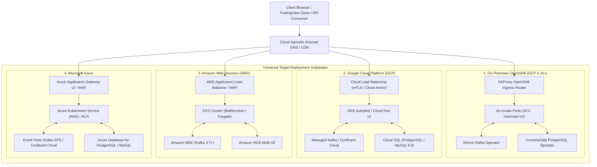

# Master: Cloud-Agnostic Infrastructure Substrate & Multi-Cloud Deployment Mesh (OpenShift, GCP, AWS, Azure)

**Plan ID**: `master_cloud_agnostic_infrastructure_substrate`  
**Version**: `v1.0.0`  
**Layer**: `Master (Platform Governance, Multi-Cloud Substrate & Universal Ingress)`  
**Status**: Implementation Ready & Active  

---

## Quick Links
- [Concise Plan Specification](concise.md) — Fast reference architecture, Helm/Kustomize contracts, and port allocation matrix
- [Detailed Plan Specification](detailed.md) — Deep-dive infrastructure specification, OpenTofu modules, OpenShift/GCP/AWS/Azure overlays, FinOps economics, and 90-day deployment roadmap
- [Plan Manifest](MANIFEST.yaml) — Machine-readable capability registry, dependencies, and platform matrix

---

## 1. Executive Summary & Strategic Positioning

The **Cloud-Agnostic Infrastructure Substrate** provides an institutional-grade, minimalist, and ultra-high-performance deployment topology for the **Neutron Binary Cicada (`nb_cicada`)** platform and its domain applications (such as [NB Honeybee Options Quantitative OS](file:///Users/lakhwinder/RustroverProjects/nb_cicada/.nb/plan/options-advisor-rewrite-plan/detailed.md) and [Enterprise QuantLib Financial App](file:///Users/lakhwinder/RustroverProjects/nb_cicada/.nb/plan/quantlib-financial-app/detailed.md)).

### Core Mandates:
1. **Radical Architectural Simplicity**: Avoids distributed microservice sprawl. The entire platform runs as an optimized **Dual-Container Microservice Topology** (`nb-backend` compiled native Rust binary + `nb-frontend` Next.js 16 standalone/edge container) backed by three standardized, agnostic storage engines (PostgreSQL/MySQL, Redis, Kafka).
2. **True Cloud-Agnostic Portability**: Eliminates vendor lock-in by utilizing CNCF-certified standard frameworks:
   - **On-Premises / Private Cloud**: **Red Hat OpenShift Container Platform (OCP 4.16+)** on bare metal or VMware.
   - **Google Cloud Platform (GCP)**: Cloud Run v2 (serverless) or Google Kubernetes Engine (GKE Autopilot).
   - **Amazon Web Services (AWS)**: Elastic Kubernetes Service (EKS) or AWS Fargate serverless containers.
   - **Microsoft Azure**: Azure Kubernetes Service (AKS) or Azure Container Apps (ACA).
3. **High-Throughput & Sub-Millisecond Latency**: Native Rust binary compilation (`linux/amd64` & `linux/arm64`), distroless zero-CVE container images ($< 45\text{MB}$ image size), and Envoy-based mTLS ingress delivering sub-1.5ms gateway latencies.
4. **FinOps Cost-Efficiency & Elastic Autoscaling**: Employs ARM64 compute (AWS Graviton, GCP Tau T2A, Azure Ampere Altra), Kubernetes Event-driven Autoscaling (KEDA) scaling pods from 0 to N based on Kafka queue lag and CPU/memory pressure, and spot/preemptible node tolerance saving $45\text{–}65\%$ in monthly cloud spend.

---

## 2. Multi-Cloud & Hybrid Deployment Architecture

---

## 3. Technology Stack & Agnostic Abstraction Matrix

| Functional Layer | Standardized Agnostic Standard | OpenShift (On-Prem) | Google Cloud (GCP) | Amazon Web Services (AWS) | Microsoft Azure |
| :--- | :--- | :--- | :--- | :--- | :--- |
| **Compute Core** | OCI Container / K8s Deployment | OCP Deployment (`restricted-v2`) | Cloud Run v2 / GKE Autopilot | EKS (Graviton) / Fargate | AKS (Ampere) / Container Apps |
| **IaC Provisioning** | OpenTofu / Terraform 1.8+ | OpenTofu vSphere / Bare Metal | OpenTofu Google Provider | OpenTofu AWS Provider | OpenTofu Azurerm Provider |
| **Packaging & CD** | Helm 3 & Kustomize Overlays | `overlays/openshift` | `overlays/gcp` | `overlays/aws` | `overlays/azure` |
| **Relational DB** | PostgreSQL 16 / MySQL 8.0 + Liquibase | CrunchyData PG / CloudNativePG | Cloud SQL PG / MySQL | Amazon RDS Multi-AZ | Azure Database for PG / MySQL |
| **In-Memory Cache**| Redis 7.x / KeyDB Cluster | Redis Enterprise Operator | Memorystore for Redis Cluster | Amazon ElastiCache for Redis | Azure Cache for Redis |
| **Event Bus** | Apache Kafka 3.7+ Protocol | Strimzi Kafka Operator | GCP Managed Service for Kafka | Amazon MSK Provisioned | Azure Event Hubs (Kafka API) |
| **Object Store** | S3-Compatible Object API | Ceph RGW / MinIO Operator | Google Cloud Storage (HMAC) | Amazon S3 Standard | Azure Blob (S3 Proxy) |
| **Zero-Trust Ingress**| Envoy Proxy / Istio Ambient | OpenShift Router / Istio | GKE Gateway API / Cloud Armor | AWS ALB Ingress Controller | Azure Application Gateway Ingress |
| **Observability** | OpenTelemetry (OTel) Collector | Red Hat OpenShift Monitoring | Cloud Monitoring & Trace | Amazon CloudWatch & X-Ray | Azure Monitor & App Insights |
| **Secrets Engine** | HashiCorp Vault / CSI Driver | OpenShift External Secrets | GCP Secret Manager CSI | AWS Secrets Manager CSI | Azure Key Vault CSI |

---

## 4. Key Architectural Guarantees & FinOps Metrics

1. **Sub-45MB Footprint & Zero Vulnerabilities**: Built using multi-stage Docker builds based on Google Distroless (`gcr.io/distroless/cc-debian12` for Rust backend and `gcr.io/distroless/nodejs20-debian12` for Next.js frontend), eliminating shell attack surfaces and reducing container startup to $< 400\text{ms}$.
2. **Multi-Arch Compilation (`linux/arm64` & `linux/amd64`)**: Seamless execution on AWS Graviton 3/4, GCP Tau T2A, Azure Ampere Altra, and on-premises OpenShift worker nodes.
3. **Liquibase Expand-and-Contract Migrations**: Zero-downtime database upgrades across all 4 environments, automated via CI/CD pre-deployment jobs.
4. **Unit Economics & Monthly Cost Profile**:
   - **Dev / Staging Environment**: Single-node DB + in-cluster Redis/Kafka &rarr; **$< $150 / month**.
   - **Production Enterprise High-Availability**: Multi-AZ autoscaling cluster, managed Kafka & DB &rarr; **$< $850 / month**.

---

## 5. Dependency Interlocks & Catalog Placement
- **Requires**:
  - [`.nb/plan/master/parent-master-plan`](file:///Users/lakhwinder/RustroverProjects/nb_cicada/.nb/plan/master/parent-master-plan/detailed.md)
  - [`.nb/plan/master/security-mesh`](file:///Users/lakhwinder/RustroverProjects/nb_cicada/.nb/plan/master/security-mesh/detailed.md)
  - [`.nb/plan/master/plan-assessment`](file:///Users/lakhwinder/RustroverProjects/nb_cicada/.nb/plan/master/plan-assessment/detailed.md)
- **Directly Enables**:
  - [`.nb/plan/options-advisor-rewrite-plan`](file:///Users/lakhwinder/RustroverProjects/nb_cicada/.nb/plan/options-advisor-rewrite-plan/detailed.md)
  - [`.nb/plan/quantlib-financial-app`](file:///Users/lakhwinder/RustroverProjects/nb_cicada/.nb/plan/quantlib-financial-app/detailed.md)
  - Universal hybrid deployment across OpenShift, GCP, AWS, and Azure.
