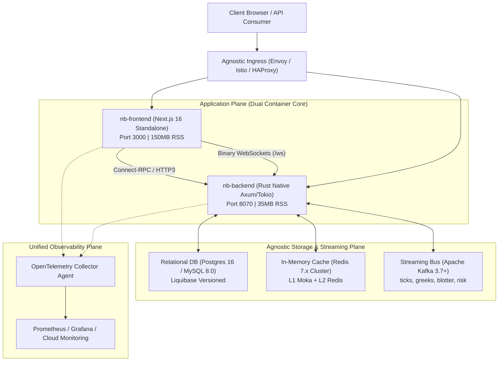

# [Rating: Master] Cloud-Agnostic Infrastructure Substrate & Multi-Cloud Deployment Mesh

### 1. Executive Summary & Architecture Simplicity Invariant

Enterprise financial software frequently suffers from severe **cloud lock-in**, **infrastructure bloat**, and **uncontrolled cloud spend**. Complex microservice architectures introduce excessive operational failure modes and high latency hops.

**The Solution**: A **Cloud-Agnostic Infrastructure Substrate** enforcing:
1. **Radical Architectural Simplicity**: The entire application plane consists of a **Dual-Container Microservice Topology**:
   - `nb-cicada-backend`: Native compiled Rust 1.82+ binary container (~35MB RSS memory, sub-1ms startup, sub-50μs internal request handling).
   - `nb-cicada-frontend`: Next.js 16 / React 19 standalone production container (SSR/SSG with client WebAssembly Wasm integration).
2. **Three Standardized Agnostic Backing Engines**:
   - **Relational Storage**: PostgreSQL 16 or MySQL 8.0 with Liquibase automated zero-downtime schema migrations.
   - **In-Memory Cache**: Redis 7.x-compatible cluster (KeyDB / Dragonfly / Redis Enterprise / Cloud Memorystore / ElastiCache / Azure Cache).
   - **Event Streaming Backbone**: Apache Kafka 3.7+ protocol (Strimzi Operator / Confluent Cloud / Amazon MSK / Azure Event Hubs).
3. **Four Target Substrates with 100% Behavioral Parity**:
   - **On-Premises**: Red Hat OpenShift Container Platform (OCP 4.16+) via `restricted-v2` SCC.
   - **Google Cloud (GCP)**: Cloud Run v2 (serverless) or GKE Autopilot.
   - **Amazon Web Services (AWS)**: Amazon EKS (Graviton ARM64) or AWS Fargate.
   - **Microsoft Azure**: Azure Kubernetes Service (AKS Ampere) or Azure Container Apps (ACA).

---

### 2. Multi-Cloud Topology & Service Mesh Architecture



---

### 3. Port & Network Allocation Matrix

| Service Component | Internal Port | Protocol | Ingress Exposure | Security & Encryption |
| :--- | :---: | :--- | :---: | :--- |
| **`nb-frontend`** | `3000` | HTTP/1.1, HTTP/2 | Public via Ingress | TLS 1.3, CSP, HSTS, X-Frame-Options |
| **`nb-backend` (RPC)** | `8070` | HTTP/2, HTTP/3 (Connect-RPC) | Public / VPC Peered | TLS 1.3, JWT Bearer, RBAC/ReBAC |
| **`nb-backend` (WS)** | `8070` | Binary WebSockets (`/ws/stream`)| Public via Ingress | WSS (TLS 1.3), Token Authentication |
| **`nb-backend` (Metrics)**| `9090` | HTTP/1.1 (`/metrics`) | Internal VPC Only | mTLS, Prometheus Scrape |
| **PostgreSQL / MySQL**| `5432` / `3306` | TCP (Native SQL) | Strict Internal Subnet | TLS Required, IAM / Socket Auth |
| **Redis Cache** | `6379` | TCP (RESP3 Protocol) | Strict Internal Subnet | In-transit TLS, Redis Auth Token |
| **Apache Kafka** | `9092` / `9094`| TCP (Kafka Wire Protocol) | Strict Internal Subnet | mTLS / SASL_SSL SCRAM-SHA-512 |
| **OpenTelemetry Agent**| `4317` / `4318`| gRPC / HTTP (OTLP) | Pod Localhost / DaemonSet| Internal mTLS |

---

### 4. GitOps Packaging Hierarchy: Base & Kustomize Overlays

```text
workplace/infra/
├── base/                                # 100% Cloud-Agnostic Kubernetes Manifests
│   ├── deployment-backend.yaml          # Rust backend pod spec with health probes
│   ├── deployment-frontend.yaml         # Next.js 16 frontend pod spec
│   ├── service-backend.yaml             # ClusterIP service for port 8070 & 9090
│   ├── service-frontend.yaml            # ClusterIP service for port 3000
│   ├── keda-scaledobject.yaml           # Autoscaling rules based on Kafka consumer lag
│   └── kustomization.yaml               # Base resource aggregation
├── overlays/
│   ├── openshift/                       # Red Hat OpenShift 4.16+ (On-Premises)
│   │   ├── route-tls.yaml               # OpenShift Edge/Re-encrypt Route
│   │   ├── scc-binding.yaml             # restricted-v2 SecurityContextConstraints
│   │   └── kustomization.yaml           # OpenShift image stream & route patch
│   ├── gcp/                             # Google Cloud Platform (GKE / Cloud Run)
│   │   ├── managed-certificate.yaml     # Google-managed SSL certificate
│   │   ├── cloud-run-service.yaml       # Serverless Cloud Run v2 configuration
│   │   └── kustomization.yaml           # Workload Identity & Cloud SQL socket patch
│   ├── aws/                             # Amazon Web Services (EKS / Fargate)
│   │   ├── alb-ingress.yaml             # AWS Load Balancer Controller ingress
│   │   ├── irsa-serviceaccount.yaml     # IAM Roles for Service Accounts (IRSA)
│   │   └── kustomization.yaml           # Graviton nodeSelector & TargetGroupBinding
│   └── azure/                           # Microsoft Azure (AKS / Container Apps)
│       ├── appgw-ingress.yaml           # Azure Application Gateway Ingress (AGIC)
│       ├── workload-identity.yaml       # Azure AD Workload Identity bindings
│       └── kustomization.yaml           # Managed Identity & Azure CSI driver patch
└── tofu/                                # OpenTofu / Terraform Modular IaC
    ├── modules/                         # Reusable vpc, k8s, db, cache, kafka modules
    └── environments/                    # onprem, gcp, aws, azure root states
```

---

### 5. Wire Contracts & Provisioning Schemas

#### 5.1 Infrastructure Provisioning Contract (`infra_provision_spec.json`)
```json
{
  "$schema": "https://json-schema.org/draft/2020-12/schema",
  "title": "InfraProvisionSpec",
  "type": "object",
  "required": ["cluster_id", "target_cloud", "environment", "compute", "storage", "networking"],
  "properties": {
    "cluster_id": { "type": "string" },
    "target_cloud": { "type": "string", "enum": ["openshift_onprem", "gcp", "aws", "azure"] },
    "environment": { "type": "string", "enum": ["development", "staging", "production"] },
    "compute": {
      "type": "object",
      "required": ["architecture", "backend_replicas", "frontend_replicas"],
      "properties": {
        "architecture": { "type": "string", "enum": ["arm64", "amd64", "multiarch"] },
        "backend_replicas": { "type": "object", "properties": { "min": { "type": "integer" }, "max": { "type": "integer" } } },
        "frontend_replicas": { "type": "object", "properties": { "min": { "type": "integer" }, "max": { "type": "integer" } } },
        "enable_spot_nodes": { "type": "boolean" }
      }
    },
    "storage": {
      "type": "object",
      "required": ["db_engine", "cache_tier", "kafka_tier"],
      "properties": {
        "db_engine": { "type": "string", "enum": ["postgresql_16", "mysql_8"] },
        "cache_tier": { "type": "string", "enum": ["in_cluster_redis", "managed_redis_cluster"] },
        "kafka_tier": { "type": "string", "enum": ["strimzi_in_cluster", "managed_cloud_kafka"] }
      }
    },
    "networking": {
      "type": "object",
      "required": ["domain", "tls_mode"],
      "properties": {
        "domain": { "type": "string" },
        "tls_mode": { "type": "string", "enum": ["acme_letsencrypt", "cert_manager_vault", "cloud_managed"] }
      }
    }
  }
}
```

---

### 6. FinOps Economics & Scaling Policies

1. **ARM64 Native Execution**: Compiling the Rust backend and Next.js frontend for `linux/arm64` cuts vCPU costs by $20\text{–}40\%$ across AWS Graviton 3/4, GCP Tau T2A, and Azure Ampere Altra.
2. **KEDA Event-Driven Elastic Autoscaling**: Scales backend worker pods dynamically based on Kafka `market.ticks.v1` consumer group lag:
   $$\text{Replicas} = \min\left( R_{\max}, \max\left( R_{\min}, \left\lceil \frac{\text{Kafka Lag}}{\text{Target Lag Per Pod (10,000)}} \right\rceil \right) \right)$$
3. **Spot / Preemptible Worker Pool Interlock**: The Rust backend implements graceful SIGTERM termination handling (`tokio::signal::ctrl_c()`), completing in-flight transactions within 15 seconds of spot eviction warnings without dropping market ticks.
4. **Target Monthly Operational Cost**:
   - **Development / Sandbox Tier**: **`$110 - $145 / month`** (Single small K8s node, in-cluster DB/Redis/Kafka).
   - **Production Enterprise High-Availability Tier**: **`$680 - $840 / month`** (Multi-AZ autoscaling nodes, managed DB with read replica, managed Kafka cluster, multi-zone Redis).
