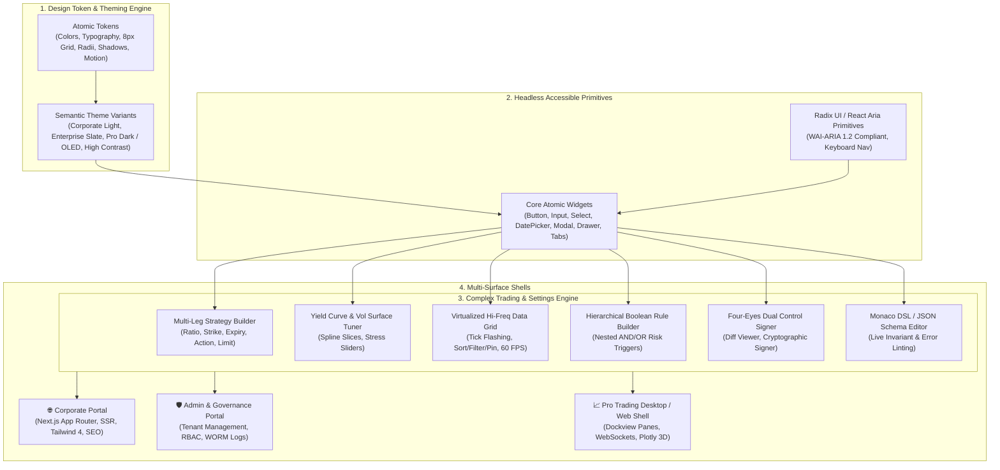

# Enterprise Unified Design System & Multi-Surface UI Architecture

**Plan ID**: `enterprise_ui_design_system`  
**Version**: `1.0.0_draft`  
**Status**: Draft Architecture (Ready for Interactive Refinement)  
**Parent Master Plan**: [`.nb/plan/master/parent-master-plan/detailed.md`](file:///Users/lakhwinder/RustroverProjects/nb_cicada/.nb/plan/master/parent-master-plan/detailed.md)

---

## Quick Links
- [Interactive Showcase Preview](templates/preview-showcase.html) - Fully functional HTML/JS interactive demonstration of Corporate, Admin & Pro Trading surfaces
- [Master CSS Template](templates/enterprise-design-tokens.css) - Standalone production CSS template with multi-theme variables & 8px spatial grid
- [Detailed Implementation Guide](detailed.md) - Exhaustive technical specifications, component contracts, widget architectures, and render pipelines
- [Concise Architecture Specification](concise.md) - Token-optimized architectural overview, token schemas, and module matrix
- [Manifest Registry](MANIFEST.yaml) - Versioning, capability flags, and module manifest

## Executive Summary
This plan establishes a **Unified Enterprise Design System and Widget Architecture** designed to deliver a consistent, beautiful, and high-performance user experience across **all applications within the organization**.

The architecture bridges the historically fragmented divide between:
1. **Public Internet-Facing Corporate Portal**: High aesthetic polish, marketing storytelling, responsive design, fast Core Web Vitals (LCP < 1.2s), SEO, and lead generation.
2. **Internal Enterprise Admin Portal**: High data density, hierarchical tenant management, audit oversight, Zanzibar ReBAC role management, and system operations.
3. **Professional Trading & Complex Analytics Applications**: Sub-millisecond tick streaming, high-frequency virtualized blotters, multi-leg derivative strategy builders, yield curve / vol surface tuners, risk thermometers, and dockable multi-window layouts.

By abstracting atomic design tokens and building specialized compound widgets on top of headless accessible primitives (Radix UI / React Aria / Tailwind CSS 4), the design system guarantees 100% visual and behavioral consistency without sacrificing the specialized performance required by institutional trading desks.

---

## 6 Core Modules

| Module ID | File | Focus Area |
| :--- | :--- | :--- |
| **`mod_01`** | [`modules/01_design_tokens_and_theming_engine.md`](modules/01_design_tokens_and_theming_engine.md) | W3C Design Tokens, 8px spatial rhythm, Tailwind 4 CSS variables, multi-theme engine (Corporate Light, Enterprise Slate, Pro OLED). |
| **`mod_02`** | [`modules/02_core_component_library.md`](modules/02_core_component_library.md) | Accessible headless primitives, typography scale, inputs, date pickers with trading holiday calendars, notifications. |
| **`mod_03`** | [`modules/03_complex_trading_and_settings_widgets.md`](modules/03_complex_trading_and_settings_widgets.md) | Multi-leg instrument builder, high-frequency virtualized blotters, yield curve tuners, hierarchical Boolean rule builders, Monaco DSL. |
| **`mod_04`** | [`modules/04_surface_specialization_and_layouts.md`](modules/04_surface_specialization_and_layouts.md) | Corporate portal shell, Admin portal layout, Pro Trading dockable pane shell (Dockview / GoldenLayout), multi-monitor support. |
| **`mod_05`** | [`modules/05_state_management_and_realtime_data.md`](modules/05_state_management_and_realtime_data.md) | Zustand reactive state, WebSocket tick buffering, 60 FPS `requestAnimationFrame` debouncing, Web Workers for heavy math. |
| **`mod_06`** | [`modules/06_governance_testing_and_component_showcase.md`](modules/06_governance_testing_and_component_showcase.md) | Storybook / Ladle visual catalog, Playwright visual regression tests, WCAG 2.2 AAA accessibility auditing, Percipience subagents. |

---

## Key Technological Choices
- **UI Foundation**: React 19 / Next.js 16 (App Router + Server Components)
- **Styling**: Tailwind CSS v4 + CSS Custom Properties (Theme Tokens)
- **Headless Primitives**: Radix UI Primitives & React Aria (100% WCAG 2.2 AAA compliant)
- **Complex Grids**: TanStack Virtual / AG Grid Community (60 FPS virtualized rendering with tick flash CSS animations)
- **Visualizations**: Lightweight Charts (TradingView) for streaming market series, Plotly.js / Three.js for 3D payoff and volatility surfaces
- **Advanced Code & Settings**: Monaco Editor with custom JSON Schema / DSL autocompletion
- **State & Streaming**: Zustand + RxJS WebWorker data ingestion pipeline
