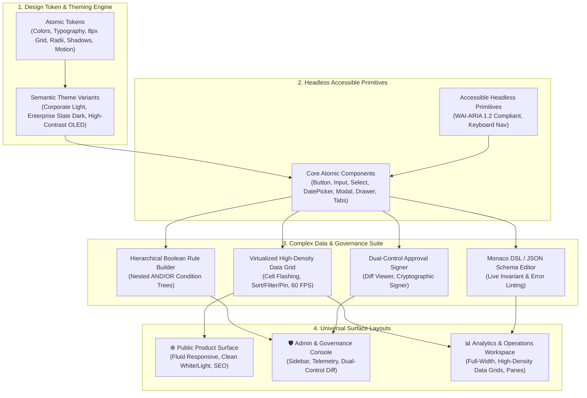

# Enterprise Unified Design System & Universal Look-and-Feel Architecture

**Plan ID**: `enterprise_ui_design_system`  
**Version**: `2.0.0_look_and_feel_agnostic`  
**Status**: Active Architecture Specification  
**Parent Master Plan**: [`.nb/plan/master/parent-master-plan/detailed.md`](file:///Users/lakhwinder/PycharmProjects/nb_fairyfly/.nb/plan/master/parent-master-plan/detailed.md)

---

## Quick Links
- [Interactive Showcase Preview](templates/preview-showcase.html) - Fully functional HTML/JS interactive demonstration of Corporate, Admin & Operations surfaces
- [Master CSS Template](templates/enterprise-design-tokens.css) - Standalone production CSS template with multi-theme tokens & 8px spatial grid
- [Detailed Implementation Guide](detailed.md) - Complete look-and-feel technical specifications, component contracts, and render pipelines
- [Concise Architecture Specification](concise.md) - Token-optimized architectural overview, design tokens schema, and module matrix
- [Manifest Registry](MANIFEST.yaml) - Versioning, capability flags, and module manifest

## Executive Summary
This plan establishes a **Unified Enterprise Design System and Look-and-Feel Architecture** strictly focused on the visual design language, spatial rhythm, ergonomics, and interactive behavior across **all applications within the organization**.

The architecture is **terminology agnostic** and domain neutral, providing universal look-and-feel primitives across three specialized application surfaces:
1. **Public & Product Showcase Surface**: High aesthetic polish, marketing storytelling, fluid responsive layout, fast Core Web Vitals (LCP < 1.2s), and clean visual hierarchy.
2. **Admin & Governance Console Surface**: High data density, hierarchical navigation, audit oversight, settings management, and dual-control approval workflows.
3. **Analytics & Operations Workspace Surface**: Full-width layouts, high-performance virtualized data grids, real-time telemetry updates, dockable multi-pane views, and micro-interactions.

By abstracting atomic design tokens and building standardized headless UI primitives (Radix UI / React Aria / Tailwind CSS 4), the design system guarantees 100% visual consistency, WCAG 2.2 AAA accessibility compliance, and effortless adaptability for any web, desktop, or mobile application.

## Architectural Modules & Structure
The implementation is partitioned into six modular specifications:

| Module | Document | Core Focus |
| :--- | :--- | :--- |
| **`mod_01`** | [`modules/01_design_tokens_and_theming_engine.md`](modules/01_design_tokens_and_theming_engine.md) | W3C Design Tokens Community Group specification, 8px spatial grid, control sizing scale, 3 certified themes. |
| **`mod_02`** | [`modules/02_core_component_library.md`](modules/02_core_component_library.md) | Accessible headless primitives, typography scale, inputs, date pickers, notifications, modal dialogs. |
| **`mod_03`** | [`modules/03_complex_data_and_governance_widgets.md`](modules/03_complex_data_and_governance_widgets.md) | High-performance virtualized data grids, hierarchical Boolean rule builders, diff viewers, schema editors. |
| **`mod_04`** | [`modules/04_surface_specialization_and_layouts.md`](modules/04_surface_specialization_and_layouts.md) | Fluid responsive layouts across Public, Admin, and Operations workspace surfaces. Zero device simulator frames. |
| **`mod_05`** | [`modules/05_state_management_and_realtime_data.md`](modules/05_state_management_and_realtime_data.md) | Real-time state synchronization, 60 FPS frame budgeting, RAF debouncing, theme switching state. |
| **`mod_06`** | [`modules/06_governance_testing_and_component_showcase.md`](modules/06_governance_testing_and_component_showcase.md) | Storybook showcase, WCAG 2.2 AAA visual regression testing, automated token consistency validation. |

## Core Invariants & Governance Rules
1. **8px Spatial Rhythm**: All padding, margins, and layout gaps MUST be exact multiples of 8px (with 4px micro-increments permitted for compact badges and icon gaps).
2. **Standardized Control Sizing**: All interactive controls conform to a 5-tier height standard: `XS (24px)`, `SM (32px)`, `MD (40px)`, `LG (48px)`, and `XL (56px)`.
3. **Tabular Financial & Numeric Formatting**: Numeric values displayed in tables and metric cards MUST use monospace or tabular numbers (`font-variant-numeric: tabular-nums`) to prevent horizontal jitter during live telemetry updates.
4. **WCAG 2.2 AAA Accessibility**: All text against background surfaces achieves at least a 7.0:1 contrast ratio. Touch targets comply with WCAG 2.5.5 ($\ge 44\text{px}$).
5. **Fluid Responsive Design**: Applications adapt naturally to desktop, tablet, and mobile viewport widths via responsive CSS grid and flexbox, without artificial device simulator frames.
