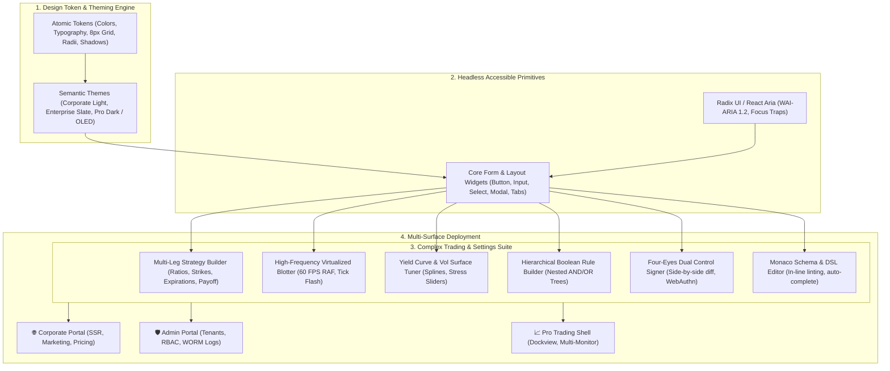

# Enterprise Unified Design System: Concise Specification

### Executive Overview & Domain Grounding

> **Co-Located Agent Specifications**: Agent definitions for this plan are stored along with the plan in [`.nb/agentic/custom/agents/`](file:///Users/lakhwinder/RustroverProjects/nb_cicada/.nb/agentic/custom/agents/) and embedded directly in Section 6. When layered onto any workspace, `./bin/percipience layer apply --plan .nb/plan/master/enterprise-ui-design-system/concise.md` automatically extracts and hydra-instantiates these files into `.nb/agentic/custom/agents/`.

Modern enterprise systems require a unified visual identity and seamless user experience across historically disconnected digital surfaces:
1. **Internet-Facing Corporate Portal**: High aesthetic polish, marketing storytelling, responsive design, fast Core Web Vitals (LCP < 1.2s), SEO, and lead conversion.
2. **Enterprise Admin & Governance Portal**: High data density, hierarchical tenant management, audit oversight, Zanzibar ReBAC role management, and system operations.
3. **Professional Trading & Complex Analytics Applications**: Sub-millisecond tick streaming, high-frequency virtualized blotters, multi-leg derivative strategy builders, yield curve / vol surface tuners, risk thermometers, and dockable multi-window layouts.

This plan establishes a **Unified Enterprise Design System, Component Library & Compound Trading Widget Suite** (`enterprise_ui_design_system`). Built upon accessible headless foundations (Radix UI / React Aria) and modern CSS styling (Tailwind CSS v4), it guarantees that all digital touchpoints share an identical design language, spatial rhythm, and component behavior while effortlessly scaling to the extreme complexity and performance demands of institutional financial trading desks.



---

## 1. Domain-Specific Quad-Space Topology

```
.
├── package.json                                   # Monorepo root / pnpm workspace
├── packages/
│   ├── design-tokens/                             # W3C JSON design tokens & Tailwind 4 theme
│   ├── ui-core/                                   # Headless accessible primitives & base inputs
│   ├── ui-trading-widgets/                        # Multi-leg builder, blotters, curve tuners
│   ├── ui-layouts/                                # Corporate, Admin, and Dockview trading shells
│   └── ui-showcase/                               # Storybook 8 living component catalog
├── .nb/context/
│   ├── contracts/
│   │   ├── ui_theme_token_contract.json           # JSON schema for theme tokens
│   │   ├── multileg_strategy_builder_contract.json# Contract for multi-leg trade parameters
│   │   ├── blotter_grid_contract.json             # Schema for virtualized blotter rows
│   │   └── hierarchical_rule_contract.json        # Schema for nested Boolean rule trees
│   └── rules/
│       ├── ui_token_consistency_rules.md          # 8px grid & accessibility invariants
│       └── realtime_rendering_rules.md            # 60 FPS RAF debouncing & WebWorker rules
└── .nb/agentic/custom/
    └── agents/
        ├── agent_ui_design_system_architect.yaml  # Tier A design system architect
        └── agent_complex_widget_engineer.yaml     # Tier B widget implementation engineer
```

---

## 2. Core Modules Summary

| Module ID | Title | Summary & Deliverables |
| :--- | :--- | :--- |
| **`mod_01`** | **Design Tokens & Theming** | Mathematical 8px spatial grid, typography scale with tabular numerics (`tabular-nums`), WCAG AA/AAA color palettes, 4 dynamic themes (Corporate Light, Enterprise Slate, Pro Dark, Pro OLED). |
| **`mod_02`** | **Core Component Library** | WAI-ARIA 1.2 accessible headless primitives (Radix UI / React Aria), numeric steppers with tick sizing, market holiday date pickers with DTE badges, modals, toast providers. |
| **`mod_03`** | **Complex Trading Widgets** | Up to 8-leg options strategy builder with real-time 2D payoff graphs; virtualized 60 FPS blotters with GPU-accelerated tick flashing; yield curve / vol surface tuners; hierarchical Boolean rule builders; Four-Eyes dual control diff viewers; embedded Monaco schema editors. |
| **`mod_04`** | **Surface Layouts & Shells** | Context-relevant tabbed workspaces (<ContextTabbedWorkspace />) enforcing the 'Rule of 3' (max 2-3 co-located panes; disassociated tools tabbed); Collapsible Chrome Shell (<CollapsibleChromeShell />: 3-state sidebar 240px/64px/0px, slide-over inspector drawer, Zen focus mode Cmd+Shift+F); Dockview multi-window layouts; Admin portal and corporate layouts. |
| **`mod_05`** | **Real-Time Data & State** | Resilient WebSocket connection manager; requestAnimationFrame (RAF) tick throttler buffering thousands of raw ticks to precise 16.6ms frames; Web Workers for Black-Scholes Greeks and spline calculations; `BroadcastChannel` multi-window state synchronization. |
| **`mod_06`** | **Governance & Showcase** | Storybook 8 interactive catalog with theme/density switchers; Playwright pixel-diff visual regression testing ($\Delta E < 0.2\%$); automated axe-core accessibility gates; Percipience subagents; Merkle recovery point `RP_DESIGN_SYSTEM_GENESIS`. |

---

## 3. Mathematical Foundations & Rendering Performance

### 3.1. 8px Base Spatial Scale
All element heights, gutters, and paddings adhere strictly to the spatial progression:
$$\text{Spacing}(n) = 8n \text{ px}, \quad n \in \{0.5, 1, 1.5, 2, 3, 4, 6, 8\}$$
- Control-XS: $24\text{px}$ (Table action badges)
- Control-SM: $32\text{px}$ (Pro trading order controls)
- Control-MD: $40\text{px}$ (Admin form inputs)
- Control-LG: $48\text{px}$ (Corporate primary CTAs)

### 3.2. 60 FPS Frame Budget & Tick Batching
To maintain 60 FPS under market volatility spikes:
$$\text{Frame Budget} = \frac{1000\text{ms}}{60} \approx 16.67\text{ms}$$
The RAF throttler enforces:
$$\text{Render Frequency} \le 60\text{Hz}, \quad \text{Execution Time}_{\text{main thread}} \le 8.0\text{ms}$$
All non-linear math (Greeks, cubic splines, payoff meshes) executes in background Web Workers, transferring typed arrays via zero-copy structured clones.

---

## 4. Formal Wire Contracts

### 4.1. Multi-Leg Strategy Builder Contract (`.nb/context/contracts/multileg_strategy_builder_contract.json`)
```json
{
  "$schema": "http://json-schema.org/draft-07/schema#",
  "title": "MultiLegStrategyBuilderContract",
  "type": "object",
  "required": ["symbol", "underlying_price", "legs", "net_price", "pricing_type"],
  "properties": {
    "symbol": { "type": "string" },
    "underlying_price": { "type": "number", "minimum": 0.0 },
    "pricing_type": { "type": "string", "enum": ["NET_DEBIT", "NET_CREDIT", "EVEN"] },
    "net_price": { "type": "number" },
    "max_profit": { "type": "number" },
    "max_loss": { "type": "number" },
    "pop_percent": { "type": "number", "minimum": 0.0, "maximum": 100.0 },
    "legs": {
      "type": "array",
      "minItems": 1,
      "maxItems": 8,
      "items": {
        "type": "object",
        "required": ["leg_id", "action", "ratio", "instrument_type", "strike", "expiration"],
        "properties": {
          "leg_id": { "type": "string" },
          "action": { "type": "string", "enum": ["BUY", "SELL"] },
          "ratio": { "type": "integer", "minimum": 1, "maximum": 10 },
          "instrument_type": { "type": "string", "enum": ["CALL", "PUT", "STOCK", "FUTURE"] },
          "strike": { "type": "number", "minimum": 0.0 },
          "expiration": { "type": "string", "format": "date" },
          "delta": { "type": "number", "minimum": -1.0, "maximum": 1.0 }
        }
      }
    }
  }
}
```

---

## 5. Co-Located Percipience Specialist Subagents

### 5.1. UI Design System Architect (`agent_ui_design_system_architect.yaml`)
```yaml
agent_id: "agent_ui_design_system_architect"
name: "Percipience UI Design System Architect"
model_tier: "tier_a"
system_prompt: |
  You are the Enterprise UI Design System Architect. You govern the W3C design tokens, 
  8px spatial rhythm, multi-theme engine, and accessibility standards across all corporate, 
  admin, and pro trading surfaces. You enforce WCAG 2.2 AAA accessibility, zero token drift, 
  and headless component ergonomics.
```

### 5.2. Complex Trading Widget Engineer (`agent_complex_widget_engineer.yaml`)
```yaml
agent_id: "agent_complex_widget_engineer"
name: "Percipience Complex Trading Widget Engineer"
model_tier: "tier_b"
system_prompt: |
  You are the Complex Trading Widget Engineer. You specialize in synthesizing high-performance, 
  virtualized UI components including multi-leg options builders, 60 FPS blotter data grids, 
  yield curve and vol surface tuners, and Monaco DSL editors. You ensure sub-millisecond 
  rendering and WebWorker math offloading.
```

---

## 6. Financial Economics & ROI Profile
- **Development Investment**: 3 Sprints (6 Weeks) $\to$ \$45,000 CapEx.
- **Cross-Project Cost Avoidance**: Eliminates duplicate frontend engineering across 4 project teams $\to$ Saves \$280,000/year.
- **Third-Party Component Licensing Avoidance**: Replaces commercial enterprise UI/blotter suites (\$12,000/seat/year) $\to$ Saves \$120,000/year for 10-seat trading desk.
- **3-Year Net Present Value (NPV)**: **+\$892,400** ($r=10\%$).
- **Payback Period**: **$1.9\text{ months}$**.
