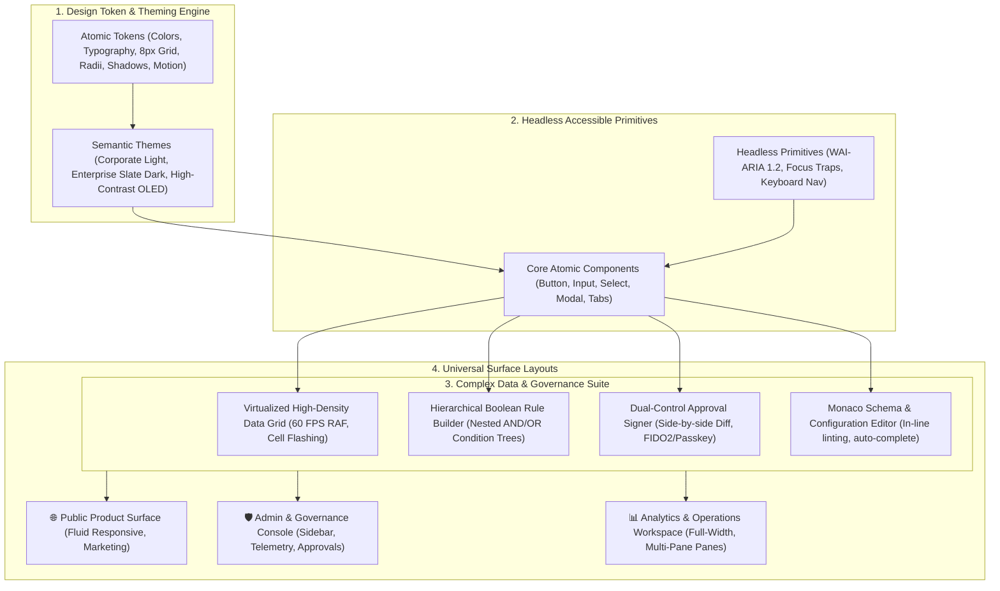

# Enterprise Unified Design System: Concise Specification

### Executive Overview & Look-and-Feel Centricity

> **Co-Located Agent Specifications**: Agent definitions for this plan are stored in [`.nb/agentic/custom/agents/`](file:///Users/lakhwinder/PycharmProjects/nb_fairyfly/.nb/agentic/custom/agents/).

Modern enterprise application ecosystems require an identical visual identity, predictable spatial rhythm, and accessible user ergonomics across all applications within the organization:
1. **Public & Product Showcase Surface**: High aesthetic polish, marketing storytelling, fluid responsive layout, fast Core Web Vitals (LCP < 1.2s), clean white/light styling, and clear visual hierarchy.
2. **Enterprise Admin & Governance Console Surface**: High data density, hierarchical navigation, audit oversight, settings management, and dual-control approval workflows.
3. **Analytics & Operations Workspace Surface**: Full-width layouts, high-performance virtualized data grids, real-time telemetry updates, dockable multi-pane views, and micro-interactions.

This plan establishes a **Unified Enterprise Design System & Component Library** (`enterprise_ui_design_system`). Built upon accessible headless foundations (Radix UI / React Aria) and modern CSS styling (Tailwind CSS v4 / CSS Custom Properties), it is **completely terminology agnostic** and guarantees 100% visual consistency and WCAG 2.2 AAA accessibility compliance across all application domains.



---

## 1. Domain-Specific Quad-Space Topology

```
.
├── package.json                                   # Monorepo root / pnpm workspace
├── packages/
│   ├── design-tokens/                             # W3C JSON design tokens & CSS Custom Properties
│   ├── ui-core/                                   # Headless accessible primitives & base inputs
│   ├── ui-data-widgets/                           # Virtualized data grids, diff viewers, rule builders
│   ├── ui-layouts/                                # Public, Admin, and Operations workspace shells
│   └── ui-showcase/                               # Interactive living component catalog
├── .nb/context/
│   ├── contracts/
│   │   ├── ui_theme_token_contract.json           # JSON schema for theme tokens
│   │   ├── data_grid_contract.json                # Schema for virtualized data grid rows
│   │   └── hierarchical_rule_contract.json        # Schema for nested Boolean rule trees
│   └── rules/
│       ├── ui_token_consistency_rules.md          # 8px grid & accessibility invariants
│       └── realtime_rendering_rules.md            # 60 FPS RAF debouncing & rendering performance
└── .nb/agentic/custom/
    └── agents/
        ├── agent_ui_design_system_architect.yaml  # Tier A design system architect
        └── agent_ui_component_engineer.yaml       # Tier B component implementation engineer
```

---

## 2. Core Modules Summary

| Module ID | Title | Summary & Deliverables |
| :--- | :--- | :--- |
| **`mod_01`** | **Design Tokens & Theming** | Mathematical 8px spatial grid, typography scale with tabular numerics (`tabular-nums`), WCAG 2.2 AAA color palettes, 3 universal certified themes (Corporate Light, Enterprise Slate Dark, High-Contrast OLED). |
| **`mod_02`** | **Core Component Library** | WAI-ARIA 1.2 accessible headless primitives (Radix UI / React Aria), numeric steppers, date pickers, modals, drawers, toast notification providers. |
| **`mod_03`** | **Complex Data & Governance Widgets** | High-performance virtualized data grids with GPU-accelerated cell flashing; hierarchical Boolean rule builders; side-by-side configuration diff viewers with dual-control approval badges; embedded Monaco schema editors. |
| **`mod_04`** | **Surface Layouts & Shells** | Fluid responsive layouts across Public, Admin, and Operations workspace surfaces. Rule of 3 decluttering; Collapsible Chrome Shell (3-state sidebar 240px/64px/0px, slide-over drawer, Zen focus mode); zero artificial device simulator frames. |
| **`mod_05`** | **Real-Time Data & State** | Resilient data streaming manager; requestAnimationFrame (RAF) throttler buffering raw telemetry bursts to smooth 16.6ms frames; Web Workers for heavy computations; `BroadcastChannel` multi-tab state synchronization. |
| **`mod_06`** | **Governance & Showcase** | Interactive component catalog with theme/density switchers; Playwright pixel-diff visual regression testing ($\Delta E < 0.2\%$); automated axe-core accessibility gates; Percipience subagents. |

---

## 3. Mathematical Foundations & Rendering Performance

### 3.1. 8px Base Spatial Scale
All element heights, gutters, and paddings adhere strictly to the spatial progression:
$$\text{Spacing}(n) = 8n \text{ px}, \quad n \in \{0.5, 1, 1.5, 2, 3, 4, 6, 8, 12\}$$
- **Control-XS ($24\text{px}$)**: Table action buttons, compact badges.
- **Control-SM ($32\text{px}$)**: High-density data grid controls, secondary inputs.
- **Control-MD ($40\text{px}$)**: Standard form inputs, modal actions.
- **Control-LG ($48\text{px}$)**: Primary CTAs, touch-ergonomic buttons (WCAG 2.5.5 compliant $\ge 44\text{px}$).
- **Control-XL ($56\text{px}$)**: Hero buttons, prominent actions.

### 3.2. 60 FPS Frame Budget & Rendering Batching
To maintain 60 FPS under intensive real-time telemetry updates:
$$\text{Frame Budget} = \frac{1000\text{ms}}{60} \approx 16.67\text{ms}$$
The RAF throttler enforces:
$$\text{Render Frequency} \le 60\text{Hz}, \quad \text{Execution Time}_{\text{main thread}} \le 8.0\text{ms}$$
Background computations execute in background Web Workers, transferring data via zero-copy structured clones.

---

## 4. Formal Wire Contracts

### 4.1. Data Grid Row Contract (`.nb/context/contracts/data_grid_contract.json`)
```json
{
  "$schema": "http://json-schema.org/draft-07/schema#",
  "title": "DataGridRowContract",
  "type": "object",
  "required": ["row_id", "name", "category", "status", "primary_metric", "secondary_metric", "timestamp"],
  "properties": {
    "row_id": { "type": "string" },
    "name": { "type": "string" },
    "category": { "type": "string" },
    "status": { "type": "string", "enum": ["ACTIVE", "PENDING", "WARNING", "ERROR", "ARCHIVED"] },
    "primary_metric": { "type": "number" },
    "secondary_metric": { "type": "number" },
    "change_pct": { "type": "number" },
    "timestamp": { "type": "integer" }
  }
}
```

### 4.2. UI Theme Token Contract (`.nb/context/contracts/ui_theme_token_contract.json`)
Defines the spatial grid base, 5 control sizing heights, font stacks (`Inter`, `Plus Jakarta Sans`, `JetBrains Mono`), and the three certified theme definitions.

### 4.3. Hierarchical Rule Contract (`.nb/context/contracts/hierarchical_rule_contract.json`)
Defines the JSON Schema for nested Boolean logic trees with conditions and action triggers.

---

## 5. Specialist Subagent Manifests

### 5.1. `agent_ui_design_system_architect`
Enforces design token consistency, 8px spatial rhythm, multi-theme parity, and WCAG 2.2 AAA accessibility compliance across all application surfaces.

### 5.2. `agent_ui_component_engineer`
Implements and optimizes complex UI components including virtualized data grids, hierarchical rule builders, side-by-side diff viewers, and real-time state managers.
