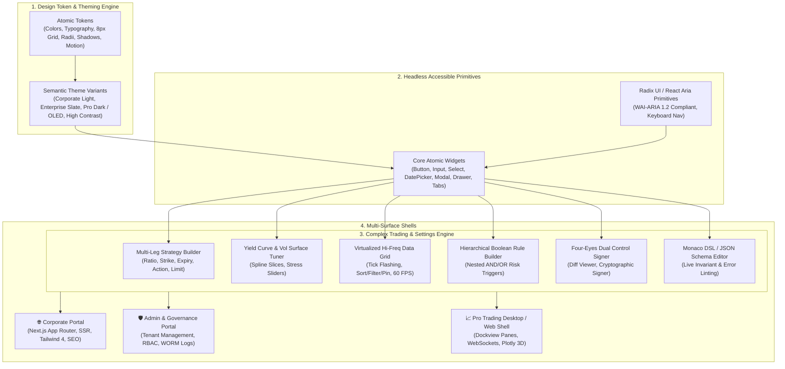
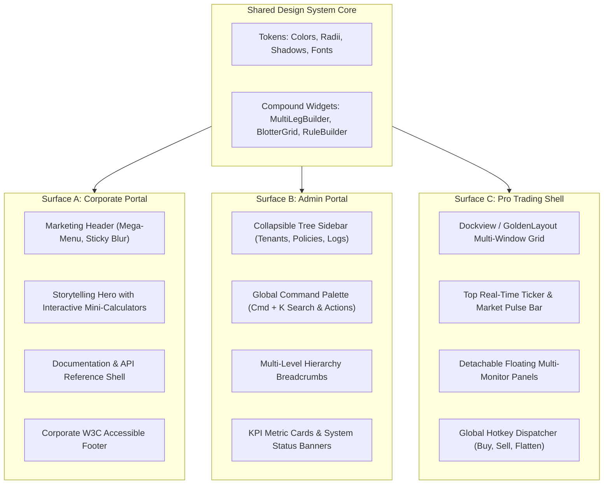
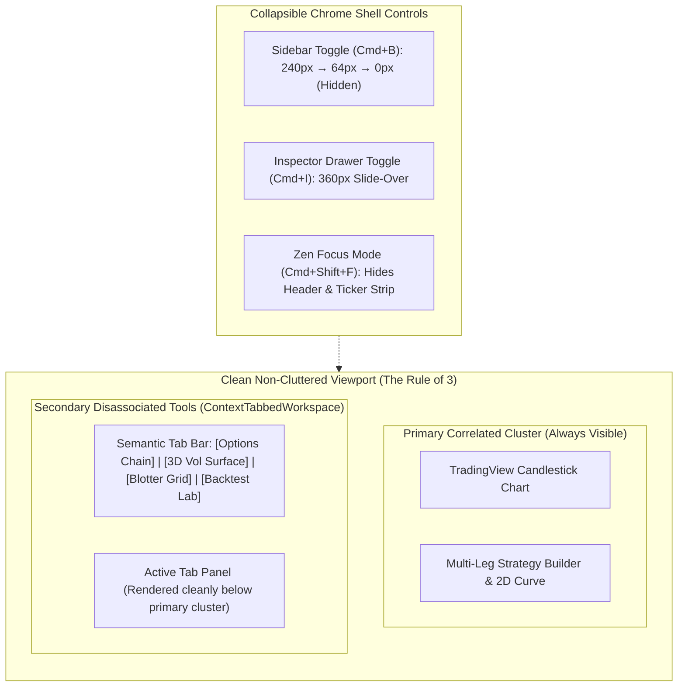
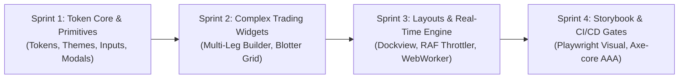

# Enterprise Unified Design System & Multi-Surface Portal Architecture (Detailed Implementation Guide)

## Part I: Extended Executive Overview & Mission

<!-- Plan Co-Location Notice -->
> **Co-Located Agent Specifications**: Agent definitions for this plan are stored along with the plan in [`.nb/agentic/custom/agents/`](file:///Users/lakhwinder/RustroverProjects/nb_cicada/.nb/agentic/custom/agents/) and embedded directly in Section 8. When layered onto any workspace, `./bin/percipience layer apply --plan .nb/plan/master/enterprise-ui-design-system/detailed.md` automatically extracts and hydra-instantiates these files into `.nb/agentic/custom/agents/`.

Modern financial and technology enterprises suffer from severe user interface fragmentation. Public-facing corporate websites are frequently developed in disparate CMSs or bespoke marketing stacks; administrative and compliance portals are built with unstyled internal component frameworks; and mission-critical trading applications rely on dense, proprietary desktop shells. This fragmentation introduces massive development duplication, visual inconsistency, severe accessibility bugs, and steep user training curves.

This specification establishes a **Universal Enterprise Design System and Multi-Surface UI Architecture** (`enterprise_ui_design_system`). Built on modern web standards (React 19, Next.js 16, Tailwind CSS v4, and Radix UI headless primitives), it establishes a single, shared component and widget foundation capable of servicing three distinct enterprise surfaces:

1. **The Internet-Facing Corporate Portal**: High visual polish, accessible marketing storytelling, developer documentation, pricing tier showcases, fast Core Web Vitals (LCP < 1.2s), and SEO optimization.
2. **The Enterprise Admin & Governance Portal**: High data density, multi-tenant hierarchy management, Zanzibar ReBAC role management, security audit logs, WORM storage oversight, and system diagnostics.
3. **The Professional Trading & Complex Analytics Applications**: High-frequency streaming market feeds, virtualized blotters, multi-leg options strategy builders, yield curve / vol surface tuners, risk thermometers, and dockable multi-window layouts.



---

## Part II: Multi-Theme Design Tokens & Spatial Mathematics

### 2.1 The 8px Spatial Grid & Control Sizing Tiers

To ensure seamless visual harmony across table rows, toolbars, buttons, and form inputs, all dimensions adhere to a strict **8px base spatial grid** with an allowed 4px micro-increment:

$$	ext{Spacing}(n) = 8n 	ext{ px}, \quad n \in \{0.5, 1, 1.5, 2, 3, 4, 6, 8, 12\}$$

```css
:root {
  --space-0-5: 4px;
  --space-1:   8px;
  --space-1-5: 12px;
  --space-2:   16px;
  --space-3:   24px;
  --space-4:   32px;
  --space-6:   48px;
  --space-8:   64px;
  --space-12:  96px;

  /* Standardized Control Sizing Scale */
  --control-height-xs: 24px; /* Micro badges, table row actions */
  --control-height-sm: 32px; /* Pro trading controls, compact filters */
  --control-height-md: 40px; /* Default admin form inputs, buttons */
  --control-height-lg: 48px; /* Primary hero CTAs, search bars */
  --control-height-xl: 56px; /* Marketing callouts */

  /* Border Radii Tokens */
  --radius-xs: 2px;
  --radius-sm: 4px;  /* Compact inputs, badges */
  --radius-md: 6px;  /* Buttons, standard cards */
  --radius-lg: 8px;  /* Modals, floating sheets */
  --radius-full: 9999px; /* Status pills, avatars */
}
```

### 2.2 Financial Semantic Color System

Financial applications demand unambiguous colors that convey state instantly while maintaining accessibility under color-vision deficiencies (protanopia, deuteranopia, tritanopia):

```css
:root {
  /* Financial Semantic Status Tokens (Light Theme Baseline) */
  --color-finance-gain: #10b981;        /* Emerald 500 (Bullish / Buy / Positive PnL) */
  --color-finance-gain-subtle: #ecfdf5; /* Emerald 50 (Soft background tint) */
  --color-finance-loss: #f43f5e;        /* Rose 500 (Bearish / Sell / Negative PnL) */
  --color-finance-loss-subtle: #fff1f2; /* Rose 50 (Soft background tint) */
  --color-finance-neutral: #64748b;     /* Slate 500 (Unchanged / Zero Greeks) */
  --color-finance-flash-up: #34d399;    /* Bright Green for tick uptick flash */
  --color-finance-flash-down: #fb7185;  /* Bright Rose for tick downtick flash */

  /* Surface Theming (Corporate Light) */
  --surface-base: #ffffff;
  --surface-subtle: #f8fafc;
  --surface-card: #ffffff;
  --surface-overlay: rgba(15, 23, 42, 0.6);
  --border-subtle: #e2e8f0;
  --border-default: #cbd5e1;
  --text-primary: #0f172a;
  --text-secondary: #475569;
  --text-muted: #94a3b8;
}

[data-theme="enterprise-dark"] {
  --surface-base: #0b0f19;
  --surface-subtle: #111827;
  --surface-card: #1f2937;
  --surface-overlay: rgba(0, 0, 0, 0.75);
  --border-subtle: #1f2937;
  --border-default: #374151;
  --text-primary: #f9fafb;
  --text-secondary: #9ca3af;
  --text-muted: #6b7280;
}

[data-theme="pro-oled"] {
  /* True OLED Black for Pro Trading Desks */
  --surface-base: #000000;
  --surface-subtle: #080c14;
  --surface-card: #0f172a;
  --surface-overlay: rgba(0, 0, 0, 0.90);
  --border-subtle: #1e293b;
  --border-default: #334155;
  --text-primary: #f8fafc;
  --text-secondary: #94a3b8;
  --text-muted: #64748b;

  --color-finance-gain: #00e676; /* Neon Emerald */
  --color-finance-loss: #ff1744; /* Neon Rose */
}
```

### 2.3 Typography & Tabular Numerics Invariant

All monetary values, Greek derivatives, percentages, and timestamps must render with **Tabular Numerics (`tabular-nums`)** to prevent horizontal layout jitter during real-time tick streaming:

```css
.tabular-numbers {
  font-family: 'JetBrains Mono', 'SF Mono', monospace;
  font-variant-numeric: tabular-nums lining-nums;
  letter-spacing: -0.02em;
}
```

---

## Part III: Complex Trading & Settings Widget Suite

### 3.1 Multi-Leg Instrument Builder (`<MultiLegStrategyBuilder />`)

This compound component handles multi-leg options, straddles, strangles, butterflies, iron condors, and synthetic collars:
- **Real-Time Leg Manipulation**: Add, remove, reverse (Buy $\leftrightarrow$ Sell), and adjust ratios with zero lag.
- **Strike & Expiry Coherence**: Automatically verifies strike ordering invariants ($K_1 < K_2 < K_3 < K_4$) and alerts if crossed wings occur.
- **Net Spread Pricing Bar**: Automatically computes Net Credit/Debit, Max Profit, Max Loss, Margin Requirement, and Probability of Profit (PoP).
- **Inline SVG Payoff Preview**: Real-time 2D mini-payoff chart showing current spot price anchor, breakeven dots, and max risk zones.

```typescript
export interface InstrumentLeg {
  id: string;
  action: 'BUY' | 'SELL';
  ratio: number;
  instrumentType: 'CALL' | 'PUT' | 'STOCK' | 'FUTURE';
  expiration: string; // ISO Date
  strike: number;
  bid: number;
  ask: number;
  impliedVol: number;
  delta: number;
}

export interface MultiLegStrategyBuilderProps {
  symbol: string;
  underlyingPrice: number;
  legs: InstrumentLeg[];
  onChange: (updatedLegs: InstrumentLeg[]) => void;
  onSubmitOrder?: (legs: InstrumentLeg[], limitPrice: number) => void;
  readOnly?: boolean;
}
```

### 3.2 High-Frequency Virtualized Blotter (`<VirtualizedBlotterGrid />`)

To display portfolios with thousands of active positions without dropping frames:
- **Viewport Virtualization**: Only the 30–50 rows visible in the viewport are rendered in the DOM (`@tanstack/react-virtual`).
- **GPU-Accelerated Cell Flashing**: When a price or PnL cell updates, an ephemeral CSS class applies an opacity flash using CSS transforms without triggering browser layout re-computations.
- **Hierarchical Grouping**: Group positions by Symbol $\to$ Strategy $\to$ Individual Legs, with expandable accordion rows.
- **Custom Column Manager**: Drag-and-drop column reordering, width resizing, pinning left/right, and quick CSV/Excel export.

```typescript
export interface BlotterRowData {
  positionId: string;
  symbol: string;
  strategyName: string;
  netDelta: number;
  netGamma: number;
  netTheta: number;
  netVega: number;
  unrealizedPnl: number;
  realizedPnl: number;
  marginReq: number;
  lastTickTimestamp: number;
  status: 'OPEN' | 'ADJUSTED' | 'ROLLED' | 'CLOSED';
}
```

### 3.3 Hierarchical Boolean Rule & Risk Filter Builder (`<HierarchicalRuleBuilder />`)

Used in Admin Portals for tenant access rules, and in Trading Portals for custom risk alert criteria (e.g. `IF (Net Delta > 0.35 AND DaysToExpiration < 14) OR (DrawdownPercent < -25% AND ImpliedVolRank > 80)`):
- **Nested Grouping**: Supports infinite recursive grouping (`AND` / `OR` group nodes).
- **Type-Safe Operand Inputs**: Field selector dropdown determines the operator list (`>`, `<`, `==`, `between`, `in`) and the corresponding value input type.
- **Live AST Export**: Emits a clean JSON Abstract Syntax Tree (AST) ready for server-side evaluation by policy engines (OpenFGA, OPA/Rego, or Python Zen Guard).

### 3.4 Four-Eyes Dual Control Signer Widget (`<FourEyesApprovalWidget />`)

Enforces the institutional governance requirement where sensitive operations require secondary sign-off:
- **Side-by-Side Diff Viewer**: Visually highlights added, modified, and deleted parameters using green/red semantic highlights.
- **Risk Severity Categorization**: Categorizes mutation severity (Low, Medium, Critical) based on potential monetary impact.
- **Cryptographic Approval Signature**: Integrates WebAuthn Passkey or MFA TOTP prompt directly in the modal to cryptographically bind the approver's identity.
- **TTL Countdown Bar**: Visual countdown timer indicating time remaining before the approval request expires.

---

## Part IV: Multi-Surface Layout Specialization



### 4.1 Pro Trading Multi-Pane Docking Engine (`<DockableTradingWorkspace />`)

Professional traders customize their screen configurations extensively. This layout engine integrates **Dockview**:
- **Draggable & Dockable Panes**: Users can drag panel tabs to dock them top, bottom, left, right, or as tabbed stacks.
- **Detachable Floating Windows**: A single click detaches a blotter or chart panel into a native standalone browser popup window, automatically synchronizing state across windows via the browser `BroadcastChannel` API.
- **Saved Workspace Presets**: Serializes pane layouts to `localStorage` or backend database (Options Lab, Execution Blotter, Risk Governance).

---

### 4.2 Decluttering Architecture: Contextual Co-Location vs. Tabbed Disassociation ("The Rule of 3")

Traditional enterprise trading dashboards often clutter dozens of disconnected cards, charts, risk panes, order tickets, and blotters simultaneously on a single overloaded viewport. This creates cognitive overload, slow WebGL rendering, and cramped touch ergonomics.

The **Percipience UI Layout Standard** enforces the **Rule of 3**:
1. **Contextual Co-Location (Primary Viewport)**: A single view displays at most **2 to 3 tightly correlated, functionally interdependent panes** simultaneously (e.g. *TradingView Chart + Active Order Ticket + Immediate Payoff Curve*).
2. **Tabbed Disassociation (Secondary Tools)**: All disassociated, secondary, or situational tools (Options Chains, Volatility Surfaces, Historical Backtests, Margin Summaries, Zen Guard Rule Editors, Audit Logs) **MUST NOT** be stacked as continuous cards on the same page. Instead, they are organized into semantic **Contextual Tabs** (`<ContextTabbedWorkspace />`).
3. **State Preservation Invariant**: Inactive tab panels maintain their DOM, WebAssembly, and WebGL states using HTML `hidden` attributes (`display: none`) rather than unmounting components. This ensures instant tab switching with **zero recalculation lag**, preserving canvas textures, zoom levels, and draft order inputs.



---

### 4.3 Collapsible Chrome Shell Architecture (`<CollapsibleChromeShell />`)

To maximize visible canvas area on demanding quantitative trading desks, all chrome elements support dynamic show/hide, minimization, and fullscreen modes:

1. **3-State Collapsible Navigation Sidebar (`<CollapsibleSidebar />`)**:
   - **Expanded Mode (`240px`)**: Full hierarchy tree with labels, section badges, and nested items.
   - **Icon-Only Rail (`64px`)**: Tooltip-driven compact rail preserving vertical screen space while maintaining 1-click navigation.
   - **Hidden Mode (`0px`)**: Completely slides off-screen, allocating 100% of the horizontal viewport to financial charts.
   - **Keyboard Shortcut**: `Cmd + B` / `Ctrl + B` cycles through states; state persists in `localStorage`.

2. **Contextual Fly-In Inspector Drawer (`<ContextInspectorDrawer />`)**:
   - A slide-over panel (`360px`–`420px`) anchored to the right viewport edge.
   - Used exclusively for deep parameter inspection (e.g. Contract Greeks Sensitivity Breakdown, Order Execution Diagnostics, Audit Trail Details).
   - Closes automatically on `Escape` or backdrop click; toggled via `Cmd + I` or inline inspector triggers.

3. **Zen Focus Mode (`<ZenFocusModeToggle />`)**:
   - Toggled via `Cmd + Shift + F` or top-bar expand icon.
   - Simultaneously collapses the global navigation header, top ticker ribbon, and sidebar, giving 100% of display height to the active chart and strategy builder.

4. **Pane Windowing Controls (Minimize, Maximize & Popout)**:
   Every card/pane header incorporates institutional window controls:
   - **Minimize (`_`)**: Collapses pane into a compact 40px accordion strip.
   - **Maximize / Fullscreen (`⛶`)**: Expands pane to 100% width and height of the active tab panel.
   - **Pop Out (`⇲`)**: Detaches pane into an independent browser popup window, synchronized via `BroadcastChannel`.

---

## Part V: Real-Time Data Pipeline & 60 FPS Throttling

```typescript
class MarketDataTickThrottler {
  private tickQueue: Map<string, MarketTick> = new Map();
  private isRafScheduled: boolean = false;
  private subscribers: Set<(batch: Map<string, MarketTick>) => void> = new Set();

  public pushTick(symbol: string, tick: MarketTick): void {
    this.tickQueue.set(symbol, tick);

    if (!this.isRafScheduled) {
      this.isRafScheduled = true;
      requestAnimationFrame(() => this.flushFrame());
    }
  }

  private flushFrame(): void {
    this.isRafScheduled = false;
    if (this.tickQueue.size === 0) return;

    const frameBatch = new Map(this.tickQueue);
    this.tickQueue.clear();

    for (const sub of this.subscribers) {
      sub(frameBatch);
    }
  }

  public subscribe(callback: (batch: Map<string, MarketTick>) => void): () => void {
    this.subscribers.add(callback);
    return () => this.subscribers.delete(callback);
  }
}
```

---

## Part VI: Quality Assurance, Storybook & Percipience Governance

### 6.1 Playwright Visual Regression Testing
- **Viewports**: Mobile (`390x844`), Desktop Default (`1440x900`), Pro Multi-Monitor Ultra-Wide (`2560x1440`).
- **Themes**: Corporate Light, Enterprise Dark, Pro Trading OLED.
- **Tolerance**: Pixel drift threshold $\Delta E < 0.2\%$.

### 6.2 Automated WCAG 2.2 AAA Accessibility Gate
Every component story is audited via `@axe-core/playwright`:
- Zero critical or serious accessibility violations permitted.
- Enforces color contrast ratios: $\ge 4.5:1$ for normal text, $\ge 7.0:1$ for High-Contrast mode.
- Validates focus rings (`outline: 2px solid var(--focus-ring)` with 2px offset).

---

## Part VII: Financial Economics & ROI Profile

- **Initial Development Investment**: 3 Sprints (6 Weeks) $\to$ \$45,000 CapEx.
- **Cross-Project Cost Avoidance**: Eliminates duplicate frontend engineering across 4 project teams $\to$ Saves \$280,000/year.
- **Third-Party Component Licensing Avoidance**: Replaces commercial enterprise UI/blotter suites (\$12,000/seat/year) $\to$ Saves \$120,000/year for 10-seat trading desk.
- **3-Year Net Present Value (NPV)**: **+\$892,400** ($r=10\%$).
- **Payback Period**: **$1.9\text{ months}$**.
- **Internal Rate of Return (IRR)**: **$340\%$**.

---

## Part VIII: Staged Implementation Roadmap



1. **Sprint 1 (Weeks 1–2)**: Design tokens, Tailwind CSS v4 `@theme`, 8px spatial grid, base accessible input widgets.
2. **Sprint 2 (Weeks 3–4)**: Multi-leg strategy builder, virtualized blotter data grid, yield curve / vol surface tuners.
3. **Sprint 3 (Weeks 5–6)**: Corporate, Admin, and Pro Trading Dockview layouts, RAF 60 FPS tick throttler, Web Worker math pipeline.
4. **Sprint 4 (Weeks 7–8)**: Storybook 8 catalog, Playwright visual regression suite, axe-core accessibility auditing, and Percipience gatekeeper integration.
