# Module 01: Design Tokens, Typography, Spatial Grid & Multi-Theme Engine

**Module ID**: `mod_design_tokens_and_theming`  
**Parent Plan**: [`.nb/plan/master/enterprise-ui-design-system`](file:///Users/lakhwinder/RustroverProjects/nb_cicada/.nb/plan/master/enterprise-ui-design-system)  
**Status**: Specification Complete

---

## 1. Architectural Mission
This module establishes the foundational design token dictionary, mathematical typography scale, 8px spatial grid system, and runtime dynamic CSS variable theming engine. It guarantees that any UI element rendered across the organization—from marketing landing pages to high-frequency data grids—inherits a unified visual DNA while supporting surface-specific density profiles.

---

## 2. Multi-Theme Token Architecture

```mermaid
graph LR
  subgraph GlobalTokens["1. Global Raw Tokens"]
    Colors["Palette Primitives<br/>(Slate, Cyan, Emerald, Rose, Amber, Indigo)"]
    Spacing["Spatial Scale<br/>(2px, 4px, 8px, 12px, 16px, 24px, 32px, 48px, 64px)"]
    Radii["Border Radii<br/>(0px, 2px, 4px, 6px, 8px, 12px, 16px, Full)"]
    Fonts["Type Scale<br/>(JetBrains Mono, Inter, Plus Jakarta Sans)"]
  end

  subgraph SemanticTokens["2. Semantic Theme Mappings"]
    ThemeLight["Corporate Light<br/>(High Contrast, Clean White/Slate, Brand Indigo)"]
    ThemeDark["Enterprise Dark<br/>(Dark Navy/Slate, Low Eye Strain)"]
    ThemeOled["High-Contrast OLED<br/>(True Black #000000, High-Contrast Semantic Accents)"]
    ThemeHighContrast["Accessibility AAA<br/>(7.0:1 Contrast Ratio, Enhanced Outlines)"]
  end

  subgraph SurfaceTokens["3. Component-Level Variables"]
    Buttons["--btn-bg, --btn-border, --btn-text"]
    Blotter["--blotter-row-hover, --blotter-flash-up, --blotter-flash-down"]
    Inputs["--input-height-sm (32px), --input-height-md (40px), --input-height-lg (48px)"]
  end

  GlobalTokens --> SemanticTokens --> SurfaceTokens
```



---

## 3. The 8px Spatial Rhythm & Control Sizing Tiers

To eliminate arbitrary layout offsets and ensure perfect alignment between data tables, toolbars, and modal forms, the design system mandates an **8px base spatial grid** with an allowed 4px micro-increment:

| Sizing Tier | Height / Dimension | Padding (X / Y) | Typical Use Cases |
| :--- | :---: | :---: | :--- |
| **Micro (`Control-XS`)** | `24px` | `6px / 2px` | High-density blotter badges, inline table action icons, compact ticker tags. |
| **Compact (`Control-SM`)** | `32px` | `10px / 4px` | High-density data controls, table filter inputs, secondary action buttons. |
| **Default (`Control-MD`)** | `40px` | `16px / 8px` | Enterprise Admin portal form inputs, primary navigation dropdowns, modal controls. |
| **Hero (`Control-LG`)** | `48px` | `24px / 12px` | Corporate portal primary CTAs, main search bars, authentication form submit buttons. |
| **Jumbo (`Control-XL`)** | `56px` | `32px / 16px` | Marketing hero callouts, enterprise pricing tier action triggers. |

---

## 4. Financial & Status Semantic Color System

Financial systems require unambiguous color semantics that remain accessible under color vision deficiencies (protanopia, deuteranopia, tritanopia):

```css
:root {
  /* Financial Semantic Status Tokens */
  --color-finance-gain: #10b981;        /* Emerald 500 (Bullish / Buy / Positive PnL) */
  --color-finance-gain-subtle: #064e3b; /* Dark Green Tint */
  --color-finance-loss: #f43f5e;        /* Rose 500 (Bearish / Sell / Negative PnL) */
  --color-finance-loss-subtle: #4c0519; /* Dark Rose Tint */
  --color-finance-neutral: #64748b;     /* Slate 500 (Unchanged / Zero Greeks) */
  --color-finance-flash-up: #34d399;    /* Bright Green for tick uptick flash */
  --color-finance-flash-down: #fb7185;  /* Bright Rose for tick downtick flash */

  /* Surface Theming (Corporate Light) */
  --surface-base: #ffffff;
  --surface-subtle: #f8fafc;
  --surface-card: #ffffff;
  --surface-overlay: rgba(15, 23, 42, 0.6);
  --border-subtle: #e2e8f0;
  --border-default: #cbd5e1;
  --text-primary: #0f172a;
  --text-secondary: #475569;
  --text-muted: #94a3b8;
}

[data-theme="pro-oled"] {
  /* Surface Theming (High-Contrast True OLED Black) */
  --surface-base: #000000;
  --surface-subtle: #0a0e17;
  --surface-card: #111827;
  --surface-overlay: rgba(0, 0, 0, 0.85);
  --border-subtle: #1e293b;
  --border-default: #334155;
  --text-primary: #f8fafc;
  --text-secondary: #94a3b8;
  --text-muted: #64748b;

  --color-finance-gain: #00e676;
  --color-finance-loss: #ff1744;
}
```

---

## 5. Typography Scale & Tabular Numerics

All financial figures, timestamps, prices, and quantities must strictly render using **Tabular Numerics (`font-variant-numeric: tabular-nums`)** to eliminate horizontal jitter during live tick streaming:

- **Display & Heading Font**: `Plus Jakarta Sans` / `Inter` (Variable weights 400–800)
- **Body & Interface Font**: `Inter` (Crisp readability at small font sizes)
- **Data, Code & Financial Numerics**: `JetBrains Mono` / `SF Mono` (`tabular-nums lining-nums`)

```css
.financial-numeric {
  font-family: 'JetBrains Mono', monospace;
  font-variant-numeric: tabular-nums lining-nums;
  letter-spacing: -0.02em;
}
```

---

## 6. Implementation Deliverables
1. `src/design-tokens/tokens.json`: Canonical W3C design tokens file.
2. `src/design-tokens/tailwind-theme.css`: Tailwind CSS v4 `@theme` block mapping all tokens into utility classes (`bg-surface-card`, `text-finance-gain`, `h-control-sm`).
3. `src/design-tokens/ThemeContext.tsx`: React theme provider supporting runtime theme switching with zero layout shift (SSR safe).
