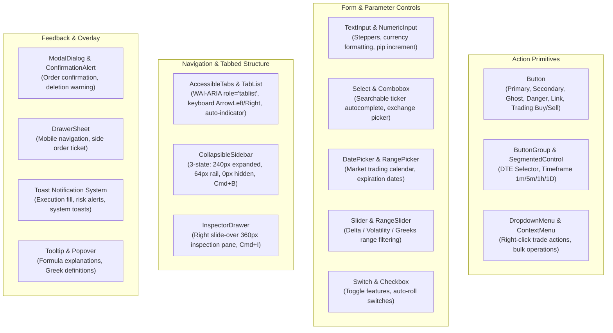

# Module 02: Accessible Headless Primitives & Core Form/Display Widgets

**Module ID**: `mod_core_component_library`  
**Parent Plan**: [`.nb/plan/master/enterprise-ui-design-system`](file:///Users/lakhwinder/RustroverProjects/nb_cicada/.nb/plan/master/enterprise-ui-design-system)  
**Status**: Specification Complete

---

## 1. Architectural Mission
This module specifies the core library of reusable UI widgets built upon accessible headless foundations (Radix UI Primitives and React Aria). These atomic and molecular widgets provide uniform behavior, complete keyboard navigation, WAI-ARIA 1.2 screen-reader compliance, and automated focus trapping.

---

## 2. Component Taxonomy



---

## 3. Specialized Financial Form Inputs

### 3.1 Numeric Stepper with Tick Sizing (`<NumericTickInput />`)
Financial markets enforce strict tick sizes (e.g., \$0.01 for equities, \$0.05/\$0.10 for options, 0.25 ticks for futures). The input widget enforces:
- Arrow up / down increments by valid `tickSize`
- Shift + arrow up / down increments by `10 * tickSize`
- Formatted with explicit currency / multiplier decorator
- Prevents invalid decimal precision on blur

```typescript
export interface NumericTickInputProps {
  value: number;
  onChange: (val: number) => void;
  tickSize: number;       // e.g. 0.05
  min?: number;
  max?: number;
  prefix?: string;         // e.g. "$"
  suffix?: string;         // e.g. "pts"
  sizeTier?: 'sm' | 'md' | 'lg';
  disabled?: boolean;
  isInvalid?: boolean;
}
```

### 3.2 Trading Calendar & Expiration Date Picker (`<OptionsExpirationPicker />`)
Standard web date pickers fail in trading applications because they do not reflect exchange trading holidays and Friday/monthly option expirations:
- Highlights active Monthly Options Expirations (3rd Friday of month in amber badge)
- Highlights Weekly Expirations (Mon/Wed/Fri in blue pill)
- Disables market holidays (NYSE, CME, Eurex calendars)
- Shows Days-to-Expiration (DTE) badge next to each selectable date

---

### 3.3 Accessible Tabbed Workspace Primitive (`<AccessibleTabs />`)

To prevent dashboard clutter and enforce the "Rule of 3", the design system provides an accessible headless tabs component based on Radix UI Tabs:
- **WAI-ARIA Semantics**: Implements `role="tablist"`, `role="tab"`, and `role="tabpanel"` with proper `aria-selected` and `aria-controls` bindings.
- **Keyboard Navigation**: `ArrowLeft` / `ArrowRight` cycles through tabs; `Home` jumps to the first tab, `End` jumps to the last tab.
- **Animated Underline Indicator**: GPU-accelerated spring animation highlights active tabs using CSS transforms (`translateX` + `scaleX`), eliminating layout shift.
- **Deep-Link URL Sync**: Automatically binds active tab state to URL query parameters (`?tab=vol-surface`) for sharable states.

```typescript
export interface AccessibleTabsProps {
  defaultValue: string;
  value?: string;
  onValueChange?: (tabId: string) => void;
  syncWithUrl?: boolean;
  urlParamName?: string;
  items: Array<{
    id: string;
    label: string;
    icon?: React.ReactNode;
    badge?: string | number;
    disabled?: boolean;
    content: React.ReactNode;
  }>;
  variant?: 'underline' | 'pill' | 'segmented';
  sizeTier?: 'sm' | 'md' | 'lg';
}
```

---

## 4. Headless Primitives & Keyboard Navigation Invariants

All interactive widgets must satisfy the **WCAG 2.2 AAA Keyboard Navigation Contract**:
1. **Focus Trap & Restoration**: Modals and drawers trap focus internally and return focus to the invoking trigger upon dismissal.
2. **Arrow Key Navigation**: Dropdowns, segmented controls, and menu items respond to `ArrowUp`, `ArrowDown`, `Home`, and `End`.
3. **Type-Ahead Search**: Comboboxes and select menus filter options in real-time as the user types, with zero keystroke lag.
4. **Accessible Labeling**: Every input possesses a linked `<label>` or `aria-label`, and error messages are associated via `aria-describedby`.

---

## 5. Implementation Deliverables
- `src/components/actions/Button.tsx`: Poly-surface button with loading spinners and buy/sell variants.
- `src/components/inputs/NumericTickInput.tsx`: Financial numeric stepper with tick-size snapping.
- `src/components/inputs/OptionsExpirationPicker.tsx`: Trading calendar with DTE badges.
- `src/components/overlays/ModalDialog.tsx`: Radix UI Dialog wrapper with accessible focus trap.
- `src/components/feedback/ToastProvider.tsx`: High-performance toast manager for trade fill broadcasts.
