# Module 03: Complex Data Grids, Rule Builders, Diff Viewers & Settings Controls

**Module ID**: `mod_complex_data_and_governance_widgets`  
**Parent Plan**: [`.nb/plan/master/enterprise-ui-design-system`](file:///Users/lakhwinder/PycharmProjects/nb_fairyfly/.nb/plan/master/enterprise-ui-design-system)  
**Status**: Specification Complete (Terminology Agnostic)

---

## 1. Architectural Mission
Enterprise applications require advanced UI controls that handle dense tabular data, complex condition logic, side-by-side configuration diffs, and high-frequency real-time telemetry updates while maintaining strict visual elegance, accessibility, and responsiveness.

This module provides an **industrial suite of compound look-and-feel components** designed for high-density, data-intensive workflows:
- **Public & Product Portals**: Interactive product showcases, performance comparison matrices, and capability catalogs.
- **Admin & Governance Consoles**: System policy configurators, role-based rule builders, and configuration change diff viewers.
- **Operations & Analytics Workspaces**: Live system telemetry grids, process monitors, and full-width multi-pane views.

---

## 2. Widget Architecture & Compound Primitives

```mermaid
graph TD
  subgraph DataGridSuite["1. High-Performance Virtualized Data Grid"]
    VirtualScroll["Virtual Scroll Windowing<br/>(100,000+ rows, 60 FPS viewport rendering)"]
    CellFlash["Value Change Cell Flashing<br/>(Green on increase, Red on decrease, GPU accelerated)"]
    ColumnPinning["Pinned Columns & Sorting<br/>(Lock ID, Name, Status, Metrics)"]
    VirtualScroll --> CellFlash --> ColumnPinning
  end

  subgraph ConditionSuite["2. Hierarchical Rule Builder"]
    ConditionRow["Condition Row Controller<br/>(Field, Operator, Threshold Value)"]
    LogicalBranch["Logical Operator Grouping<br/>(Nested AND / OR branching trees)"]
    ValidationPill["Real-Time Validation Badge<br/>(Syntactic & logical error indicators)"]
    ConditionRow --> LogicalBranch --> ValidationPill
  end

  subgraph DiffGovernance["3. Configuration Diff & Dual-Control"]
    SideBySide["Side-by-Side Diff Viewer<br/>(Added, modified, deleted lines)"]
    ApprovalSigner["Dual-Control Approval Signer<br/>(Cryptographic verification, Passkey/FIDO2)"]
    AuditBadge["Sealed Status Badges<br/>(Immutable approval timestamping)"]
    SideBySide --> ApprovalSigner --> AuditBadge
  end

  subgraph EditorSuite["4. Code & Configuration Editor"]
    MonacoEditor["Monaco Config Editor<br/>(JSON/YAML schema validation, line linting)"]
  end
```

---

## 3. Deep Specification of Core Components

### 3.1 High-Performance Virtualized Data Grid (`<VirtualizedDataGrid />`)
A compound table component supporting tens of thousands of rows with buttery 60 FPS rendering:
- **Windowed Virtualization**: Only rows currently within the scroll viewport (plus a small overscan buffer) are mounted to the DOM via TanStack Virtual or CSS virtual scrolling.
- **Tabular Numeric Alignment**: All numeric cells enforce monospaced figures (`font-variant-numeric: tabular-nums`) to prevent horizontal layout shift during dynamic updates.
- **Cell Change Flashing**: When a cell value changes, a GPU-accelerated CSS animation (`@keyframes flashUp` or `@keyframes flashDown`) highlights the change with a gentle fade, debounced to prevent optical fatigue.
- **Sticky Headers & Pinned Columns**: Headers stick to top during vertical scroll; identifier columns pin to left during horizontal scroll with subtle drop shadows.

### 3.2 Hierarchical Boolean Rule Builder (`<HierarchicalRuleBuilder />`)
A recursive visual component for constructing nested logical filter expressions:
- **Logical Groups**: Supports nested groups of conditions combined via `AND` or `OR` toggles.
- **Dynamic Condition Rows**: Field selector, comparison operator (`EQUALS`, `GREATER_THAN`, `CONTAINS`, `REGEX_MATCH`), value input, and remove button.
- **Depth Limiting & Visual Indentation**: Enforces max nesting depth ($d \le 4$) with distinct color-coded left indentation borders for readability.

### 3.3 Configuration Diff Viewer & Dual-Control Signer (`<DualControlDiffSigner />`)
A governance look-and-feel component for critical configuration approvals:
- **Side-by-Side or Unified Diff**: Green backgrounds (`rgba(16, 185, 129, 0.08)`) for added lines, red backgrounds (`rgba(244, 63, 94, 0.08)`) for deleted lines.
- **Dual-Control Status Badge**: Distinct visual state indicating whether a second officer's signature is required, pending, or verified.
- **Cryptographic Signature Action**: Visual Passkey/WebAuthn confirmation button that seals the approval and activates downstream action buttons.

### 3.4 Monaco Schema & Config Editor (`<MonacoConfigEditor />`)
Embedded lightweight code and schema editor with live linting, collapsible folding regions, and theme integration matching Corporate Light, Enterprise Dark, and Pro OLED themes.
