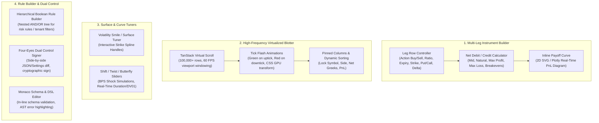
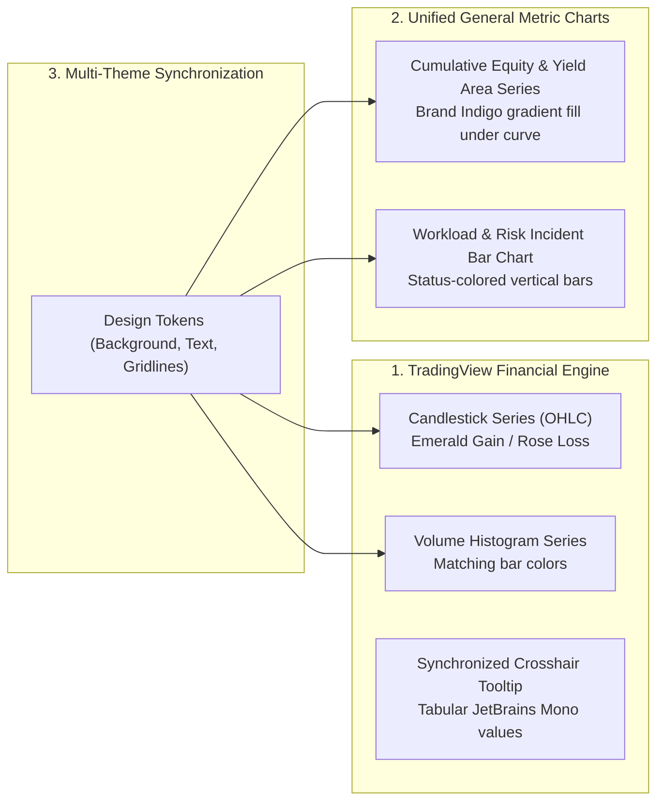

# Module 03: Complex Trading Settings, Multi-Leg Builders & High-Density Grids

**Module ID**: `mod_complex_trading_widgets`  
**Parent Plan**: [`.nb/plan/master/enterprise-ui-design-system`](file:///Users/lakhwinder/RustroverProjects/nb_cicada/.nb/plan/master/enterprise-ui-design-system)  
**Status**: Specification Complete

---

## 1. Architectural Mission
Trading applications for complex instruments (multi-leg options, interest rate swaps, structured notes, collateralized baskets) require advanced UI controls that handle non-linear parameters, mathematical invariants, and high-frequency real-time updates.

This module provides an **industrial suite of compound widgets** designed to handle these intricate trading workflows while remaining aesthetic, accessible, and lightweight enough to be embedded seamlessly into:
- **Corporate Portals**: As interactive product demos, pricing simulators, and structured product calculators.
- **Admin Portals**: As risk policy configurators, fee schedule matrix editors, and compliance rule builders.
- **Pro Trading Platforms**: As live order execution tickets, risk blotters, and volatility surface tuners.

---

## 2. Widget Architecture & Compound Primitives



---

## 3. Deep Specification of Core Complex Widgets

### 3.1 Multi-Leg Instrument Builder (`<MultiLegStrategyBuilder />`)
A compound widget supporting up to 8 legs with real-time validation:
- **Dynamic Leg Addition**: Preset strategy buttons (Iron Condor, Jade Lizard, Broken Wing Butterfly, Calendar Spread) instantly populate legs.
- **Ratio & Action Toggles**: Visual pill selectors for `BUY` (Emerald green) and `SELL` (Rose red) with integer ratio stepper (`1x`, `2x`, `3x`).
- **Strike & DTE Linkage**: Auto-checks strike order invariants ($K_1 < K_2 < K_3 < K_4$) and alerts if crossed wings occur.
- **Net Spread Pricing Bar**: Displays Net Credit or Net Debit, Max Profit, Max Loss, Margin Requirement, and Probability of Profit (PoP).
- **Inline SVG Payoff Preview**: Real-time 2D mini-payoff chart showing current spot price anchor, breakeven dots, and max risk zones.

```typescript
export interface InstrumentLeg {
  id: string;
  action: 'BUY' | 'SELL';
  ratio: number;
  instrumentType: 'CALL' | 'PUT' | 'STOCK' | 'FUTURE';
  expiration: string; // ISO Date
  strike: number;
  bid: number;
  ask: number;
  impliedVol: number;
  delta: number;
}

export interface MultiLegStrategyBuilderProps {
  symbol: string;
  underlyingPrice: number;
  legs: InstrumentLeg[];
  onChange: (updatedLegs: InstrumentLeg[]) => void;
  onSubmitOrder?: (legs: InstrumentLeg[], limitPrice: number) => void;
  readOnly?: boolean;
}
```

---

### 3.2 High-Frequency Virtualized Blotter (`<VirtualizedBlotterGrid />`)
Blotters handling live tick data often crash browser DOM renderers if thousands of updates occur concurrently. The `<VirtualizedBlotterGrid />` solves this via:
- **Viewport Virtualization**: Only the 30–50 rows visible in the viewport are rendered in the DOM (`@tanstack/react-virtual`).
- **GPU-Accelerated Cell Flashing**: When a price or PnL cell updates, an ephemeral CSS class applies an opacity flash using CSS transforms without triggering browser layout re-computations.
- **Hierarchical Grouping**: Group positions by Symbol $\to$ Strategy $\to$ Individual Legs, with expandable accordion rows.
- **Custom Column Manager**: Drag-and-drop column reordering, width resizing, pinning left/right, and quick CSV/Excel export.

---

### 3.3 Hierarchical Boolean Rule & Risk Filter Builder (`<HierarchicalRuleBuilder />`)
Used in Admin Portals for tenant access rules, and in Trading Portals for custom risk alert criteria (e.g. `IF (Net Delta > 0.35 AND DaysToExpiration < 14) OR (DrawdownPercent < -25% AND ImpliedVolRank > 80)`):
- **Nested Grouping**: Supports infinite recursive grouping (`AND` / `OR` group nodes).
- **Type-Safe Operand Inputs**: Field selector dropdown determines the operator list (`>`, `<`, `==`, `between`, `in`) and the corresponding value input type (numeric, date, multiselect).
- **Live Validation & AST Export**: Emits a clean JSON Abstract Syntax Tree (AST) ready for server-side evaluation by policy engines (OpenFGA, OPA/Rego, or Python Zen Guard).

```json
{
  "combinator": "AND",
  "rules": [
    { "field": "net_delta", "operator": "greater_than", "value": 0.35 },
    {
      "combinator": "OR",
      "rules": [
        { "field": "dte", "operator": "less_than", "value": 14 },
        { "field": "drawdown_percent", "operator": "less_than", "value": -25.0 }
      ]
    }
  ]
}
```

---

### 3.4 Four-Eyes Dual Control Signer Widget (`<FourEyesApprovalWidget />`)
Enforces the institutional governance requirement where sensitive operations (large trade blocks, tenant risk limits, API secret revocations) require secondary sign-off:
- **Side-by-Side Diff Viewer**: Visually highlights added, modified, and deleted parameters using green/red semantic highlights.
- **Risk Assessment Banner**: Categorizes mutation severity (Low, Medium, Critical) based on potential monetary impact.
- **Cryptographic Approval Signature**: Integrates WebAuthn Passkey or MFA TOTP prompt directly in the modal to cryptographically bind the approver's identity.
- **TTL Countdown Bar**: Visual countdown timer indicating time remaining before the approval request expires.

---

### 3.5 Monaco DSL & Invariant Editor (`<MonacoSettingsEditor />`)
For technical administrators and quantitative researchers:
- Embedded Monaco Editor configured with custom JSON Schema / Python / Rego language services.
- Live syntax error markers and squiggly underlines for mathematical invariant breaches.
- Minimap, diff mode, and automatic code formatting (`prettier` / `ruff` integration).

---


### 3.6 Financial & Metric Charting Architecture (TradingView & Unified Charts)

Financial applications demand institutional-grade interactive charting that strictly adheres to the enterprise design tokens. This subsystem standardizes three primary chart topologies:



#### 1. TradingView Financial Candlestick & Volume Chart (`<TradingViewFinancialChart />`)
- **Technology**: TradingView Lightweight Charts™ (`lightweight-charts`).
- **Series Coupling**: Synchronized dual-pane layout with primary Candlestick series (top 75%) and Volume Histogram series (bottom 25%).
- **Timeframe Scaling**: Built-in pill selector for `1m`, `5m`, `15m`, `1h`, `1D`, `1W`.
- **Dynamic Series Type**: Seamlessly switches between `Candlesticks`, `Line`, and `Area` without losing viewport pan/zoom state.
- **Real-Time WebSocket Updates**: Directly receives price ticks from `MarketDataTickThrottler` to mutate the current in-flight candle (`open`, `high`, `low`, `close`, `volume`) at 60 FPS.

#### 2. Cumulative Return & Equity Line/Area Chart (`<PerformanceAreaChart />`)
- Used on the **Corporate Portal** and **Investor Dashboards** to display historical strategy returns, Sharpe ratios, and benchmark comparisons (e.g. Alpha vs. S&P 500).
- Smooth cubic bezier interpolation with subtle gradient area fill (`rgba(79, 70, 229, 0.2)` to `transparent`).
- Zero layout shift during responsive resizing via `ResizeObserver`.

#### 3. Operational Throughput & Risk Incident Bar Chart (`<WorkloadBarChart />`)
- Used on the **Admin Portal** to display API request volume, authorization rate, and risk interventions by hour.
- Employs the identical axis line styles (`var(--border-subtle)`), font tokens (`var(--font-mono)`), and tooltip crosshairs as the TradingView charts, ensuring absolute visual continuity across the platform.

## 4. Implementation Deliverables
- `src/components/trading/MultiLegStrategyBuilder.tsx`
- `src/components/trading/VirtualizedBlotterGrid.tsx`
- `src/components/trading/VolSurfaceTuner.tsx`
- `src/components/admin/HierarchicalRuleBuilder.tsx`
- `src/components/admin/FourEyesApprovalWidget.tsx`
- `src/components/admin/MonacoSettingsEditor.tsx`
- `src/components/charts/TradingViewFinancialChart.tsx`
- `src/components/charts/PerformanceAreaChart.tsx`
- `src/components/charts/WorkloadBarChart.tsx`
