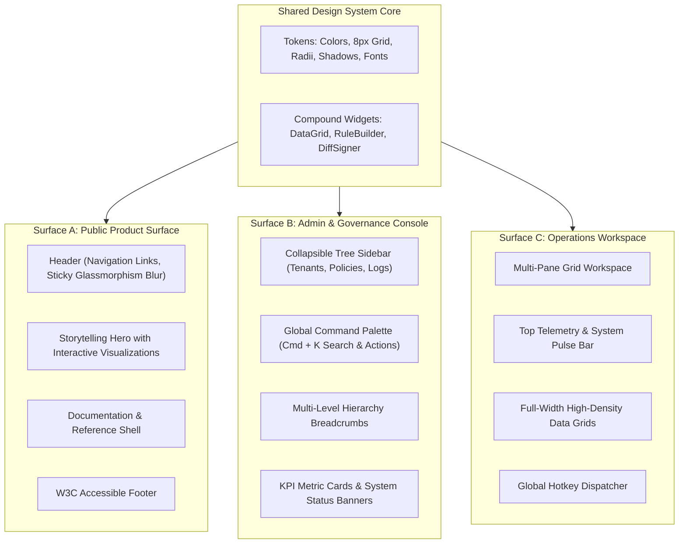

# Module 04: Public Product Surface, Admin Governance Console & Operations Workspace Layouts

**Module ID**: `mod_surface_specialization`  
**Parent Plan**: [`.nb/plan/master/enterprise-ui-design-system`](file:///Users/lakhwinder/PycharmProjects/nb_fairyfly/.nb/plan/master/enterprise-ui-design-system)  
**Status**: Specification Complete (Terminology Agnostic)

---

## 1. Architectural Mission
An enterprise application suite incorporates three distinct classes of user surfaces:
1. **The Public Product Surface**: Clean marketing presentation, product capabilities, developer documentation, pricing tiers, and client authentication.
2. **The Enterprise Admin & Governance Console**: Internal operations, multi-tenant hierarchy, RBAC permission trees, security logs, and compliance auditing.
3. **The Analytics & Operations Workspace**: Dense workspace for operational telemetry, process monitoring, high-density data tables, and real-time state visualization.

This module specifies the **Surface Specialization Engine**. It allows all three applications to share 100% of the underlying design tokens, atomic components, and complex widgets, while providing tailored layout templates and density presets appropriate for each surface's user persona.

---

## 2. Multi-Surface Topology & Layout Matrix

---

## 3. Surface Specifications & Density Profiles

| Architectural Trait | 🌐 Public Product Surface | 🛡️ Admin & Governance Console | 📊 Analytics & Operations Workspace |
| :--- | :--- | :--- | :--- |
| **Primary Audience** | Prospective clients, developers, public users | IT Admins, Compliance Officers, SecOps | System Operators, Data Analysts, Engineers |
| **Information Density** | **Relaxed / Spacious** (Base unit: 16px/24px) | **Balanced / Standard** (Base unit: 8px/12px) | **Compact / Dense** (Base unit: 4px/8px) |
| **Rendering Strategy** | SSR / Static Pre-rendering with SEO Optimization | Client-Side SPA with Hydrated Session State | High-Performance SPA with WebWorker Offloading |
| **Default Color Theme** | Corporate Light (Clean White `#FFFFFF`) | Enterprise Slate Dark | High-Contrast OLED True Black (`#000000`) |
| **Navigation Shell** | Top Navigation + Sticky Blur Header | Collapsible Tree Sidebar + Breadcrumbs | Minimal Icon Rail + Top Telemetry Bar |
| **Search Mechanism** | Public Full-Text Search / Documentation Filter | Quick-Action Command Palette (`Cmd + K`) | Quick Entity / Process Search (`/` or `Ctrl+F`) |

---

## 4. Decluttering Architecture: Contextual Co-Location vs. Tabbed Disassociation ("The Rule of 3")

Traditional enterprise dashboards frequently suffer from "dashboard sprawl" — cramming dozens of disconnected cards, charts, and monitors into a single chaotic viewport. This creates severe cognitive fatigue and slow rendering.

The **UI Layout Standard** enforces the **Rule of 3**:
1. **Contextual Co-Location (Primary Viewport)**: A single view may display at most **2 to 3 tightly correlated, functionally interdependent panes** simultaneously (e.g. *Primary Telemetry Chart + Immediate Action Panel*).
2. **Tabbed Disassociation (Secondary Tools)**: All disassociated, secondary, or situational tools (Audit Logs, Rule Editors, Historical Reports) **MUST NOT** be stacked vertically on the same screen. Instead, they are organized into semantic **Contextual Tabs** (`<ContextTabbedWorkspace />`).
3. **State Preservation Invariant**: Inactive tab panels maintain their DOM states using HTML `hidden` attributes (`display: none`) rather than unmounting components. This ensures instant switching with **zero recalculation lag**, preserving canvas textures and form inputs.

---

## 5. Collapsible Chrome Shell Architecture (`<CollapsibleChromeShell />`)

To maximize visible screen real estate, all chrome elements support dynamic show/hide and minimization:

1. **3-State Collapsible Navigation Sidebar (`<CollapsibleSidebar />`)**:
   - **Expanded Mode (`240px`)**: Full hierarchy tree with labels, section badges, and nested items.
   - **Icon-Only Rail (`64px`)**: Tooltip-driven compact rail preserving horizontal space while maintaining 1-click navigation.
   - **Hidden Mode (`0px`)**: Completely slides off-screen, allocating 100% of the horizontal viewport to data grids.
   - **Keyboard Shortcut**: `Cmd + B` / `Ctrl + B` cycles through states; state persists in `localStorage`.

2. **Contextual Fly-In Inspector Drawer (`<ContextInspectorDrawer />`)**:
   - A slide-over panel (`360px`–`420px`) anchored to the right viewport edge.
   - Used exclusively for deep parameter inspection (e.g. Detailed Logs, Telemetry Breakdown, Audit Trail Details).
   - Closes automatically on `Escape` or backdrop click; toggled via `Cmd + I`.

3. **Zen Focus Mode (`<ZenFocusModeToggle />`)**:
   - Toggled via `Cmd + Shift + F` or top-bar expand icon.
   - Simultaneously collapses the global navigation header and sidebar, giving 100% of display height to the active workspace.

---

## 6. Fluid Responsive Architecture (Zero Device Simulator Frames)

All surfaces comply with **Fluid Responsive Standards (WCAG 2.5.5)**:
1. **Full-Width Fluid Containers**:
   - Replaces artificial fixed max-width constraints with fluid containers (`width: 100%`, responsive padding `var(--space-2)` to `var(--space-6)`).
   - Data grids expand to fill 100% of available viewport real estate without artificial device simulator frames.
2. **Mobile Ergonomics & Touch Compliance**:
   - **Target Size (WCAG 2.5.5)**: Interactive controls provide a minimum touch target height of $44\text{px}$ (`--touch-target-min: 44px`).
   - **Mobile Bottom Navigation Bar (`<MobileBottomNav />`)**: Fixed 60px bottom toolbar on mobile viewports for clean one-thumb navigation.
   - **Mobile Slide-Over Drawer (`<MobileDrawer />`)**: Touch slide-over navigation containing surface switcher, theme toggles, and shortcut links.
   - **Horizontally Scrollable Sticky Grid**: Data tables on mobile preserve the primary identifier column frozen on the left (`position: sticky; left: 0`) while allowing smooth horizontal scrolling across secondary metrics.
