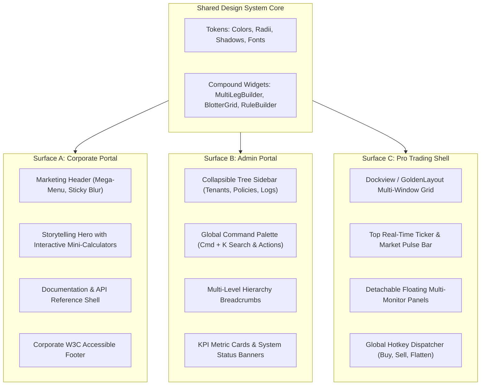
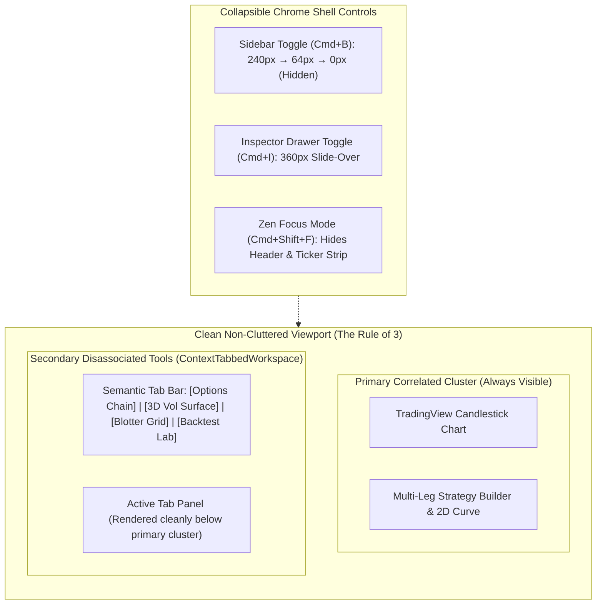

# Module 04: Corporate Portal, Admin Portal & Pro Trading Dockable Layouts

**Module ID**: `mod_surface_specialization`  
**Parent Plan**: [`.nb/plan/master/enterprise-ui-design-system`](file:///Users/lakhwinder/RustroverProjects/nb_cicada/.nb/plan/master/enterprise-ui-design-system)  
**Status**: Specification Complete

---

## 1. Architectural Mission
A single organization often builds three distinct classes of web surfaces:
1. **The Internet-Facing Corporate Portal**: Public-facing, highly polished marketing, product capabilities, developer documentation, pricing tiers, and client login.
2. **The Enterprise Admin & Governance Portal**: Internal operations, multi-tenant hierarchy, RBAC/ReBAC permission trees, security logs, and compliance auditing.
3. **The Professional Trading & Analytics Platform**: Intensive workspace for traders and quants, requiring multi-panel layouts, dockable tool windows, and dense real-time market data.

This module specifies the **Surface Specialization Engine**. It allows all three applications to share 100% of the underlying design tokens, atomic components, and complex widgets, while providing tailored layout templates and density presets appropriate for each surface's user persona.

---

## 2. Multi-Surface Topology & Layout Matrix

---

## 3. Surface Specifications & Density Profiles

| Architectural Trait | 🌐 Internet Corporate Portal | 🛡️ Enterprise Admin Portal | 📈 Pro Trading Application |
| :--- | :--- | :--- | :--- |
| **Primary Audience** | Prospective clients, investors, public quants | IT Admins, Compliance Officers, Risk Managers | Portfolio Managers, Options & Equity Traders |
| **Information Density** | **Relaxed / Spacious** (Base unit: 16px/24px) | **Balanced / Standard** (Base unit: 8px/12px) | **Compact / Ultra-Dense** (Base unit: 4px/8px) |
| **Rendering Strategy** | Next.js App Router SSR / SSG (Optimized for SEO) | Client-Side SPA with Hydrated Session State | High-Performance SPA with WebWorker Offloading |
| **Default Color Theme** | Corporate Light or Clean Navy Dark | Enterprise Slate Dark | Pro OLED True Black (`#000000`) |
| **Navigation Shell** | Top Mega-Menu + Sticky Glassmorphism Header | Collapsible Tree Sidebar + Breadcrumbs | Minimal Icon Rail + Top Ticker Ribbon |
| **Search Mechanism** | Public Full-Text Search / Algolia DocSearch | Quick-Action Command Palette (`Cmd + K`) | Quick Ticker & Order Ticket Search (`/` or `Ctrl+F`) |
| **Multi-Window Behavior** | Single standard browser window | Standard window with tabbed sub-views | Multi-pane grid with detachable popup windows |

---

## 4. Pro Trading Multi-Pane Docking Engine (`<DockableTradingWorkspace />`)

Professional traders customize their screen configurations extensively (e.g. 4-quadrant layout: Chart top-left, Order Book top-right, Strategy Builder bottom-left, Blotter bottom-right).

This layout engine integrates **Dockview**:
- **Draggable & Dockable Panes**: Users can drag panel tabs to dock them top, bottom, left, right, or as tabbed stacks.
- **Detachable Floating Windows**: A single click detaches a blotter or chart panel into a native standalone browser popup window, automatically synchronizing state across windows via the browser `BroadcastChannel` API.
- **Saved Workspace Presets**: Serializes pane layouts to `localStorage` or backend database:
  - Preset 1: *Options Strategy Lab* (Builder + 3D Payoff + Greek Matrix)
  - Preset 2: *Execution Execution Blotter* (Full-screen virtualized blotter + Order ticket)
  - Preset 3: *Risk Governance* (Zen Guard warnings + Margin breakdown)

---

## 4.2 Decluttering Architecture: Contextual Co-Location vs. Tabbed Disassociation ("The Rule of 3")

Traditional enterprise trading dashboards frequently suffer from "dashboard sprawl" — cramming dozens of disconnected cards, charts, risk panes, order tickets, and blotters into a single chaotic viewport. This creates severe cognitive fatigue, slow WebGL rendering, and cramped touch ergonomics.

The **Percipience UI Layout Standard** enforces the **Rule of 3**:
1. **Contextual Co-Location (Primary Viewport)**: A single view may display at most **2 to 3 tightly correlated, functionally interdependent panes** simultaneously (e.g. *TradingView Chart + Active Order Ticket + Immediate Payoff Curve*).
2. **Tabbed Disassociation (Secondary Tools)**: All disassociated, secondary, or situational tools (Options Chains, Volatility Surfaces, Historical Backtests, Margin Summaries, Zen Guard Rule Editors, Audit Logs) **MUST NOT** be stacked on the same page. Instead, they are organized into semantic **Contextual Tabs** (`<ContextTabbedWorkspace />`).
3. **State Preservation Invariant**: Inactive tab panels maintain their DOM and WebGL states using HTML `hidden` attributes (`display: none`) rather than unmounting components. This ensures instant switching with **zero recalculation lag**, preserving canvas textures, zoom levels, and draft order inputs.

---

## 4.3 Collapsible Chrome Shell Architecture (`<CollapsibleChromeShell />`)

To maximize visible canvas area on demanding quantitative trading desks, all chrome elements support dynamic show/hide and minimization:

1. **3-State Collapsible Navigation Sidebar (`<CollapsibleSidebar />`)**:
   - **Expanded Mode (`240px`)**: Full hierarchy tree with labels, section badges, and nested items.
   - **Icon-Only Rail (`64px`)**: Tooltip-driven compact rail preserving vertical screen space while maintaining 1-click navigation.
   - **Hidden Mode (`0px`)**: Completely slides off-screen, allocating 100% of the horizontal viewport to financial charts.
   - **Keyboard Shortcut**: `Cmd + B` / `Ctrl + B` cycles through states; state persists in `localStorage`.

2. **Contextual Fly-In Inspector Drawer (`<ContextInspectorDrawer />`)**:
   - A slide-over panel (`360px`–`420px`) anchored to the right viewport edge.
   - Used exclusively for deep parameter inspection (e.g. Contract Greeks Sensitivity Breakdown, Order Execution Diagnostics, Audit Trail Details).
   - Closes automatically on `Escape` or backdrop click; toggled via `Cmd + I` or inline inspector triggers.

3. **Zen Focus Mode (`<ZenFocusModeToggle />`)**:
   - Toggled via `Cmd + Shift + F` or top-bar expand icon.
   - Simultaneously collapses the global navigation header, top ticker ribbon, and sidebar, giving 100% of display height to the active chart and strategy builder.

4. **Pane Windowing Controls (Minimize, Maximize & Popout)**:
   Every card/pane header incorporates institutional window controls:
   - **Minimize (`_`)**: Collapses pane into a compact 40px accordion strip.
   - **Maximize / Fullscreen (`⛶`)**: Expands pane to 100% width and height of the active tab panel.
   - **Pop Out (`⇲`)**: Detaches pane into an independent browser popup window, synchronized via `BroadcastChannel`.

---

## 5. Universal Command Palette (`<UniversalCommandPalette />`)

A shared `Cmd + K` (or `Ctrl + K`) shortcut provides instant navigation across all surfaces:
- In the Corporate Portal: Quick search for documentation articles, API endpoints, whitepapers.
- In the Admin Portal: Direct navigation to specific tenants, user accounts, audit log IDs, and system toggles.
- In the Pro Trading Shell: Instant ticker lookups, strategy loading, emergency "Flatten All Positions" triggers.

---

### 5.2 Agent Swarm Operations & Orchestration View (`<AgentSwarmKanbanWidget />`)

To provide real-time operational governance over autonomous coding swarms, the Admin Portal integrates directly with **Docker-Agents (`cagent`)** via `docker-agent serve`:
- **Kanban Pipeline Display**: Visualizes agent task progression (`Dev` $\to$ `Review` $\to$ `Push` $\to$ `Done`) using standardized 8px card components and status badges.
- **Live ReAct Stream**: Streams agent reasoning thoughts (`toolset: think`), terminal outputs, and AST diffs via WebSockets.
- **Four-Eyes Agent Approval Gate**: Intercepts PR promotions from `Review` to `Push`, requiring human-in-the-loop cryptographic approval via `<FourEyesApprovalWidget />`.

### 5.3 Full-Width Architecture & Mobile Compliance Standards (WCAG 2.5.5)

To ensure seamless operation on both ultra-wide multi-monitor trading desks (3840px 4K) and mobile handheld smartphones (390px iOS/Android), all surfaces comply with the **Percipience Responsive & Mobile Design Standard**:

1. **Full-Width Fluid Containers**:
   - Replaces artificial fixed max-width constraints with `.container-fluid` (`width: 100%`, responsive padding `var(--space-3)` to `var(--space-6)`).
   - Blotter grids and dockable multi-window layouts expand to fill 100% of available viewport real estate, maximizing visible financial information density.

2. **Mobile Compliance & Touch Ergonomics**:
   - **Target Size (WCAG 2.5.5 / Apple HIG)**: All interactive buttons, order triggers, and form inputs provide a minimum touch target height of $44\text{px}$ (`--touch-target-min: 44px`, `.btn-touch`).
   - **Mobile Bottom Navigation Bar (`<MobileBottomNav />`)**: Fixed 60px bottom toolbar on mobile viewports for one-thumb navigation across Corporate, Admin, and Trading surfaces.
   - **Mobile Slide-Over Drawer (`<MobileDrawer />`)**: Touch-gesture slide-over navigation containing tenant switches, theme toggles, and shortcut links.
   - **Horizontally Scrollable Sticky Blotter**: High-frequency blotters on mobile preserve the `Symbol` column frozen on the left (`position: sticky; left: 0`) while allowing smooth momentum touch scrolling across Greeks, PnL, and actions.

## 6. Implementation Deliverables
- `src/layouts/CorporatePortalLayout.tsx`: Marketing header, mega-menu, responsive container.
- `src/layouts/AdminPortalLayout.tsx`: Collapsible navigation sidebar, header breadcrumbs, command palette.
- `src/layouts/DockableTradingLayout.tsx`: Dockview workspace container with layout serialization.
- `src/components/navigation/UniversalCommandPalette.tsx`: CMDK-powered global search modal.
- `src/components/admin/AgentSwarmKanbanWidget.tsx`: Docker-Agents live orchestration interface.
- `src/components/navigation/MobileBottomNav.tsx`: Touch-optimized bottom navigation bar.
- `src/components/navigation/MobileDrawer.tsx`: Slide-over mobile drawer menu.
