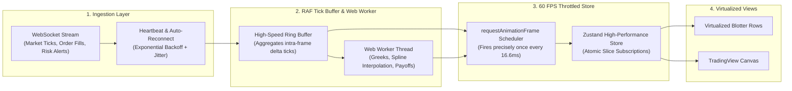

# Module 05: High-Frequency WebSocket Streaming, 60 FPS Virtualization & State

**Module ID**: `mod_realtime_data_and_state`  
**Parent Plan**: [`.nb/plan/master/enterprise-ui-design-system`](file:///Users/lakhwinder/RustroverProjects/nb_cicada/.nb/plan/master/enterprise-ui-design-system)  
**Status**: Specification Complete

---

## 1. Architectural Mission
Financial trading and analytics portals collapse under heavy data load if high-frequency WebSocket ticks trigger standard React component re-renders. A sudden market volatility spike can deliver 5,000+ price ticks per second across an active options chain.

This module specifies the **Real-Time Data Pipeline & State Management Architecture**. It guarantees that the UI maintains silky smooth **60 frames per second (FPS)** rendering without freezing the user interface, dropping keystrokes, or desynchronizing multi-leg spread calculations.

---

## 2. Real-Time Data Pipeline Architecture



---

## 3. High-Frequency Tick Throttling Engine

To decouple WebSocket network ingestion from browser DOM repaints, the client uses a **requestAnimationFrame (RAF) Throttler**:

```typescript
class MarketDataTickThrottler {
  private tickQueue: Map<string, MarketTick> = new Map();
  private isRafScheduled: boolean = false;
  private subscribers: Set<(batch: Map<string, MarketTick>) => void> = new Set();

  public pushTick(symbol: string, tick: MarketTick): void {
    // Overwrite the symbol key so only latest price is processed per frame
    this.tickQueue.set(symbol, tick);

    if (!this.isRafScheduled) {
      this.isRafScheduled = true;
      requestAnimationFrame(() => this.flushFrame());
    }
  }

  private flushFrame(): void {
    this.isRafScheduled = false;
    if (this.tickQueue.size === 0) return;

    const frameBatch = new Map(this.tickQueue);
    this.tickQueue.clear();

    // Broadcast consolidated batch to Zustand store
    for (const sub of this.subscribers) {
      sub(frameBatch);
    }
  }

  public subscribe(callback: (batch: Map<string, MarketTick>) => void): () => void {
    this.subscribers.add(callback);
    return () => this.subscribers.delete(callback);
  }
}
```

---

## 4. Offloading Heavy Math to Dedicated Web Workers

Calculating real-time Greeks ($\Delta, \Gamma, \Theta, \mathcal{V}, \rho$), continuous yield curve cubic splines, and 3D volatility surface meshes on the main browser thread causes noticeable micro-stutters and input lag.

The design system delegates all computational algorithms to `math_worker.ts`:
- **Input**: Raw price ticks + option chain metadata.
- **Worker Execution**: Vectorized Black-Scholes-Merton calculations and Newton-Raphson / Brent IV root finding executed in a background WebAssembly (WASM) or WebWorker thread.
- **Output**: Pre-computed Greek deltas and 3D surface vertices transferred via `ArrayBuffer` structured clone transfers with **zero main-thread memory copies**.

---

## 5. Multi-Window Cross-Tab State Synchronization

When traders detach blotters or charts into secondary monitors, the state must stay in lockstep without requiring separate WebSocket connections:
- A single master window maintains the primary WebSocket connection.
- Secondary windows communicate with the master via the browser **`BroadcastChannel('trade_portal_bus')`**.
- Order placement from an external pop-out ticket instantly updates the blotter in the main window within $< 1\text{ms}$.

---

## 6. Implementation Deliverables
- `src/realtime/WebSocketManager.ts`: Resilient streaming client with auto-reconnect and channel multiplexing.
- `src/realtime/MarketDataTickThrottler.ts`: RAF-based 60 FPS batching engine.
- `src/realtime/workers/math_worker.ts`: WebWorker for offloaded financial calculations.
- `src/realtime/BroadcastSync.ts`: Multi-window cross-tab state synchronization bus.
