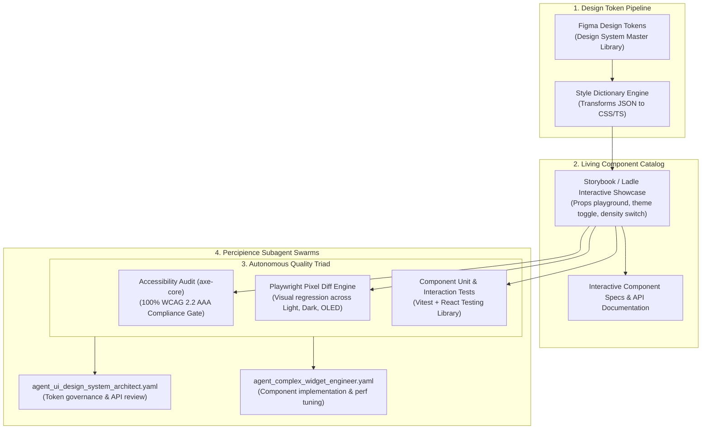

# Module 06: Storybook Showcase, Visual Regression CI/CD & Percipience Swarms

**Module ID**: `mod_governance_and_showcase`  
**Parent Plan**: [`.nb/plan/master/enterprise-ui-design-system`](file:///Users/lakhwinder/RustroverProjects/nb_cicada/.nb/plan/master/enterprise-ui-design-system)  
**Status**: Specification Complete

---

## 1. Architectural Mission
An enterprise design system is only as effective as its governance, documentation, and verification rigor. Without automated visual and functional testing, cross-team implementations quickly drift into inconsistent styling, broken focus states, and performance regressions.

This module establishes the **Living Component Showcase, Automated Testing Pipeline, and Percipience Specialist Agent Governance** to ensure continuous quality and painless cross-project adoption.

---

## 2. Automated Quality & Governance Pipeline

---

## 3. Visual Regression & Accessibility Test Gates

### 3.1 Playwright Visual Regression Testing
Every pull request automatically captures baseline snapshots across 3 viewports and 4 theme variants:
- **Viewports**: Mobile (`390x844`), Desktop Default (`1440x900`), Pro Multi-Monitor Ultra-Wide (`2560x1440`).
- **Themes**: Corporate Light, Enterprise Dark, Pro Trading OLED.
- **Max Pixel Drift Threshold**: Strict tolerance $\Delta E < 0.2\%$. Any unexpected visual shift blocks PR merge via `wf_pr_gatekeeper.yaml`.

### 3.2 Automated WCAG 2.2 AAA Accessibility Gate
Every component story is audited via `@axe-core/playwright`:
- Zero critical or serious accessibility violations permitted.
- Enforces color contrast ratios: $\ge 4.5:1$ for normal text, $\ge 7.0:1$ for High-Contrast mode.
- Validates focus rings (`outline: 2px solid var(--focus-ring)` with 2px offset).

---

## 4. Co-Located Percipience Specialist Subagents

### 4.1 UI Design System Architect (`agent_ui_design_system_architect.yaml`)
- **Role**: Tier A Cognitive Specialist
- **System Prompt Mandate**: Enforces semantic design token hygiene, evaluates component API ergonomics, verifies headless accessibility primitives, and prevents styling drift across corporate and trading surfaces.
- **Tool Access**: Read-only workspace inspection, AST token linter, design system validator.

### 4.2 Complex Trading Widget Engineer (`agent_complex_widget_engineer.yaml`)
- **Role**: Tier B Rapid Implementation Specialist
- **System Prompt Mandate**: Synthesizes and optimizes compound widgets (`MultiLegStrategyBuilder`, `VirtualizedBlotterGrid`, `VolSurfaceTuner`), profiles 60 FPS RAF rendering pipelines, and implements WebWorker math offloading.
- **Tool Access**: Sandboxed Git worktree write tools, Vitest / Playwright test runners.

---

## 5. Merkle Context Ledger Integration

All design token releases and component library versions are sealed into the **Percipience Merkle State Ledger** (`.nb/context/ledger/context_ledger.yaml`) under recovery point **`RP_DESIGN_SYSTEM_GENESIS`**:
- Cryptographically signs token hash values and component story snapshots.
- Supports instant rollback if a theme regression impacts downstream trading blotters or corporate portals.

---

## 6. Implementation Deliverables
- `.storybook/`: Storybook 8 configuration with Tailwind v4 and theme switcher addon.
- `tests/visual/playwright.config.ts`: Visual regression configuration across viewports.
- `tests/a11y/axe.spec.ts`: Automated accessibility test suite.
- `.nb/agentic/custom/agents/agent_ui_design_system_architect.yaml`: Architect agent definition.
- `.nb/agentic/custom/agents/agent_complex_widget_engineer.yaml`: Widget engineer agent definition.
