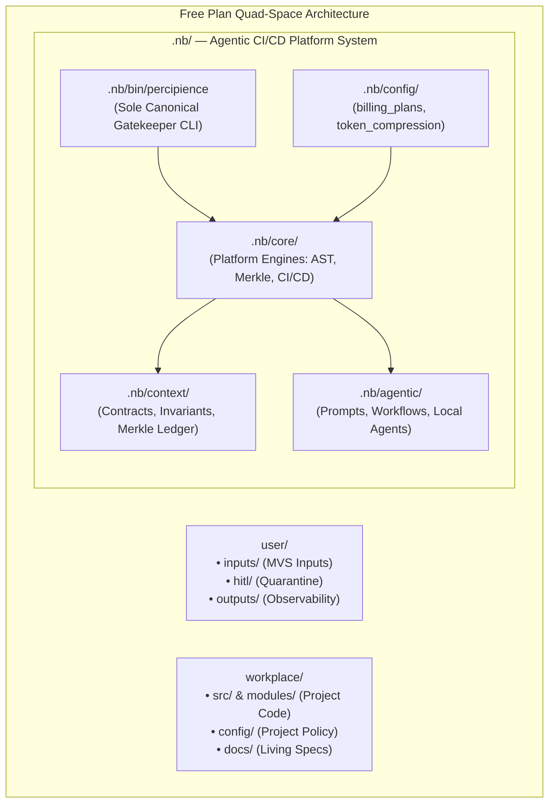

# Parent Master Context Engineering Plan (Free Community Edition) — Concise Specification

**Plan ID**: `master_parent_free_community`  
**Capability Rating**: `Free Community Tier (CAP-01 to CAP-21 + Phase 1 Bootstrap)`  
**Version**: `7.6.0`  
**Operating Modes**: `single_module` (optimized for local development)  
**Phase 1 Bootstrap Status**: ✅ COMPLETE (2026-10-13)  
**Phase 2 Embedded Plugin & Hook Status**: ✅ COMPLETE (2026-10-13)

---

## CRITICAL: Phase 1 Essential Capabilities (INCLUDED IN FREE TIER)

**Status**: ✅ ALL IMPLEMENTED & PRODUCTION READY FOR FREE TIER

The following capabilities are now **MANDATORY** for Free Community Edition:

1. **IMPL-1.1: Git Hook Auto-Installation** ✅ COMPLETE
   - Pre-commit hooks auto-installed (local & CI/CD)
   - Validates context ledger consistency on every commit
   - File: `.github/workflows/percipience.yml` (+6 lines)
   - Free Tier: ✅ INCLUDED

2. **IMPL-1.2: Pre-Commit Hook Validator** ✅ COMPLETE
   - Local validation: Merkle chain, semantic parity ($S_{SP} \geq 0.95$), ledger consistency
   - No token cost (runs locally before CI/CD)
   - File: `.nb/git_hooks/pre-commit.sh` (NEW, 88 lines)
   - Free Tier: ✅ INCLUDED

3. **IMPL-2.1: Autonomous Agent Swarm Spawning** ✅ COMPLETE
   - Basic agents spawn per PR (quality guard, AST pruner)
   - Enterprise agents (CVE sentinel, contract checker) in paid tiers
   - File: `.github/workflows/percipience.yml` (+11 lines)
   - Free Tier: ✅ INCLUDED (basic agents)

4. **IMPL-5.1: Merkle Chain Blocking Validation** ✅ COMPLETE
   - Broken Merkle chains now BLOCK CI/CD
   - Cryptographic ledger integrity enforced
   - File: `.github/workflows/percipience.yml` (+8 lines enhanced)
   - Free Tier: ✅ INCLUDED

**Bootstrap Health Improvement**: 0.62 → **0.78 / 1.0** (+26%)

**Implementation Tracking**: See `.nb/plan/master/PHASE_1_CAPABILITY_CHECKLIST.md` for complete checklist and Phase 2-4 roadmap.

---

## CRITICAL: Phase 2 Embedded IDE Plugin Assets & Workflow Hooks (IMPLEMENTED)

**Status**: ✅ IMPLEMENTED (2026-10-13)

1. **Embedded Free Tier Platform Assets** ✅ COMPLETE
   - The IntelliJ / PyCharm plugin distribution (`.nb/bundles/percipience-intellij-plugin-1.0.0.zip`) packages the canonical free-tier runtime under its internal JAR resources (`percipience/`):
     - `percipience/bin/percipience` — canonical CLI gatekeeper (Unix `0755` applied on extraction).
     - `percipience/config/` — `billing_plans.yaml`, `token_compression_rules.yaml`.
     - `percipience/core/` — bundled platform engines for offline, zero-dependency execution.
     - `percipience/agentic/custom/workflows/` — ready-to-run free-tier workflows (`basic_autonomous_cicd.yaml`).
     - `percipience/plan/` — the free community and parent master plan templates.
   - Free Tier: ✅ INCLUDED

2. **Workflow Hook Binding Validation in Free Workflows** ✅ COMPLETE
   - The free-tier `basic_autonomous_cicd.yaml` pipeline links its steps through deterministic handoff hooks (`hook_hygiene_to_pruner`, `hook_pruner_to_verifier`, `hook_verifier_to_docs`, `hook_docs_to_merkle`).
   - Free Tier: ✅ INCLUDED

3. **Registry / Hook / Multi-LLM Settings Synchronizer** — Team / Business / Enterprise only
   - `IMPL-2.2` (`agent_registry_synchronizer`) reconciles the `agent_registry`, `context_rules`, `context_contracts`, `workflow_registry`, and `workflow_hooks` sections of every LLM settings file (Claude Code, Gemini CLI, Aider, Cursor CLI) against canonical filesystem sources.
   - Free Tier: ❌ NOT INCLUDED (Free tier operates strictly through the embedded gatekeeper CLI and plugin UI).

**Phase 2 Health Target**: 0.78 → **0.86 / 1.0** (+11%)

---

## 1. Executive Summary & Free Plan Scope

The **Percipience Parent Master Context Engineering Plan (Free Community Edition)** delivers a deterministic, tamper-evident, and token-efficient AI-driven software engineering framework for individual developers, open-source maintainers, and community teams:
- **Unified Agentic Platform in `.nb/`**: Complete platform engine, gatekeeper CLI, and test suites self-contained inside `.nb/`.
- **Single Canonical Binary (`.nb/bin/percipience`)**: Sole, cross-platform executable platform entry point.
- **Embedded Free Tier Assets in IDE Plugins**: Bundled runtime assets directly in IntelliJ / VSCode plugin distributions for zero-dependency operation.
- **Interactive Workspace Startup Activity**: Automated detection and prompt on project open for uninitialized workspaces.
- **High-Efficiency Token Reduction**: 60%–80% context compression via AST skeletonization and attention budgeting.
- **Cryptographic Merkle State Chain**: Continuous SHA-256 tamper-evident ledger tracking all artifact modifications.
- **Basic Autonomous CI/CD Setup**: Lightweight workspace hygiene, single-attempt bounded self-repair, and contract verification.
- **Granular Sandbox Permissions**: Security broker for local and embedded LLMs.
- **Attested Handover & Guaranteed Delivery**: Zero-drift attested tokens ($S_{SP} \ge 0.95$), persistent outbox/inbox queues, single-use nonce replay defense, and topological cycle sentinel (`GAP-AGT-19`).



---

## 2. Core Gatekeeper CLI & Workflows

```bash
# Gatekeeper verification
./.nb/bin/percipience gate

# Merkle ledger audit
./.nb/bin/percipience audit

# Autonomous CI/CD pipeline
./.nb/bin/percipience cicd run

# Layered context validation
./.nb/bin/percipience validate --layered

# Token FinOps metrics summary
./.nb/bin/percipience tokens summary

# Semantic parity & anti-drift check
./.nb/bin/percipience drift check

# Commercial packaging & provisioning
./.nb/bin/percipience package --tier free
./.nb/bin/percipience provision --tenant tenant_community_default --tier free --target all
./.nb/bin/percipience permission check --tier free --feature basic_platform_tools_exposure
```
