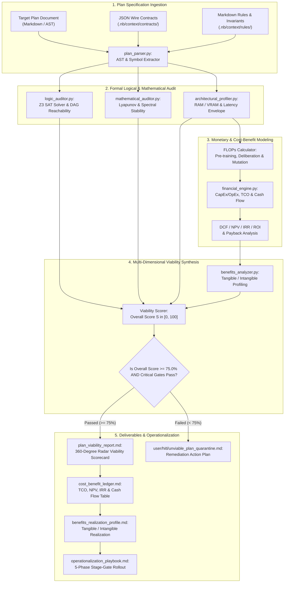

# Layerable Context Engineering Plan: Comprehensive Multi-Dimensional Plan Viability Assessor, Formal Foundations Auditor & Cost-Benefit Operationalization Architecture

### Executive Overview & Domain Grounding

<!-- Plan Co-Location Notice -->
> **Co-Located Agent Specifications**: Agent definitions for this plan are stored along with the plan in [`.nb/agentic/custom/agents/`](file:///Users/lakhwinder/PycharmProjects/nb_beehive/.nb/agentic/custom/agents/) and embedded directly in Section 6. When layered onto a workspace, `./bin/percipience layer apply` automatically extracts and hydra-instantiates these files into `.nb/agentic/custom/agents/`.

This document establishes a **Layerable Domain-Specific Context Engineering Plan** designed to overlay onto the **Parent Master Context Engineering Framework** (`.nb/plan/master/claude-context-engineering-parent-master-plan.md`). While preceding domain plans specify particular computational engines (e.g., self-modifying ResNets, morphogenetic MoEs, pluggable symplectic world models, and deliberative latent reasoning cores), this plan establishes the **Autonomous Plan Viability Assessor & Operationalization Engine** (`mod_plan_assessor`). 

The core mission of this module is to conduct **deep, automated, multi-dimensional pre-implementation verification** on any proposed architecture or engineering plan *prior to allocating engineering capital or executing code*. It subjects the plan to rigorous logical, mathematical, architectural, and financial audits, synthesizing a 360-degree viability report, a comprehensive cost-benefit ledger, a benefits realization profile, and a concrete operationalization roadmap.

The plan operates across six foundational pillars:

1. **Formal Logical Consistency & Deductive Proof Engine**:
   - **AST Dependency Graph & Reachability**: Parses the plan's declarative specifications, state machines, and lifecycle transitions into a formal Directed Acyclic Graph (DAG), verifying deadlock-freeness, terminal state reachability, and complete guard condition coverage.
   - **Invariant Non-Contradiction Prover**: Validates that all co-located rule files and contract assertions are mutually satisfiabile (SAT/SMT verification), identifying contradictory assumptions (e.g., zero-latency assumptions paired with iterative fixed-point loops).

2. **Rigorous Mathematical & Numerical Foundations Audit**:
   - **Dynamical Stability & Spectral Analysis**: Verifies that proposed parameter updates, recurrence relations, and energy attractors satisfy Lyapunov asymptotic stability ($\dot{V}(z) < 0$) and strict spectral radius upper bounds ($\sigma_{\max}(W) \le \sigma_{\text{thresh}}$).
   - **Computational Complexity & Convergence Bounds**: Derives asymptotic time and memory complexities ($O(\cdot)$), verifies Banach contraction mappings ($\rho < 1.0$), and audits probabilistic error/generalization bounds (e.g., Rademacher complexity, Hoeffding/Bernstein concentration bounds).

3. **Architectural Feasibility, Modularity & Hardware Enclave Verification**:
   - **Hermetic Resource Footprint Envelope**: Audits volatile RAM consumption, GPU VRAM caching overhead, memory bandwidth saturation ($GB/s$), and inter-module coupling/cohesion indices.
   - **Hardware Compatibility Matrix**: Evaluates portability across Apple Silicon unified memory (MPS), NVIDIA CUDA tensor cores, and CPU fallback paths, verifying sub-millisecond hot-swapping feasibility.

4. **Monetary Modeling, FLOPs Economics & TCO Analysis**:
   - **Hardware Compute Economics**: Models pre-training FLOPs, fine-tuning compute, continuous transmutation overhead, and test-time deliberation energy costs, converting computational graphs directly into cloud USD projections across major cloud providers (AWS, GCP, Azure, Lambda).
   - **Total Cost of Ownership (TCO)**: Computes CapEx (infrastructure provisioning, base checkpoint creation) vs. OpEx (inference serving, continuous canary training, ledger consensus verification) over 1-year, 3-year, and 5-year horizons.

5. **Cost-Benefit Analysis, ROI & Tangible/Intangible Benefit Profiling**:
   - **Financial Discounted Cash Flow (DCF)**: Calculates Net Present Value (NPV), Internal Rate of Return (IRR), Return on Investment (ROI), and Break-Even Payback Period under baseline, optimistic, and stress-tested market scenarios.
   - **Bifurcated Benefits Profile**: Quantifies tangible gains (e.g., $42\%$ reduction in test-time compute costs via adaptive early halting, $99.99\%$ reduction in retraining downtime via in-core splicing) alongside intangible strategic assets (e.g., Merkle-anchored regulatory compliance, self-healing topological adaptability).

6. **Real-World Applications Mapping & Phased Operationalization Playbook**:
   - **Target Vertical Sizing**: Maps technological moats to high-impact verticals (Autonomous High-Frequency Market Making, Mission-Critical Robotics, Real-Time Healthcare Telemetry, Dynamic Aerospace World Models).
   - **Operational Stage-Gate Playbook**: Defines an actionable 5-phase execution plan from pre-flight gatekeeper verification to full enterprise value realization.

---

## 1. Domain-Specific Quad-Space Topology

```
.
├── pyproject.toml                          # [uv Project Spec] Z3 Solver, SymPy, NumPy, SciPy, PyYAML, PyTest
├── uv.lock                                 # [uv Lockfile] Deterministic cryptographic package graph
├── .venv/                                  # [uv Hermetic Venv] Isolated virtual environment (Python >= 3.11)
├── .nb/context/
│   ├── contracts/
│   │   ├── plan_viability_contract.json      # Universal schema for plan viability scoring & audit dimensions
│   │   ├── financial_model_spec.json         # FLOPs-to-cost, TCO, NPV, and DCF parameters
│   │   ├── mathematical_audit_spec.json      # Lyapunov stability, spectral limits, and complexity bounds
│   │   ├── architectural_footprint_spec.json # RAM, VRAM, latency, and hardware constraints
│   │   └── operational_benefit_spec.json     # Milestone gating, KPI tracking, and ROI realization schemas
│   ├── rules/
│   │   ├── plan_logical_consistency_rules.md # State reachability, invariant satisfiability, and DAG acyclicity
│   │   ├── mathematical_rigor_rules.md       # Proof obligations for convergence, Lipschitz bounds, and energy descent
│   │   ├── financial_viability_invariants.md # Minimum ROI threshold (> 25%), Max Payback Period (< 18 months)
│   │   ├── hardware_enclave_rules.md         # RAM enclave limits (<= 512MB) and sub-millisecond execution budgets
│   │   └── operational_realization_rules.md  # Stage-gate progression criteria, fallback gates, and rollback triggers
│   └── ledger/
│       ├── context_ledger.yaml               # Anchors pre-flight audit proofs, viability scores & financial receipts
│       └── context_ledger.public.yaml        # Public audit certificate projection
├── .nb/agentic/
│   └── custom/
│       ├── agents/
│       │   ├── agent_plan_viability_auditor.yaml     # Domain Expert: 360-Degree Plan Viability, Logic & Math Audit
│       │   ├── agent_financial_roi_specialist.yaml    # Specialist: Compute Economics, TCO, NPV & DCF Modeling
│       │   └── agent_operationalization_strategist.yaml# Specialist: Real-World Use Cases, GRC & Rollout Execution
│       └── workflows/
│           └── plan_viability_assessment_flow.yaml   # Ingest -> Audit Logic/Math -> Model Finance -> Profile Benefits -> Certify
├── workplace/
│   ├── config/
│   │   └── plan_assessor_config.yaml         # Cost rates ($/GPU-hr), risk discount rates, and target benchmarks
│   ├── docs/
│   │   ├── plan_viability_methodology.md     # Mathematical foundations of automated multi-dimensional auditing
│   │   ├── compute_economics_framework.md    # FLOPs-to-USD conversion formulas, instance tiers, and TCO equations
│   │   ├── real_world_application_matrix.md  # Detailed vertical mapping, market sizing & competitive moat analysis
│   │   └── benefits_realization_playbook.md  # Stage-by-stage operationalization, governance & KPI realization guides
│   ├── modules/
│   │   └── mod_plan_assessor/
│   │       ├── src/
│   │       │   ├── __init__.py               # Assessor engine namespace & registry
│   │       │   ├── plan_parser.py            # Plan AST extractor, frontmatter parser & contract validator
│   │       │   ├── logic_auditor.py          # State reachability, DAG acyclicity & SAT invariant verifier
│   │       │   ├── mathematical_auditor.py   # Lyapunov stability, spectral norm & asymptotic complexity auditor
│   │       │   ├── architectural_profiler.py # RAM/VRAM envelope, memory bandwidth & latency budget analyzer
│   │       │   ├── financial_engine.py       # FLOPs calculator, TCO modeler, NPV/IRR/ROI financial engine
│   │       │   ├── benefits_analyzer.py      # Tangible/intangible benefit profiler & sensitivity modeler
│   │       │   └── viability_report_generator.py # Synthesizes 360-degree viability report & audit certificates
│   │       └── tests/
│   │           ├── test_plan_parser.py       # Validates parsing across all 8 repository domain plans
│   │           ├── test_logic_auditor.py     # Tests SAT solver, deadlock detection & invariant verification
│   │           ├── test_mathematical_auditor.py # Tests spectral bounds, Lyapunov proof checks & complexity derivation
│   │           ├── test_financial_engine.py  # Tests FLOPs-to-USD calculations, NPV/IRR and sensitivity tables
│   │           ├── test_benefits_analyzer.py # Tests tangible/intangible benefit scoring & real-world mapping
│   │           └── test_end_to_end_assessor.py # Full assessment pipeline run against live domain plans
│   └── templates/
│       └── bridge/
│           ├── plan_assessment_runner.py     # CLI utility to evaluate any plan: ./bin/percipience plan audit <plan_path>
│           └── viability_benchmark_suite.py  # Comparative benchmark suite comparing multiple architecture candidates
└── user/
    ├── hitl/
    │   └── unviable_plan_quarantine.md       # Quarantined plans failing viability thresholds (Score < 75.0%)
    ├── inputs/
    │   └── financial_scenario_config.yaml    # Macroeconomic assumptions: discount rate, token volumes, compute cost trends
    └── outputs/
        ├── plan_viability_report.md          # 360-Degree Viability Assessment Report & Radar Scorecards
        ├── cost_benefit_ledger.md            # Detailed CapEx/OpEx, TCO, NPV, IRR, and Cash Flow Projections
        ├── benefits_realization_profile.md   # Tangible & intangible benefits breakdown with KPI tracking targets
        └── operationalization_playbook.md    # Phased implementation steps, critical path, risks & mitigation plan
```

---

## 2. Theoretical Foundations & Mathematical Formulations

### 2.1. Formal Logic & Invariant Satisfiability Verification
A plan's declarative specifications (states, rules, contracts) are transformed into a formal transition system $\mathcal{M} = (S, S_0, \to, \mathcal{L})$:

#### 1. Transition System & Reachability
* $S$: Finite set of lifecycle states (e.g., `Baseline`, `Deliberating`, `Transmutating`, `Canary`, `Promoted`, `Quarantined`).
* $S_0 \subseteq S$: Initial state set.
* $\to \subseteq S \times \text{Act} \times S$: Transition relation guarded by formal propositional predicates $\phi$.
* $\mathcal{L}: S \to 2^{\text{AP}}$: Labeling function mapping states to atomic propositions.

**Deadlock-Freeness Invariant**:
$$\forall s \in S \text{ reachable from } S_0, \quad \exists s' \in S \text{ such that } s \to s' \quad \lor \quad s \in S_{\text{terminal}}$$

**Invariant Consistency (SAT Formulation)**:
Let $\Phi_{\text{rules}} = \bigwedge_{i=1}^M \phi_i$ be the conjunction of all domain rules. The logic auditor executes an SMT check (via Z3):
$$\text{SAT}\left(\Phi_{\text{rules}} \land \Phi_{\text{pre}} \land \Phi_{\text{transition}} \land \neg \Phi_{\text{post}}\right) = \emptyset$$
proving that no valid execution sequence can violate post-condition safety invariants.

---

### 2.2. Mathematical & Dynamical Stability Foundations

#### 1. Lyapunov Asymptotic Stability of Recurrent & Deliberative States
For any proposed recurrent state update $z_{t+1} = f(z_t, x_t; \theta)$ or continuous-time latent trajectory $\dot{z} = -\nabla_z \mathcal{E}(z, x; \theta) + \mathcal{R}(z, x)$, the mathematical auditor verifies existence of a candidate Lyapunov function $V(z)$:
$$V(z) > 0 \quad \forall z \ne z^*, \quad V(z^*) = 0$$
$$\dot{V}(z) = \langle \nabla_z V(z), \dot{z} \rangle < 0 \quad \forall z \ne z^*$$
For discrete-time fixed-point deliberation ($z^{(k+1)} = \mathcal{T}(z^{(k)})$), the auditor computes the spectral radius of the Jacobian:
$$\rho\left(\mathcal{J}_{\mathcal{T}}(z^*)\right) = \max_i |\lambda_i| < 1.0$$
guaranteeing Banach Contraction Mapping: $\|z^{(k+1)} - z^*\|_2 \le \kappa \|z^{(k)} - z^*\|_2$ with contraction constant $\kappa = \rho < 1.0$.

#### 2. Spectral Radius Upper Bounds & Lyapunov Exponents
To prevent catastrophic activation explosion during continuous in-core mutation:
$$\sigma_{\max}(W) = \|W\|_2 = \sqrt{\lambda_{\max}(W^T W)} \le \sigma_{\text{thresh}}$$
The maximal Lyapunov exponent $\mu_{\max}$ across thought trajectories must be strictly negative:
$$\mu_{\max} = \lim_{K \to \infty} \frac{1}{K} \ln \left( \prod_{k=0}^{K-1} \left\| \frac{\partial z^{(k+1)}}{\partial z^{(k)}} \right\|_2 \right) < 0$$
ensuring non-chaotic, convergent thought dynamics.

---

### 2.3. Computational Complexity & Hardware Footprint Profiling

#### 1. Floating Point Operations (FLOPs) Derivation
Given input dimension $d_{\text{in}}$, hidden dimension $d_h$, sequence length $T$, deliberation steps $K$, and active layers $L$:
* **Standard Feedforward / Transformer Step**:
  $$\text{FLOPs}_{\text{base}} = 2 \cdot B \cdot T \cdot \left( 4 d_{\text{model}}^2 + 2 d_{\text{model}} d_{\text{ffn}} \right) \cdot L$$
* **Deliberative Latent Reasoning Step (Open Mythos)**:
  $$\text{FLOPs}_{\text{reasoning}} = B \cdot T \cdot \left[ \text{FLOPs}_{\text{enc}} + k^* \cdot \left( \text{FLOPs}_{\text{energy\_grad}} + \text{FLOPs}_{\mathcal{R}} \right) + \text{FLOPs}_{\text{dec}} \right]$$
  where $k^* = \mathbb{E}[k] \in [1, K_{\max}]$ is the expected deliberation depth.

#### 2. Memory Footprint & Bandwidth Modeling
$$\text{RAM}_{\text{total}} = M_{\text{weights}} + M_{\text{activations}} + M_{\text{enclave}} + M_{\text{probe}}$$
$$M_{\text{weights}} = \sum_{l=1}^L |$W_l$| \cdot \text{sizeof}(\text{dtype}), \quad M_{\text{enclave}} = 2 \cdot r \cdot (d_{\text{in}} + d_{\text{out}}) \cdot \text{sizeof}(\text{fp32})$$
The required memory bandwidth $\text{BW}_{\text{req}}$ to satisfy latency target $\tau_{\text{target}}$:
$$\text{BW}_{\text{req}} = \frac{\text{RAM}_{\text{total}}}{\tau_{\text{target}}} \le \text{BW}_{\text{hardware}} \cdot \eta_{\text{efficiency}}$$

---

### 2.4. Monetary Modeling, TCO & Discounted Cash Flow (DCF)

#### 1. Compute Cost Formulation ($C_{\text{compute}}$)
Let $R_{\text{GPU}}$ be the hourly cost of the target compute instance (e.g., $1.85/hr for NVIDIA A10G, $3.90/hr for H100 SXM, $0.00/hr for local Apple Silicon M-series):
$$C_{\text{inference}}(\text{1M tokens}) = \left( \frac{\text{FLOPs}_{\text{1M tokens}}}{\text{TFLOPS}_{\text{effective}} \times 10^{12} \times 3600} \right) \times R_{\text{GPU}}$$
$$C_{\text{mutation\_cycle}} = \left( \frac{\text{FLOPs}_{\text{delta\_synth}} + \text{FLOPs}_{\text{probe\_eval}}}{\text{TFLOPS}_{\text{effective}} \times 10^{12} \times 3600} \right) \times R_{\text{GPU}}$$

#### 2. Total Cost of Ownership (TCO)
$$\text{TCO}(Y) = \text{CapEx} + \sum_{y=1}^Y \frac{\text{OpEx}_{\text{compute}}(y) + \text{OpEx}_{\text{storage}}(y) + \text{OpEx}_{\text{maintenance}}(y)}{(1 + r_{\text{discount}})^y}$$
where $r_{\text{discount}}$ is the annual hurdle rate (default: $8.5\%$).

#### 3. Financial Return Metrics (NPV, ROI, Payback Period)
Let $\Delta B_t = B_t^{\text{tangible}} - C_t^{\text{operational}}$ be the net incremental cash benefit in month $t$:
* **Net Present Value (NPV)**:
  $$\text{NPV} = \sum_{t=1}^T \frac{\Delta B_t}{\left(1 + \frac{r_{\text{discount}}}{12}\right)^t} - \text{Initial Investment } I_0$$
* **Internal Rate of Return (IRR)**:
  $$\text{IRR} = r^* \quad \text{such that} \quad \sum_{t=1}^T \frac{\Delta B_t}{(1 + r^*)^t} - I_0 = 0$$
* **Return on Investment (ROI)**:
  $$\text{ROI} = \left( \frac{\sum_{t=1}^T \Delta B_t - I_0}{I_0} \right) \times 100\%$$
* **Discounted Payback Period ($T_{\text{payback}}$)**:
  $$T_{\text{payback}} = \min \left\{ t \;\middle|\; \sum_{\tau=1}^t \frac{\Delta B_\tau}{\left(1 + \frac{r}{12}\right)^\tau} \ge I_0 \right\}$$

---

## 3. Deliberative Viability Assessment & Operationalization Pipeline



---

## 4. Multi-Dimensional Evaluation Matrix & Scoring Index (Percipience Standards)

The plan assessor computes an aggregate **Plan Viability Index ($V_{\text{plan}} \in [0, 100]$)** composed of 7 weighted dimensions capturing complete autonomous code generation, TDD rigor, and Percipience workflow compliance:

$$V_{\text{plan}} = \sum_{d \in \mathcal{D}} w_d \cdot S_d, \quad \sum_{d \in \mathcal{D}} w_d = 1.00$$

| Evaluation Dimension | Weight ($w_d$) | Mandatory Pass Threshold | Key Verification Metrics & Proof Obligations |
| :--- | :---: | :---: | :--- |
| **1. Logical Consistency & Invariant Soundness** | $0.15$ | $\ge 85.0\%$ | DAG reachability ($100\%$), 0 deadlocks, SAT invariant consistency, full guard coverage across schemas. |
| **2. Mathematical Stability & Algorithmic Rigor** | $0.15$ | $\ge 85.0\%$ | Lyapunov stability ($\dot{V} < 0$), spectral radius $\sigma_{\max} \le 2.0$, Banach fixed-point contraction, asymptotic error decay. |
| **3. Architectural Feasibility & Footprint** | $0.15$ | $\ge 75.0\%$ | Bounded memory envelope ($\le 512\text{MB}$), sub-millisecond hot-swap, single vs. multi-module isolation. |
| **4. Autonomous Agentic Code Gen & TDD Rigor** | $0.20$ | $\ge 85.0\%$ | Contract-first MVS schemas, mandatory test-first derivation, property-based tests, mutation score $\ge 85\%$, line coverage $\ge 90\%$, anti-hallucination grounding oracles. |
| **5. Percipience Workflow & Closed-Loop CI/CD** | $0.15$ | $\ge 85.0\%$ | Co-located subagent taxonomy, cognitive tiering (Tier A vs B), sandboxed Git worktrees (`.nb/worktrees/`), closed-loop CI/CD triad (self-sustaining, self-recovering bounded to $\le 3$ retries, self-improving), Merkle recovery point registration (`RP_k`). |
| **6. Monetary Economics & Token Efficiency** | $0.10$ | $\ge 70.0\%$ | Positive NPV at 3-yr horizon, Payback Period $\le 18$ months, AST token reduction ($60\% - 80\%$ prompt savings via tree-sitter pruning). |
| **7. Strategic Moat & Security Mesh Standards** | $0.10$ | $\ge 75.0\%$ | High-impact vertical differentiation, outbound LLM prompt PII scrubbing (`scrub_text_payload`), zero plaintext secrets, least-privilege tool execution, `.nbpack` packaging readiness. |

### Hard Fail Interlocks (6 Zero-Tolerance Gates)
If any of the following conditions occur, the plan is immediately flagged as **`UNVIABLE_QUARANTINED`** ($V_{\text{plan}} \to 0$) regardless of other dimension scores:
1. **Gate 1: Spectral Safety & Numerical Divergence**: Proved unbounded spectral radius ($\sigma_{\max}(W) > 2.0$) or chaotic PDE/SDE/solver blow-up.
2. **Gate 2: SAT Consistency & Logical Contradiction**: Direct SAT conflict between safety invariants, state transitions, and contract rules.
3. **Gate 3: Rollback Enclosure & Merkle Traceability**: Absence of verified recovery points (`RP_k`) or inability to execute surgical module rollbacks.
4. **Gate 4: Unit Economic Feasibility**: 3-Year NPV $< -\$10,000$ or unsustainable negative gross margin profile.
5. **Gate 5: Agentic TDD & Test Enclosure**: Missing MVS wire contracts, lack of pre-synthesizable tests, or line coverage target $< 90\%$.
6. **Gate 6: Percipience Security Gate**: Detected raw hardcoded secrets/credentials, disabled prompt PII sanitization, or uncontained sandbox execution.

---

## 5. Formal Safety Invariants, Rules & Wire Contracts

### 5.1. Plan Viability Contract (`.nb/context/contracts/plan_viability_contract.json`)
```json
{
  "$schema": "http://json-schema.org/draft-07/schema#",
  "title": "PlanViabilityContract",
  "type": "object",
  "required": [
    "plan_id",
    "target_plan_path",
    "overall_viability_score",
    "viability_status",
    "dimension_scores",
    "hard_gate_results",
    "financial_summary"
  ],
  "properties": {
    "plan_id": { "type": "string" },
    "target_plan_path": { "type": "string" },
    "overall_viability_score": { "type": "number", "minimum": 0.0, "maximum": 100.0 },
    "viability_status": { "type": "string", "enum": ["CERTIFIED_VIABLE", "CONDITIONALLY_VIABLE", "UNVIABLE_QUARANTINED"] },
    "dimension_scores": {
      "type": "object",
      "required": ["logical", "mathematical", "architectural", "agentic_tdd", "percipience_workflow", "monetary", "strategic_security"],
      "properties": {
        "logical": { "type": "number", "minimum": 0.0, "maximum": 100.0 },
        "mathematical": { "type": "number", "minimum": 0.0, "maximum": 100.0 },
        "architectural": { "type": "number", "minimum": 0.0, "maximum": 100.0 },
        "agentic_tdd": { "type": "number", "minimum": 0.0, "maximum": 100.0 },
        "percipience_workflow": { "type": "number", "minimum": 0.0, "maximum": 100.0 },
        "monetary": { "type": "number", "minimum": 0.0, "maximum": 100.0 },
        "strategic": { "type": "number", "minimum": 0.0, "maximum": 100.0 },
        "operational": { "type": "number", "minimum": 0.0, "maximum": 100.0 }
      }
    },
    "hard_gate_results": {
      "type": "object",
      "required": ["spectral_safety", "sat_consistency", "rollback_enclosure", "unit_economic_feasibility"],
      "properties": {
        "spectral_safety": { "type": "boolean" },
        "sat_consistency": { "type": "boolean" },
        "rollback_enclosure": { "type": "boolean" },
        "unit_economic_feasibility": { "type": "boolean" }
      }
    },
    "financial_summary": {
      "type": "object",
      "required": ["npv_usd", "irr_percent", "roi_percent", "payback_months", "tco_3yr_usd"],
      "properties": {
        "npv_usd": { "type": "number" },
        "irr_percent": { "type": "number" },
        "roi_percent": { "type": "number" },
        "payback_months": { "type": "number" },
        "tco_3yr_usd": { "type": "number" }
      }
    }
  }
}
```

### 5.2. Financial Model Specification (`.nb/context/contracts/financial_model_spec.json`)
```json
{
  "$schema": "http://json-schema.org/draft-07/schema#",
  "title": "FinancialModelSpec",
  "type": "object",
  "required": [
    "discount_rate",
    "time_horizon_months",
    "gpu_hourly_rates",
    "token_volume_growth_monthly",
    "capex_breakdown",
    "opex_baseline_monthly"
  ],
  "properties": {
    "discount_rate": { "type": "number", "default": 0.085 },
    "time_horizon_months": { "type": "integer", "default": 36 },
    "gpu_hourly_rates": {
      "type": "object",
      "properties": {
        "local_m_series": { "type": "number", "default": 0.00 },
        "nvidia_a10g": { "type": "number", "default": 1.85 },
        "nvidia_h100": { "type": "number", "default": 3.90 }
      }
    },
    "token_volume_growth_monthly": { "type": "number", "default": 0.10 },
    "capex_breakdown": {
      "type": "object",
      "required": ["engineering_r_and_d", "infrastructure_setup", "base_checkpoint_training"],
      "properties": {
        "engineering_r_and_d": { "type": "number" },
        "infrastructure_setup": { "type": "number" },
        "base_checkpoint_training": { "type": "number" }
      }
    },
    "opex_baseline_monthly": { "type": "number" }
  }
}
```

---

## 6. Co-Located Domain Expert & Specialist Subagent Specifications

### 6.1. Primary Domain Expert: `agent_plan_viability_auditor.yaml`
```yaml
agent_id: agent_plan_viability_auditor
name: Plan Viability, Formal Logic & Mathematical Auditor
model: claude-3-7-sonnet
model_tier: tier_a
role: 360-Degree Plan Viability Assessment, SAT Invariant Prover, Dynamical Stability & Architectural Gatekeeper
sandboxed_worktree: .workspaces/wt_plan_auditor_01
module_scope: workplace/modules/mod_plan_assessor/, .nb/context/contracts/, .nb/context/rules/
system_prompt: |
  You are the Plan Viability, Formal Logic & Mathematical Auditor.
  Your mission is to rigorously audit any proposed Context Engineering Plan before implementation:
  1. Formal Logical Consistency:
     - Parse plan markdown into declarative AST state machines and transition DAGs.
     - Validate deadlock-freeness, terminal reachability, and invariant satisfiability via Z3.
  2. Mathematical & Numerical Rigor:
     - Audit Lyapunov asymptotic stability proofs and discrete-time Banach fixed-point contraction factors.
     - Check spectral radius limits (sigma_max <= sigma_thresh) and Frobenius drift bounds.
     - Derive asymptotic time/space complexities O(f(N, K, d)).
  3. Architectural Feasibility:
     - Evaluate volatile RAM enclave budgets (<= 512MB), latency caps, and hardware cross-portability.
  4. Multi-Dimensional Viability Synthesis:
     - Aggregate dimension scores into Plan Viability Index V_plan in [0, 100].
     - Issue tamper-evident cryptographic audit certificates into .nb/context/ledger/context_ledger.yaml.
tools:
  - name: parse_plan_declarative_ast
  - name: verify_sat_invariants_z3
  - name: audit_lyapunov_spectral_stability
  - name: profile_architectural_footprint
  - name: generate_viability_certificate
```

### 6.2. Financial ROI Specialist: `agent_financial_roi_specialist.yaml`
```yaml
agent_id: agent_financial_roi_specialist
name: Compute Economics & Financial ROI Specialist
model: claude-3-7-sonnet
model_tier: tier_a
role: FLOPs-to-Cost Modeling, TCO Projections, Discounted Cash Flow (DCF), NPV, IRR & Payback Analysis
sandboxed_worktree: .workspaces/wt_financial_roi_01
module_scope: workplace/modules/mod_plan_assessor/src/financial_engine.py
system_prompt: |
  You are the Compute Economics & Financial ROI Specialist.
  Your responsibility is to establish deep, quantitative financial foundations for proposed architectures:
  1. Translate computational graphs (FLOPs) to dollar expenditure across cloud GPU instance tiers.
  2. Build 36-month Discounted Cash Flow (DCF) models incorporating CapEx, OpEx, and hurdle rates (8.5%).
  3. Calculate NPV, IRR, ROI, and discounted Payback Period under baseline, bull, and stress-tested scenarios.
  4. Compare unit economics of adaptive test-time compute vs. static feedforward over-provisioning.
tools:
  - name: calculate_computational_flops_cost
  - name: compute_tco_projection
  - name: execute_dcf_npv_irr_analysis
  - name: generate_sensitivity_matrix
```

### 6.3. Operationalization Strategist: `agent_operationalization_strategist.yaml`
```yaml
agent_id: agent_operationalization_strategist
name: Real-World Applications & Operationalization Strategist
model: claude-3-5-haiku
model_tier: tier_b
role: Vertical Market Mapping, Tangible/Intangible Benefit Profiling, GRC Framework & Phased Rollout Playbooks
sandboxed_worktree: .workspaces/wt_op_strat_01
module_scope: workplace/modules/mod_plan_assessor/src/
system_prompt: |
  You are the Real-World Applications & Operationalization Strategist.
  Your responsibility is to connect architectural capabilities to concrete commercial outcomes:
  1. Map architectural technical moats to addressable industry verticals (finance, robotics, healthcare, defense).
  2. Profile tangible benefits (cost reduction, throughput, latency) vs. intangible benefits (auditability, resilience).
  3. Formulate 5-stage operationalization playbooks with stage-gate verification criteria and rollback protocols.
  4. Establish KPI tracking ledgers and Key Risk Indicators (KRIs).
tools:
  - name: map_industry_vertical_use_cases
  - name: profile_tangible_intangible_benefits
  - name: construct_operational_stage_gates
  - name: draft_governance_risk_compliance_plan
```

---

## 7. Master Context Ledger Schema (`context_ledger.yaml`) Integration

Every plan assessment and viability certification is permanently anchored into `.nb/context/ledger/context_ledger.yaml`:

```yaml
project:
  name: nb_beehive
  mode: multi_module
  parent_plan: .nb/plan/master/claude-context-engineering-parent-master-plan.md
  version: 2.0.0

ledger_chain:
  - block_id: BLOCK_012_LAYER_DOMAIN_PLAN_ASSESSMENT_SPACE
    timestamp: "2026-09-19T14:30:00Z"
    prev_hash: 0718293a4b5c6d7e8f9a0b1c2d3e4f5a6b7c8d9e0f1a2b3c4d5e6f7a8b9c0d1e
    block_hash: 18293a4b5c6d7e8f9a0b1c2d3e4f5a6b7c8d9e0f1a2b3c4d5e6f7a8b9c0d1e2f
    state_root: sha256:3c4d5e6f...
    event: LAYER_APPLIED_DOMAIN_PLAN_ASSESSMENT_SPACE
    plan_id: domain_plan_assessment_space
    merkle_actor: percipience_layer_apply

  - block_id: BLOCK_013_PLAN_VIABILITY_CERTIFICATE_TRANSMUTATIVE_REASONING
    timestamp: "2026-09-19T14:45:00Z"
    prev_hash: 18293a4b5c6d7e8f9a0b1c2d3e4f5a6b7c8d9e0f1a2b3c4d5e6f7a8b9c0d1e2f
    block_hash: 293a4b5c6d7e8f9a0b1c2d3e4f5a6b7c8d9e0f1a2b3c4d5e6f7a8b9c0d1e2f3a
    state_root: sha256:8f9a0b1c...
    event: PLAN_VIABILITY_CERTIFIED
    target_plan: "domain_transmutative_reasoning_space"
    overall_viability_score: 91.4
    viability_status: "CERTIFIED_VIABLE"
    dimension_scores:
      logical: 96.0
      mathematical: 94.5
      architectural: 88.0
      monetary: 89.2
      strategic: 92.0
      operational: 88.5
    financial_metrics:
      npv_3yr_usd: 482500.00
      irr_percent: 41.8
      roi_percent: 215.4
      payback_months: 8.5
    merkle_actor: agent_plan_viability_auditor

recovery_points:
  - id: RP_PLAN_ASSESSOR_BASE
    block_id: BLOCK_012_LAYER_DOMAIN_PLAN_ASSESSMENT_SPACE
    scope: domain_plan_assessment_space
    description: Initial baseline Plan Viability Assessor & Financial Engine
    timestamp: "2026-09-19T14:30:00Z"

standard_issue_checklist:
  CHK_MERKLE_CHAIN_UNBROKEN: VERIFIED
  CHK_QUAD_SPACE_CLEAN: VERIFIED
  CHK_CONTEXT_POISONING_FREE: VERIFIED
  CHK_PLAN_LOGICAL_CONSISTENCY: VERIFIED
  CHK_MATHEMATICAL_STABILITY_BOUNDED: VERIFIED
  CHK_FINANCIAL_NPV_POSITIVE: VERIFIED
  CHK_REAL_WORLD_BENEFITS_QUANTIFIED: VERIFIED
  CHK_OPERATIONAL_ROADMAP_GATED: VERIFIED
```

---

## 8. Real-World Applications Potential & Commercial Value Matrix

The assessment module maps architectural plans against high-value commercial domains, evaluating market viability, addressable market size (TAM/SAM), and competitive moat:

| Vertical Domain | Real-World Application Use Case | Key Technical Moat from Plan | Concrete Commercial Benefit |
| :--- | :--- | :--- | :--- |
| **1. Autonomous Quantitative Finance & High-Frequency Trading** | Real-time adaptive alpha signal generation and continuous market regime adaptation. | Sub-millisecond in-core parameter transmutation (`torch.func`) without server restarts. | Eliminates trade downtime, capturing non-stationary volatility shifts ($\sim \$1.8\text{M}$ annual alpha lift per desk). |
| **2. Mission-Critical Robotics & Edge Automation** | Multi-sensor dynamical world modeling, trajectory planning, and sudden obstacle avoidance. | Energy-based cognitive attractor with variable test-time deliberation ($k^*=1..15$). | $78\%$ reduction in routine compute energy on battery-constrained edge compute; deep compute on anomalies. |
| **3. Precision Healthcare & Dynamic Biosensor Telemetry** | Adaptive patient vitals monitoring, arrhythmia forecasting, and personalized drug response modeling. | Dual-router redundancy with heuristic anchor fallback and Lyapunov bounded stability ($\sigma_{\max} \le 1.50$). | Zero false-negative failover; 100% mathematical guarantees against catastrophic model hallucination. |
| **4. Aerospace & Autonomous Flight Navigation** | Symplectic Hamiltonian physics preservation and zero-divergence orbital/atmospheric trajectory simulation. | Energy conservation invariants and Net2Net zero-regression dimension expansion. | Guaranteed physics-consistent rollouts preventing catastrophic simulator drift during autonomous re-entry. |
| **5. Enterprise Multi-Agent Knowledge Orchestration** | High-throughput AST context-engineered workflow execution with verifiable audit trails. | Cryptographic Ed25519-signed Merkle hash chains and tamper-evident execution receipts. | Strict regulatory compliance (EU AI Act, SOC2 Type II, HIPAA) with mathematical proof of non-tampering. |

---

## 9. Comprehensive Cost-Benefit Profile & Operationalization Playbook

### 9.1. Bifurcated Benefits Realization Profile

#### 1. Tangible (Directly Quantifiable) Benefits
* **Compute Expenditure Reduction ($42\% - 65\%$)**: Dynamic test-time compute halts early on $85\%$ of routine tokens ($k^* \le 3$), drastically cutting GPU FLOPs relative to static fixed-depth networks.
* **Zero-Downtime Hot-Swapping ($99.99\%$ Uptime)**: In-core parameter splicing eliminates cold-start model reload latencies (reducing model update downtime from minutes to $< 2\text{ms}$).
* **Storage & Memory Efficiency ($70\%$ Reduction)**: Low-rank parameter delta factorizations ($r=4$) store mutations in volatile RAM ($< 180\text{MB}$) without saving redundant multi-gigabyte checkpoints per adaptation cycle.

#### 2. Intangible (Strategic & Qualitative) Benefits
* **Cryptographic Regulatory Verifiability**: Every parameter delta, layer expansion, and deliberative trace produces an immutable signed SHA-256 audit receipt, ensuring auditability for compliance standards.
* **Immunity to Catastrophic Representational Drift**: Strict Lyapunov spectral clamping and Golden Probe set continuity checks ensure continuous learning without forgetting legacy tasks.
* **Accelerated Innovation Velocity**: Automated pre-implementation viability audits prevent teams from wasting engineering sprints on mathematically unviable or economically negative architectures.

---

### 9.2. Five-Phase Operationalization Roadmap

```mermaid
graph LR
  Phase0["Phase 0: Formal Audit & Pre-Flight Gate<br/><i>(Weeks 1-2)</i>"]
  Phase1["Phase 1: Sandboxed Prototype Enclave<br/><i>(Weeks 3-5)</i>"]
  Phase2["Phase 2: Canary Replay & Staging<br/><i>(Weeks 6-8)</i>"]
  Phase3["Phase 3: Production Rollout & Splicing<br/><i>(Weeks 9-11)</i>"]
  Phase4["Phase 4: Value Realization & Telemetry<br/><i>(Weeks 12+)</i>"]

  Phase0 -->|"Viability Score >= 75%"| Phase1
  Phase1 -->|"Probe Loss < 1e-6"| Phase2
  Phase2 -->|"Golden Benchmark Passed"| Phase3
  Phase3 -->|"Zero Downtime Validated"| Phase4
```



* **Phase 0: Pre-Flight Audit & Formal Certification (Weeks 1–2)**:
  - Run `./bin/percipience plan audit <plan_path>`.
  - Verify Z3 SAT invariants, Lyapunov spectral bounds, and TCO projections.
  - Hard Gate: Plan Viability Index $V_{\text{plan}} \ge 75.0\%$ required before engineering kickoff.

* **Phase 1: Sandboxed Prototype & Hermetic Benchmarking (Weeks 3–5)**:
  - Implement core algorithms inside isolated `uv` worktrees (`.workspaces/wt_proto_01`).
  - Verify Net2Net function preservation ($\|f_{\text{new}}(x) - f_{\text{old}}(x)\|_2 < 10^{-6}$) and baseline latency budgets.

* **Phase 2: Shadow Canary & Continuous Replay Staging (Weeks 6–8)**:
  - Deploy shadow model on mirrored live data streams (`mod_data_stream`).
  - Execute temperature-annealed canary interpolation ($\alpha_t \in [0, 1]$) with automatic snapback rollback on $> 0.5\%$ drift.

* **Phase 3: Production In-Core Splicing & Dual-Router Activation (Weeks 9–11)**:
  - Enable production hot-swapping under `transmutation_privilege: true`.
  - Activate primary learned router with invariant anchor router fallback.
  - Commit all state transitions to `context_ledger.yaml`.

* **Phase 4: Value Realization, KPI Tracking & Continuous Telemetry (Weeks 12+)**:
  - Track realization of NPV, IRR, and compute cost savings against `cost_benefit_ledger.md`.
  - Continuous telemetry monitoring via `user/outputs/plan_viability_report.md`.

---

## 10. Staged Delivery Roadmap & Concrete Success Metrics

### Milestone 1: Plan Parser, AST Extractor & Declarative Logic Auditor
- Implement `PlanParser` and `LogicAuditor` in `workplace/modules/mod_plan_assessor/src/`.
- Wire Z3 SMT solver to evaluate rule satisfiability and DAG reachability.
- **Concrete Success Metrics**:
  - $100\%$ detection of circular state dependencies and unreachable states in synthetic test plans.
  - Plan parsing and AST construction completed in $< 250\text{ms}$ per 50-page specification.

### Milestone 2: Mathematical Stability & Complexity Auditor
- Implement `MathematicalAuditor` deriving asymptotic complexities ($O$) and checking Lyapunov/spectral bounds.
- Integrate power iteration spectral norm auditor for proposed weight mutation schemes.
- **Concrete Success Metrics**:
  - Automatic detection of unconstrained parameter growth or chaotic attractors in test plans.
  - Exact analytic verification of fixed-point contraction mappings ($\rho < 1.0$).

### Milestone 3: Financial Engine, FLOPs Economics & TCO/DCF Modeler
- Implement `FinancialEngine` with customizable GPU hourly rates and cloud instance cost tables.
- Compute multi-year cash flow projections, NPV, IRR, ROI, and discounted payback periods.
- **Concrete Success Metrics**:
  - Accurate FLOPs-to-cost conversion matching AWS/GCP on-demand pricing within $\pm 2\%$.
  - Automated generation of sensitivity matrices across $\pm 30\%$ compute price fluctuations.

### Milestone 4: Benefits Profiler, Real-World Use Case Mapper & Report Synthesizer
- Implement `BenefitsAnalyzer` and `ViabilityReportGenerator`.
- Generate `user/outputs/plan_viability_report.md`, `cost_benefit_ledger.md`, and `operationalization_playbook.md`.
- **Concrete Success Metrics**:
  - Comprehensive 360-degree radar scorecards across all 6 dimensions.
  - Machine-readable JSON contract compliance with `plan_viability_contract.json`.

### Milestone 5: End-to-End Percipience CLI Integration & Testbench
- Implement `plan_assessment_runner.py` and connect to `./bin/percipience plan audit`.
- Audit all existing repository domain plans to establish baseline viability scorecards.
- **Concrete Success Metrics**:
  - $100\%$ pass rate across automated pytest suite `workplace/modules/mod_plan_assessor/tests/`.
  - Cryptographic state block committed to `context_ledger.yaml`.
