# Layerable Context Engineering Plan: Generic Multi-Tenant Security & PII Protection Mesh (Concise Specification)

### Executive Overview & Universal Injection Mandate

<!-- Plan Co-Location Notice -->
> **Co-Located Agent Specifications**: Agent definitions for this plan are stored along with the plan in [`.nb/agentic/custom/agents/`](file:///Users/lakhwinder/RustroverProjects/nb_cicada/.nb/agentic/custom/agents/) and embedded directly in Section 6. When layered onto any workspace, `./bin/percipience layer apply --plan .nb/plan/master/security-mesh/concise.md` automatically extracts and hydra-instantiates these files into `.nb/agentic/custom/agents/`.

This document establishes the **Generic Multi-Tenant Security, Adaptive Authentication & PII Protection Mesh** (`generic_multitenant_security_mesh`). Designed to be applied either standalone or **injected into existing domain plans** (such as quantitative platforms, IoT architectures, or SaaS systems), it hardens workloads for enterprise cloud deployments.

### Six Architectural Pillars

```mermaid
graph TD
  subgraph TenantIsolation["1. Multi-Tenant ReBAC & RLS"]
    TenantModel["Tenant Hierarchy & Boundaries<br/>(Tenant -> Org -> Dept -> Team)"]
    ZanzibarGraph["OpenFGA / Zanzibar ReBAC Graph<br/>(Relationship Tuples)"]
    PostgresRLS["PostgreSQL Row-Level Security<br/>(USING tenant_id = current_tenant())"]
    TenantModel --> ZanzibarGraph --> PostgresRLS
  end

  subgraph AdaptiveAuth["2. Adaptive Auth & Passkeys"]
    WebAuthn["FIDO2 / WebAuthn Passkeys<br/>(Phishing-Immune Hardware Auth)"]
    TotpMfa["RFC 6238 TOTP Engine<br/>(AES-256 Encrypted Seeds)"]
    GeoRisk["Adaptive Risk Engine<br/>(Geo-Velocity & Device Trust)"]
    WebAuthn --> GeoRisk
    TotpMfa --> GeoRisk
  end

  subgraph ZeroTrust["3. Continuous ZTA & mTLS"]
    SpiffeMesh["SPIFFE/SPIRE mTLS Identities<br/>(Automatic 60-min SVID Rotation)"]
    TokenRevoke["Sub-ms Distributed Revocation<br/>(Redis Cluster Bloom Filter)"]
    DualControl["Four-Eyes Dual Control Engine<br/>(Cryptographic Multi-Signature)"]
    SpiffeMesh --> TokenRevoke --> DualControl
  end

  subgraph PiiProtection["4. PII Protection & Scrubbing"]
    FpeCrypto["NIST SP 800-38G FPE (FF1)<br/>(Format-Preserving Encryption)"]
    DynamicMask["Role-Based Dynamic Masking<br/>(Full vs Partial vs Plaintext)"]
    PromptScrub["Streaming Log & LLM Scrubber<br/>(Zero-Leakage AST/Regex Filter)"]
    FpeCrypto --> DynamicMask --> PromptScrub
  end

  subgraph CloudPosture["5. CSPM & WORM Egress"]
    CspmEngine["Cloud Security Posture (CSPM)<br/>(CIS Benchmarks & K8s Restricted)"]
    WormEgress["SEC 17a-4 / FINRA WORM Vault<br/>(Immutable S3/GCS Retention Lock)"]
    CspmEngine --> WormEgress
  end

  subgraph PlanInjection["6. Generic Plan Injection Engine"]
    WeaverScript["Automated Plan Injector<br/>(inject_security_mesh.py)"]
    MerkleChain["Cryptographic Merkle State Ledger<br/>(context_ledger.yaml)"]
    WeaverScript --> MerkleChain
  end
```



---

## 1. Domain-Specific Quad-Space Topology

```
.
├── Cargo.toml                                 # [Rust Workspace] Security core, ZTA, crypto crates
├── package.json                               # [Frontend] WebAuthn browser bindings & auth components
├── pyproject.toml                             # [uv Spec] CSPM scanners, policy linters
├── .nb/context/
│   ├── contracts/
│   │   ├── security_tenant_profile_contract.json  # Multi-tenant isolation configuration schema
│   │   ├── security_mfa_challenge_contract.json   # WebAuthn and TOTP challenge/response schema
│   │   ├── security_rebac_policy_contract.json    # Zanzibar relationship tuple definition schema
│   │   ├── security_pii_vault_contract.json       # FPE token vault and masking specification
│   │   └── security_four_eyes_contract.json       # Dual-control cryptographic authorization schema
│   ├── rules/
│   │   ├── multitenant_isolation_rules.md         # RLS enforcement, cross-tenant leak prevention
│   │   ├── zero_trust_rules.md                    # Continuous verification, mTLS SVID validation
│   │   ├── pii_protection_rules.md                # Zero-plaintext PII, streaming prompt scrubbers
│   │   └── rbac_governance_rules.md               # Segregation of duties, non-self approval invariants
│   └── ledger/
│       ├── context_ledger.yaml                # Merkle state block chain recording security events
│       └── context_ledger.public.yaml         # Public audit projection for regulatory compliance
├── .nb/agentic/
│   └── custom/
│       ├── agents/
│       │   ├── agent_cloud_security_officer.yaml     # Zero-Trust, mTLS, WebAuthn & RLS architect
│       │   └── agent_privacy_compliance_auditor.yaml # PII protection, FPE encryption, WORM audits
│       └── workflows/
│           ├── security_mesh_continuous_audit.yaml   # Continuous security verification workflow
│           └── pii_leakage_scan_workflow.yaml        # Automated log and prompt PII audit flow
├── workplace/
│   ├── modules/
│   │   └── mod_security_core/                 # [Rust] Core authentication, ReBAC, FPE, mTLS
│   │       ├── src/
│   │       │   ├── rbac/                      # Multi-tenant ReBAC graph & Cedar engine
│   │       │   ├── auth/                      # WebAuthn passkeys, TOTP & adaptive risk
│   │       │   ├── zerotrust/                 # SPIFFE mTLS, Redis Bloom filter revocation
│   │       │   ├── privacy/                   # NIST FF1 FPE encryption & log/prompt scrubber
│   │       │   └── compliance/                # KMS envelope encryption & WORM egress
│   ├── shared/
│   │   └── tools/
│   │       ├── inject_security_mesh.py        # Automated injection tool for existing plans
│   │       └── lint_security_parity.py        # Security policy and RLS linter
│   └── docs/                                  # Living security documentation & architecture
└── user/
    ├── inputs/                                # Tenant configurations, IdP metadata (SAML/OIDC)
    ├── hitl/                                  # Quarantined security events, Four-Eyes approvals
    └── outputs/                               # SOC2/ISO audit scorecards, CSPM compliance reports
```

---

## 2. Multi-Tenant ReBAC & Database Row-Level Security (RLS)

- **PostgreSQL RLS Invariant**: Every query executes within a verified session context (`SET LOCAL app.current_tenant_id = '...'`). The kernel enforces `USING (tenant_id = current_tenant_id())` on all tenant-owned tables.
- **Zanzibar / OpenFGA Relationship Tuples**: Stores fine-grained relations (`entity#relation@subject`) enabling dynamic role inheritance without table joins.
- **Cedar ABAC Engine**: Sub-microsecond policy decision point checking contextual attributes (time of day, network CIDR, device trust, MFA state).

---

## 3. FIDO2/WebAuthn Passkeys & Adaptive Risk-Based MFA

- **Phishing-Immune Credentials**: Hardware-backed public-key authentication via FIDO2 / WebAuthn, replacing vulnerable passwords.
- **RFC 6238 TOTP**: Software MFA fallback with AES-256-GCM encrypted seeds and Argon2id hashed recovery codes.
- **Adaptive Risk Engine**: Computes risk score $R \in [0.0, 1.0]$ based on Great-Circle geo-velocity (impossible travel $> 1,000	ext{ km/h}$), IP reputation, and device fingerprint drift. Dynamically triggers mandatory biometric step-up challenges.
- **Enterprise SSO**: OIDC and SAML 2.0 federation with Okta, Microsoft Entra ID, and Google Workspace with SCIM 2.0 provisioning.

---

## 4. Continuous Zero-Trust Authorization & SPIFFE/SPIRE mTLS

- **Workload Identity**: Ephemeral X.509 SVID certificates rotated automatically every 60 minutes via SPIRE daemons. Enforces bidirectional mTLS across all microservices and Envoy proxies.
- **Sub-Millisecond Revocation**: Distributed Redis Cluster Bloom filter evaluating active session IDs (`jti`) within $\le 200\mu	ext{s}$, immediately invalidating compromised sessions.
- **Four-Eyes Dual Control**: Multi-signature state machine requiring two distinct authorized digital signatures for high-stakes operational state changes.

---

## 5. PII Protection, Format-Preserving Encryption & Prompt Scrubbing

- **NIST SP 800-38G FPE (FF1)**: Format-preserving encryption encrypting structured identifiers (SSN, IBAN, Credit Cards) while preserving their exact string length and formatting.
- **Dynamic Role-Based Field Masking**: Renders plaintext for authorized compliance officers, partial masking (`***-**-1234`) for traders/analysts, and full redaction (`[REDACTED_PII]`) for general access.
- **Zero-Leakage Log & Prompt Scrubber**: High-speed streaming regex and AST filter intercepting application loggers (`tracing`) and outbound LLM prompts, scrubbing emails, tax IDs, and bank accounts in real time.
- **KMS Token Vault**: Replaces real-world PII with opaque UUIDs backed by FIPS 140-3 Hardware Security Modules.

---

## 6. Co-Located Security Specialist Subagents

1. `agent_cloud_security_officer`: Designs, verifies, and audits multi-tenant RLS policies, WebAuthn passkey integrations, SPIFFE mTLS identities, and Redis Bloom filter revocation.
2. `agent_privacy_compliance_auditor`: Audits schemas for zero-plaintext PII storage, verifies NIST FF1 format-preserving encryption, embeds real-time prompt scrubbers, and validates SEC 17a-4 WORM archive locks.

---

## 7. Plan Injection Guide

To inject this generic security mesh into any existing domain plan:
```bash
python workplace/shared/tools/inject_security_mesh.py .nb/plan/quantlib-financial-app
```
And seal the layered state into the Percipience Merkle ledger:
```bash
./.nb/bin/percipience layer apply --plan .nb/plan/master/security-mesh/concise.md
```
