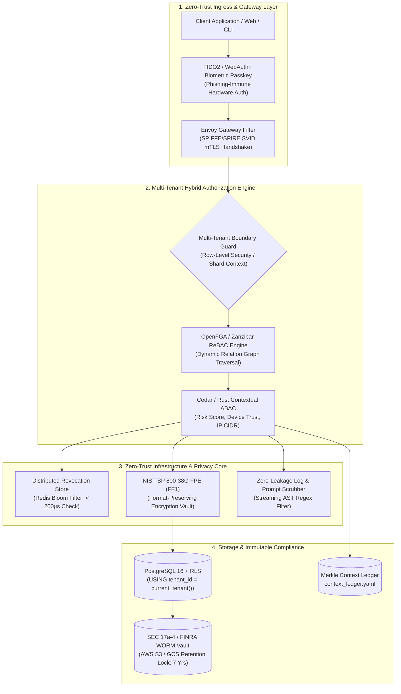

# Layerable Context Engineering Plan: Generic Multi-Tenant Security & PII Protection Mesh (Detailed Specification)

## Executive Overview & Universal Injection Mandate

<!-- Plan Co-Location Notice -->
> **Co-Located Agent Specifications**: Agent definitions for this plan are stored along with the plan in [`.nb/agentic/custom/agents/`](file:///Users/lakhwinder/RustroverProjects/nb_cicada/.nb/agentic/custom/agents/) and embedded directly in Section 8. When layered onto any workspace, `./bin/percipience layer apply --plan .nb/plan/master/security-mesh/detailed.md` automatically extracts and hydra-instantiates these files into `.nb/agentic/custom/agents/`.

Modern enterprise systems deployed into public clouds (AWS, GCP, Azure, Hybrid) face sophisticated adversaries: adversary-in-the-middle (AiTM) phishing proxies, credential stuffing swarms, stolen session tokens, cross-tenant lateral traversal in shared databases, and data privacy leaks into cloud log aggregators and LLM prompts.

This specification establishes a **Generic, Modular, and Injectable Security Mesh** (`generic_multitenant_security_mesh`). Designed to overlay onto any existing application architecture (such as quantitative platforms, IoT swarms, or financial applications), it elevates the host system to **DoD / Banking-Grade Security Posture (NIST SP 800-207 Zero-Trust, NIST SP 800-63B AAL3, FIPS 140-3, and GDPR/SEC 17a-4 compliance)**.



---

## 1. Domain-Specific Quad-Space Topology

```
.
├── Cargo.toml                                 # [Rust Workspace] Security core, ZTA, crypto crates
├── package.json                               # [Frontend] WebAuthn browser bindings & auth components
├── pyproject.toml                             # [uv Spec] CSPM scanners, policy linters
├── .nb/context/
│   ├── contracts/
│   │   ├── security_tenant_profile_contract.json  # Multi-tenant isolation configuration schema
│   │   ├── security_mfa_challenge_contract.json   # WebAuthn and TOTP challenge/response schema
│   │   ├── security_rebac_policy_contract.json    # Zanzibar relationship tuple definition schema
│   │   ├── security_pii_vault_contract.json       # FPE token vault and masking specification
│   │   └── security_four_eyes_contract.json       # Dual-control cryptographic authorization schema
│   ├── rules/
│   │   ├── multitenant_isolation_rules.md         # RLS enforcement, cross-tenant leak prevention
│   │   ├── zero_trust_rules.md                    # Continuous verification, mTLS SVID validation
│   │   ├── pii_protection_rules.md                # Zero-plaintext PII, streaming prompt scrubbers
│   │   └── rbac_governance_rules.md               # Segregation of duties, non-self approval invariants
│   └── ledger/
│       ├── context_ledger.yaml                # Merkle state block chain recording security events
│       └── context_ledger.public.yaml         # Public audit projection for regulatory compliance
├── .nb/agentic/
│   └── custom/
│       ├── agents/
│       │   ├── agent_cloud_security_officer.yaml     # Zero-Trust, mTLS, WebAuthn & RLS architect
│       │   └── agent_privacy_compliance_auditor.yaml # PII protection, FPE encryption, WORM audits
│       └── workflows/
│           ├── security_mesh_continuous_audit.yaml   # Continuous security verification workflow
│           └── pii_leakage_scan_workflow.yaml        # Automated log and prompt PII audit flow
├── workplace/
│   ├── modules/
│   │   └── mod_security_core/                 # [Rust] Core authentication, ReBAC, FPE, mTLS
│   │       ├── src/
│   │       │   ├── rbac/                      # Multi-tenant ReBAC graph & Cedar engine
│   │       │   ├── auth/                      # WebAuthn passkeys, TOTP & adaptive risk
│   │       │   ├── zerotrust/                 # SPIFFE mTLS, Redis Bloom filter revocation
│   │       │   ├── privacy/                   # NIST FF1 FPE encryption & log/prompt scrubber
│   │       │   └── compliance/                # KMS envelope encryption & WORM egress
│   ├── shared/
│   │   └── tools/
│   │       ├── inject_security_mesh.py        # Automated injection tool for existing plans
│   │       └── lint_security_parity.py        # Security policy and RLS linter
│   └── docs/                                  # Living security documentation & architecture
└── user/
    ├── inputs/                                # Tenant configurations, IdP metadata (SAML/OIDC)
    ├── hitl/                                  # Quarantined security events, Four-Eyes approvals
    └── outputs/                               # SOC2/ISO audit scorecards, CSPM compliance reports
```

---

## 2. Multi-Tenant ReBAC & Database Row-Level Security (RLS)

### 2.1. Isolation Taxonomy & Tenant Hierarchy
1. **Tenant**: Root enterprise entity (e.g. `tenant_citadel`, `tenant_two_sigma`).
2. **Organization / Subsidiary**: Legal operating entity (e.g. `org_us_brokerage`, `org_uk_ltd`).
3. **Department / Desk**: Operational trading unit (e.g. `desk_rates`, `desk_vol_arb`).
4. **Team / Pod**: Fine-grained subagent or trader group.

### 2.2. Row-Level Security (RLS) Database Enforcement
All tenant tables enforce PostgreSQL RLS policies at the database engine level:
```sql
CREATE POLICY tenant_isolation_policy ON target_table
    FOR ALL
    USING (tenant_id = NULLIF(current_setting('app.current_tenant_id', true), ''))
    WITH CHECK (tenant_id = NULLIF(current_setting('app.current_tenant_id', true), ''));
```
Any SQL query executed without the session context parameter `app.current_tenant_id` immediately yields zero rows, making SQL injection cross-tenant exfiltration mathematically impossible.

---

## 3. Adaptive Authentication, WebAuthn Passkeys & MFA

### 3.1. FIDO2 / WebAuthn Biometric Passkeys
- Implementation: `@simplewebauthn/browser` on frontend, `webauthn-rs` on backend.
- Public-key authentication: Private keys remain sealed inside device Secure Enclaves (TouchID, FaceID, YubiKey); servers store only public keys and monotonic counters to detect cloning.
- Immunity to Phishing: Credentials cryptographically bound to the WebAuthn `rp_id` (origin FQDN).

### 3.2. Adaptive Risk-Based Authentication Engine
Calculates risk score $R \in [0.0, 1.0]$ based on:
1. **Haversine Geo-Velocity**: Identifies impossible travel scenarios (velocity $> 1,000	ext{ km/h}$).
2. **Device Hardware Fingerprint**: Tracks CPU core counts, Canvas WebGL hashes, screen dimensions.
3. **IP Reputation & ASN**: Threat intelligence flagging Tor exit nodes, proxy VPNs, and malicious ASNs.
- If $R > 0.50$: Enforces mandatory biometric WebAuthn challenge.
- If $R > 0.85$: Immediately halts session and quarantines into `user/hitl/poisoning_quarantine.md`.

---

## 4. Continuous Zero-Trust Authorization & SPIFFE/SPIRE mTLS

- **NIST SP 800-207 Compliance**: Every request evaluated dynamically based on continuous session health, not one-time login state.
- **SPIFFE/SPIRE Workload Identities**: Ephemeral X.509 SVID certificates rotated every 60 minutes via local SPIRE daemons. Enforces mutual cipher negotiation across microservices.
- **Redis Bloom Filter Revocation**: Sub-millisecond revocation verification ($\le 200\mu	ext{s}$) checking session IDs (`jti`) against an in-memory Bloom filter.

---

## 5. PII Protection, Format-Preserving Encryption & Dynamic Obfuscation

### 5.1. 4-Tier Data Classification Matrix
- **Level 1 (Public)**: Market curves, tickers, benchmark indices.
- **Level 2 (Internal)**: Internal desk identifiers, aggregated portfolio PnL.
- **Level 3 (Confidential)**: Raw trade bookings, counterparty entity names.
- **Level 4 (Restricted / PII)**: Trader personal names, SSN/TIN, IBANs, email addresses, employee compensation.

### 5.2. NIST SP 800-38G Format-Preserving Encryption (FF1)
- Encrypts sensitive structured fields while preserving exact character sets and lengths (e.g. `987-65-4321` $
ightarrow$ `412-89-0532`).
- Enables legacy database schema compatibility and exact-match indexing without storing plaintext.

### 5.3. Streaming Log & LLM Prompt Scrubber
- Zero-allocation streaming filter intercepting stdout, file loggers (`tracing`), and outbound LLM prompts.
- Detects and redacts emails, tax IDs, and bank account numbers in real time, preventing PII leakage into third-party LLM providers or cloud log services.

---

## 6. Cloud Security Posture Management (CSPM) & Compliance

- **CIS Benchmarks & Kubernetes Pod Security Standards**: Enforces `Restricted` profile (read-only root filesystem, drop all Linux capabilities, non-root UID $> 10000$).
- **FIPS 140-3 Hardware Envelope Encryption**: Customer Master Keys (CMKs) protected inside Cloud HSMs; transient Data Encryption Keys (DEKs) zeroized in memory upon drop.
- **SEC 17a-4 / FINRA 4511 WORM Vault**: Continuous streaming mirroring of Merkle blocks to AWS S3 Object Lock and GCP Bucket Lock with locked retention policies.

---

## 7. Plan Injection Protocol

The plan injection engine (`inject_security_mesh.py`) enables zero-friction composition:
1. **Dependency Weaving**: Adds `security-mesh` to target plan dependencies.
2. **Schema Migration Injection**: Adds `tenant_id` columns, RLS policies, WebAuthn tables, and FPE token vaults.
3. **Middleware Hooking**: Wraps API endpoints with continuous Zero-Trust checks and PII scrubbers.
4. **Agent Swarm Integration**: Registers `agent_cloud_security_officer` and continuous audit gates into the delivery workflow.

---

## 8. Co-Located Security Specialist Subagents

1. `agent_cloud_security_officer`: Enforces multi-tenant RLS, WebAuthn passkeys, SPIFFE mTLS, and Redis Bloom filter revocation.
2. `agent_privacy_compliance_auditor`: Audits data models for zero plaintext PII, validates NIST FF1 encryption, embeds real-time prompt scrubbers, and verifies SEC 17a-4 WORM archives.
