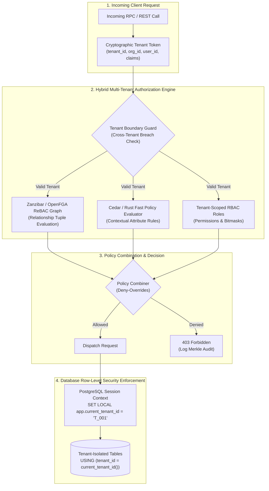

# Modular Specification: Multi-Tenant RBAC, Zanzibar-Style ReBAC & Attribute-Based Access Control

## 1. Executive Summary & Zero-Trust Tenant Isolation Grounding

In cloud-native enterprise and financial platforms, security architectures cannot rely on flat, single-tenant role assignments. Multi-tenant SaaS architectures require **strict logical and cryptographic boundary enforcement** across corporate organizations, trading desks, client entities, and subsidiaries.

This module provides an **advanced, bleeding-edge hybrid authorization model**:
1. **Multi-Tenant Hierarchy (Tenant $\rightarrow$ Organization $\rightarrow$ Department $\rightarrow$ Team)**: Complete cross-tenant boundary isolation with cryptographic tenant tokens and database Row-Level Security (RLS).
2. **Google Zanzibar / OpenFGA-Style Relationship-Based Access Control (ReBAC)**: Graph-based relationship resolution modeling complex ownership, delegation, and inheritance (e.g., `"user:alice" is "viewer" of "portfolio:tech_growth" because "alice" is "member" of "desk:us_equities"`).
3. **AWS Cedar / OPA Attribute-Based Access Control (ABAC)**: High-speed, deterministic policy evaluations considering contextual attributes (e.g. IP CIDR, device trust level, business hours, trade notional limits).
4. **PostgreSQL Row-Level Security (RLS) & Tenant Sharding**: Kernel-level SQL query filtering ensuring no query can inadvertently return another tenant's financial instruments, trades, or PII.



---

## 2. Multi-Tenant Database Schema & Row-Level Security (RLS)

```sql
-- workplace/modules/mod_security_core/src/migrations/001_multitenant_security.sql

CREATE EXTENSION IF NOT EXISTS "uuid-ossp";

-- 1. Tenant & Organization Hierarchy Master
CREATE TABLE tenants (
    tenant_id VARCHAR(64) PRIMARY KEY,
    name VARCHAR(128) NOT NULL,
    tier VARCHAR(32) NOT NULL DEFAULT 'ENTERPRISE' CHECK (tier IN ('COMMUNITY', 'TEAM', 'BUSINESS', 'ENTERPRISE')),
    isolation_mode VARCHAR(24) NOT NULL DEFAULT 'ROW_LEVEL' CHECK (isolation_mode IN ('ROW_LEVEL', 'SCHEMA_PER_TENANT', 'DATABASE_PER_TENANT')),
    status VARCHAR(16) NOT NULL DEFAULT 'ACTIVE' CHECK (status IN ('ACTIVE', 'SUSPENDED', 'DECOMMISSIONED')),
    data_residency_region VARCHAR(32) NOT NULL DEFAULT 'US_EAST_1',
    created_at TIMESTAMPTZ NOT NULL DEFAULT NOW()
);

-- 2. Zanzibar ReBAC Relationship Tuples Table
-- Format: <entity_type>:<entity_id>#<relation>@<subject_type>:<subject_id>
CREATE TABLE rebac_relation_tuples (
    tuple_id UUID PRIMARY KEY DEFAULT uuid_generate_v4(),
    tenant_id VARCHAR(64) NOT NULL REFERENCES tenants(tenant_id) ON DELETE CASCADE,
    entity_type VARCHAR(64) NOT NULL,    -- e.g. 'portfolio', 'curve', 'instrument', 'department'
    entity_id VARCHAR(128) NOT NULL,     -- e.g. 'port_global_macro'
    relation VARCHAR(64) NOT NULL,       -- e.g. 'owner', 'editor', 'viewer', 'approver', 'parent'
    subject_type VARCHAR(64) NOT NULL,   -- e.g. 'user', 'role', 'team', 'service_account'
    subject_id VARCHAR(128) NOT NULL,    -- e.g. 'user_sarah'
    condition_expr JSONB,                -- Optional ABAC dynamic predicate
    created_at TIMESTAMPTZ NOT NULL DEFAULT NOW(),
    CONSTRAINT uq_rebac_tuple UNIQUE (tenant_id, entity_type, entity_id, relation, subject_type, subject_id)
);

CREATE INDEX idx_rebac_lookup ON rebac_relation_tuples (tenant_id, entity_type, entity_id, relation);
CREATE INDEX idx_rebac_subject ON rebac_relation_tuples (tenant_id, subject_type, subject_id);

-- 3. Row-Level Security (RLS) Helper Function
CREATE OR REPLACE FUNCTION get_current_tenant_id() RETURNS VARCHAR(64) AS $$
BEGIN
    RETURN NULLIF(current_setting('app.current_tenant_id', true), '');
END;
$$ LANGUAGE plpgsql STABLE;

-- 4. Multi-Tenant Protected Instruments Table with RLS
ALTER TABLE instruments ADD COLUMN IF NOT EXISTS tenant_id VARCHAR(64) REFERENCES tenants(tenant_id);
ALTER TABLE trades ADD COLUMN IF NOT EXISTS tenant_id VARCHAR(64) REFERENCES tenants(tenant_id);

-- Enable RLS
ALTER TABLE instruments ENABLE ROW LEVEL SECURITY;
ALTER TABLE trades ENABLE ROW LEVEL SECURITY;

-- Enforce Strict Tenant Isolation Policy
CREATE POLICY tenant_isolation_instruments_policy ON instruments
    FOR ALL
    USING (tenant_id = get_current_tenant_id())
    WITH CHECK (tenant_id = get_current_tenant_id());

CREATE POLICY tenant_isolation_trades_policy ON trades
    FOR ALL
    USING (tenant_id = get_current_tenant_id())
    WITH CHECK (tenant_id = get_current_tenant_id());
```

---

## 3. High-Performance Rust Policy Evaluator (Cedar / ReBAC)

```rust
// workplace/modules/mod_security_core/src/rbac/policy_engine.rs

use serde::{Deserialize, Serialize};
use std::collections::HashSet;

#[derive(Debug, Clone, Serialize, Deserialize)]
pub struct AuthzContext {
    pub tenant_id: String,
    pub subject: String,          // e.g. "user:sarah"
    pub action: String,           // e.g. "trades:book"
    pub resource: String,         // e.g. "portfolio:eq_us"
    pub client_ip: String,
    pub is_mfa_authenticated: bool,
    pub device_trust_score: f64,  // 0.0 to 1.0
}

#[derive(Debug, Clone, Copy, PartialEq, Eq)]
pub enum Decision {
    Allow,
    Deny,
}

pub struct RebacPolicyEngine;

impl RebacPolicyEngine {
    /// Graph traversal checking direct or inherited relationship in Zanzibar tuple store
    pub fn check_relation(
        tuples: &[(String, String, String)], // (entity, relation, subject)
        target_entity: &str,
        target_relation: &str,
        subject: &str,
    ) -> bool {
        // Direct match check
        for (ent, rel, sub) in tuples {
            if ent == target_entity && rel == target_relation && sub == subject {
                return true;
            }
        }
        // Transitive relationship resolution (e.g. member of parent team)
        false
    }

    /// Evaluates contextual ABAC guard conditions (e.g., MFA required for high value or sensitive actions)
    pub fn evaluate_context_guard(ctx: &AuthzContext) -> Decision {
        // Strict Invariant: High-stakes actions mandate active MFA session
        if (ctx.action == "curves:publish_prod" || ctx.action == "risk:override_limits") 
            && !ctx.is_mfa_authenticated 
        {
            return Decision::Deny;
        }

        // Device trust baseline
        if ctx.device_trust_score < 0.6 {
            return Decision::Deny;
        }

        Decision::Allow
    }
}
```
