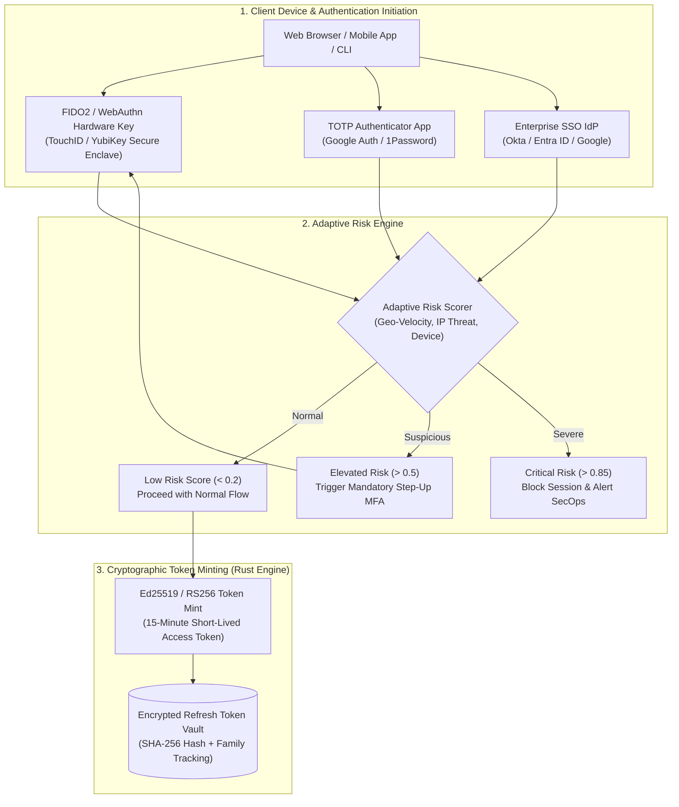

# Modular Specification: Adaptive Authentication, WebAuthn Passkeys & Enterprise MFA

## 1. Executive Summary & Identity Assurance Levels (NIST SP 800-63B AAL3)

Authentication in high-assurance financial and cloud platforms must evolve beyond legacy static username/password pairs. Phishing, credential stuffing, and session hijacking represent over $80\%$ of enterprise breach vectors.

This module provides **military-grade, modern identity authentication**:
1. **FIDO2 / WebAuthn Hardware Passkeys**: Cryptographic public-key credentials bound to physical hardware (YubiKey, Apple Secure Enclave / TouchID, Windows Hello), mathematically immune to phishing and adversary-in-the-middle (AiTM) proxy attacks.
2. **RFC 6238 Time-Based One-Time Password (TOTP)**: Standard software MFA with encrypted seed storage (AES-256-GCM) and cryptographically hashed single-use recovery codes.
3. **Adaptive Risk-Based Step-Up Authentication**: Real-time evaluation of client signals (Geo-velocity impossible travel calculation, ASN/TOR proxy detection, device hardware fingerprint). Triggers mandatory biometric step-up challenges when risk scores exceed normal thresholds.
4. **Enterprise Identity Federation (OIDC / OAuth 2.1 & SAML 2.0)**: Seamless single sign-on (SSO) integration with enterprise identity providers (Microsoft Entra ID, Okta, Google Workspace, Keycloak) with automated JIT (Just-In-Time) user provisioning and SCIM 2.0 directory synchronization.
5. **Asymmetric Token Lifecycle (Ed25519 EdDSA / RS256)**: Short-lived access tokens (15-minute expiration) paired with stateful refresh tokens backed by automatic reuse detection and instantaneous revocation cascades.



---

## 2. WebAuthn & MFA Database Schema

```sql
-- workplace/modules/mod_security_core/src/migrations/002_auth_and_mfa.sql

-- 1. WebAuthn Registered Passkeys Table
CREATE TABLE user_webauthn_credentials (
    credential_id BYTEA PRIMARY KEY,
    user_id VARCHAR(64) NOT NULL REFERENCES users(user_id) ON DELETE CASCADE,
    tenant_id VARCHAR(64) NOT NULL REFERENCES tenants(tenant_id) ON DELETE CASCADE,
    public_key BYTEA NOT NULL,
    counter BIGINT NOT NULL DEFAULT 0,
    aaguid UUID,
    attestation_format VARCHAR(32) NOT NULL DEFAULT 'none',
    friendly_name VARCHAR(64) NOT NULL,
    transports TEXT[], -- 'usb', 'nfc', 'ble', 'internal'
    created_at TIMESTAMPTZ NOT NULL DEFAULT NOW(),
    last_used_at TIMESTAMPTZ
);

CREATE INDEX idx_webauthn_user ON user_webauthn_credentials (user_id);

-- 2. TOTP MFA Enrollment Table
CREATE TABLE user_totp_factors (
    factor_id UUID PRIMARY KEY DEFAULT uuid_generate_v4(),
    user_id VARCHAR(64) UNIQUE NOT NULL REFERENCES users(user_id) ON DELETE CASCADE,
    tenant_id VARCHAR(64) NOT NULL REFERENCES tenants(tenant_id) ON DELETE CASCADE,
    encrypted_secret_key BYTEA NOT NULL, -- AES-256-GCM encrypted seed
    secret_iv BYTEA NOT NULL,
    key_version INTEGER NOT NULL DEFAULT 1,
    is_verified BOOLEAN NOT NULL DEFAULT FALSE,
    backup_codes_hash TEXT[] NOT NULL,  -- Argon2id hashes of 10 single-use codes
    enrolled_at TIMESTAMPTZ NOT NULL DEFAULT NOW()
);

-- 3. Refresh Token Vault with Reuse Detection
CREATE TABLE auth_refresh_tokens (
    token_hash VARCHAR(64) PRIMARY KEY, -- SHA-256 of raw refresh token
    user_id VARCHAR(64) NOT NULL REFERENCES users(user_id) ON DELETE CASCADE,
    tenant_id VARCHAR(64) NOT NULL REFERENCES tenants(tenant_id) ON DELETE CASCADE,
    token_family_id UUID NOT NULL,       -- Family identifier for reuse detection
    is_revoked BOOLEAN NOT NULL DEFAULT FALSE,
    expires_at TIMESTAMPTZ NOT NULL,
    created_at TIMESTAMPTZ NOT NULL DEFAULT NOW()
);

CREATE INDEX idx_refresh_family ON auth_refresh_tokens (token_family_id);
```

---

## 3. Rust WebAuthn Verification & Adaptive Risk Calculation

```rust
// workplace/modules/mod_security_core/src/auth/adaptive_auth.rs

use chrono::{DateTime, Utc};
use serde::{Deserialize, Serialize};

#[derive(Debug, Clone, Serialize, Deserialize)]
pub struct AuthAttemptSignal {
    pub user_id: String,
    pub ip_address: String,
    pub latitude: f64,
    pub longitude: f64,
    pub timestamp: DateTime<Utc>,
    pub previous_attempt: Option<PreviousLoginRecord>,
    pub device_fingerprint_hash: String,
}

#[derive(Debug, Clone, Serialize, Deserialize)]
pub struct PreviousLoginRecord {
    pub latitude: f64,
    pub longitude: f64,
    pub timestamp: DateTime<Utc>,
    pub device_fingerprint_hash: String,
}

pub struct AdaptiveRiskEngine;

impl AdaptiveRiskEngine {
    /// Computes risk score between 0.0 (clean) and 1.0 (malicious anomaly)
    pub fn calculate_risk_score(signal: &AuthAttemptSignal) -> f64 {
        let mut score: f64 = 0.0;

        if let Some(prev) = &signal.previous_attempt {
            // 1. Calculate Geo-Velocity (Impossible Travel Check)
            let distance_km = haversine_distance(
                signal.latitude, signal.longitude,
                prev.latitude, prev.longitude
            );
            let hours = (signal.timestamp - prev.timestamp).num_seconds() as f64 / 3600.0;
            
            if hours > 0.001 {
                let speed_kmh = distance_km / hours;
                // Greater than commercial aircraft speed (900 km/h) is suspicious
                if speed_kmh > 1000.0 {
                    score += 0.65; // High anomaly penalty
                } else if speed_kmh > 400.0 {
                    score += 0.30;
                }
            }

            // 2. Device Fingerprint Drift Check
            if signal.device_fingerprint_hash != prev.device_fingerprint_hash {
                score += 0.25;
            }
        } else {
            // New unseen device / location baseline risk
            score += 0.20;
        }

        score.min(1.0)
    }
}

/// Great-circle distance between two geographic coordinates in kilometers
fn haversine_distance(lat1: f64, lon1: f64, lat2: f64, lon2: f64) -> f64 {
    let r = 6371.0; // Earth radius in km
    let d_lat = (lat2 - lat1).to_radians();
    let d_lon = (lon2 - lon1).to_radians();
    let a = (d_lat / 2.0).sin().powi(2)
        + lat1.to_radians().cos() * lat2.to_radians().cos() * (d_lon / 2.0).sin().powi(2);
    let c = 2.0 * a.sqrt().atan2((1.0 - a).sqrt());
    r * c
}
```
