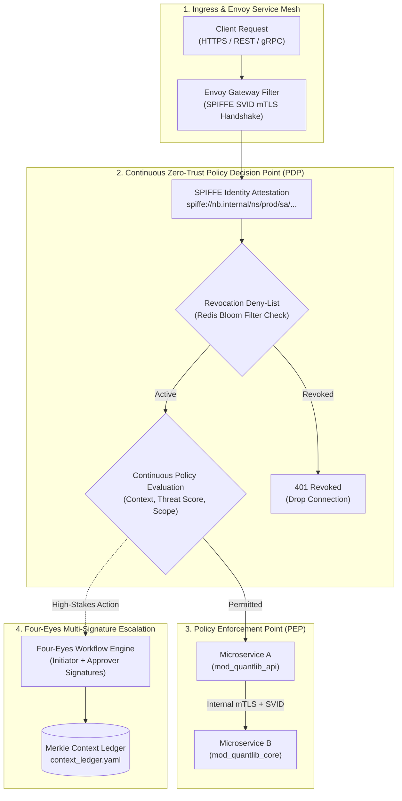

# Modular Specification: Continuous Zero-Trust Authorization, SPIFFE/SPIRE mTLS & Dynamic Revocation

## 1. Executive Summary & NIST SP 800-207 Zero-Trust Architecture

In modern cloud-native architectures, the traditional perimeter-based security model ("castle-and-moat") is fundamentally obsolete. Once an attacker or rogue container breaches the internal virtual network (VPC/subnet), unsegmented networks allow horizontal lateral movement.

This module implements a **NIST SP 800-207 compliant Continuous Zero-Trust Architecture (ZTA)**:
1. **Never Trust, Always Verify**: Every single API request, gRPC invocation, and intra-service packet is explicitly authenticated, authorized, and encrypted—regardless of whether it originates outside the cloud or inside the Kubernetes cluster.
2. **Workload Identity & Mutual TLS (SPIFFE/SPIRE)**: Every microservice and batch worker receives an ephemeral cryptographic X.509 SVID (SPIFFE Verifiable Identity Document), rotated automatically every 60 minutes via SPIRE daemons. Enforces bidirectional mTLS encryption and identity attestation.
3. **Sub-Millisecond Distributed Revocation (Redis Bloom Filter)**: High-speed distributed token revocation layer checking active session IDs (`jti`) against an in-memory Bloom filter with $\le 200\mu\text{s}$ evaluation latency, eradicating the vulnerability window of stolen JWT tokens.
4. **Institutional Four-Eyes Principle (Dual-Control State Machine)**: Cryptographic multi-signature protocol requiring two distinct authorized actors before state-altering actions (e.g. promoting production pricing models, overriding risk limits, or altering security policies) can execute.



---

## 2. SPIFFE/SPIRE Service Identity & mTLS Configuration

### 2.1. Workload Identity Taxonomy
Workload identities are bound to cryptographic URIs:
- QuantLib API Gateway: `spiffe://nb.enterprise/ns/finance/sa/mod_quantlib_api`
- Numerical Core Compute Enclave: `spiffe://nb.enterprise/ns/finance/sa/mod_quantlib_core`
- TimescaleDB & DuckDB Persistence Service: `spiffe://nb.enterprise/ns/finance/sa/mod_quantlib_db`
- Accounting Subledger Worker: `spiffe://nb.enterprise/ns/finance/sa/mod_quantlib_accounting`

### 2.2. Envoy mTLS Service Mesh Filter Spec
```yaml
# workplace/modules/mod_security_core/config/envoy_zt_filter.yaml
static_resources:
  listeners:
  - name: internal_grpc_listener
    address:
      socket_address: { address: 0.0.0.0, port_value: 9443 }
    filter_chains:
    - transport_socket:
        name: envoy.transport_sockets.tls
        typed_config:
          "@type": type.googleapis.com/envoy.extensions.transport_sockets.tls.v3.DownstreamTlsContext
          common_tls_context:
            tls_certificates:
            - certificate_chain: { filename: "/run/spire/certs/svid.pem" }
              private_key: { filename: "/run/spire/certs/key.pem" }
            validation_context:
              trusted_ca: { filename: "/run/spire/certs/bundle.pem" }
              match_typed_subject_alt_names:
              - sanitizer:
                  exact: "spiffe://nb.enterprise/ns/finance/sa/mod_quantlib_api"
    filters:
    - name: envoy.filters.network.http_connection_manager
      typed_config:
        "@type": type.googleapis.com/envoy.extensions.filters.network.http_connection_manager.v3.HttpConnectionManager
        stat_prefix: ingress_grpc
        route_config:
          name: local_route
          virtual_hosts:
          - name: local_service
            domains: ["*"]
            routes:
            - match: { prefix: "/quantlib.v1.QuantLibPricingService/" }
              route: { cluster: local_quant_core_cluster }
```

---

## 3. Distributed Real-Time Token Revocation (Rust + Redis)

```rust
// workplace/modules/mod_security_core/src/zerotrust/revocation.rs

use redis::AsyncCommands;
use std::sync::Arc;

pub struct DistributedRevocationStore {
    redis_pool: deadpool_redis::Pool,
}

impl DistributedRevocationStore {
    pub fn new(pool: deadpool_redis::Pool) -> Self {
        Self { redis_pool: pool }
    }

    /// Revokes a JWT ID (jti) immediately across all globally distributed gateway nodes
    pub async fn revoke_token(&self, jti: &str, ttl_seconds: usize) -> Result<(), redis::RedisError> {
        let mut conn = self.redis_pool.get().await.map_err(|e| {
            redis::RedisError::from((redis::ErrorKind::IoError, "Redis connection failed", e.to_string()))
        })?;

        let key = format!("revoked:jti:{}", jti);
        conn.set_ex::<_, _, ()>(key, "1", ttl_seconds as u64).await?;
        
        // Also flag into bloom filter for fast local cache pre-check
        let _: () = redis::cmd("BF.ADD")
            .arg("bloom:revoked_tokens")
            .arg(jti)
            .query_async(&mut conn)
            .await
            .unwrap_or(()); // Non-fatal if RedisBloom module is absent

        Ok(())
    }

    /// Sub-millisecond verification checking whether a token has been revoked
    pub async fn is_token_revoked(&self, jti: &str) -> Result<bool, redis::RedisError> {
        let mut conn = self.redis_pool.get().await.map_err(|e| {
            redis::RedisError::from((redis::ErrorKind::IoError, "Redis connection pool error", e.to_string()))
        })?;

        let key = format!("revoked:jti:{}", jti);
        let exists: bool = conn.exists(key).await?;
        Ok(exists)
    }
}
```

---

## 4. Cryptographic Four-Eyes Multi-Signature Verification Invariant

When executing any high-stakes state change:
$$\text{ActionStatus} = \begin{cases} 
\text{EXECUTED} & \text{if } \text{VerifySig}(K_{\text{initiator}}, M) \land \text{VerifySig}(K_{\text{approver}}, M) \land (\text{initiator} \ne \text{approver}) \\
\text{DENIED} & \text{otherwise}
\end{cases}$$

Every authorized payload is sealed into an immutable block in `.nb/context/ledger/context_ledger.yaml` with both Ed25519 digital signatures.
