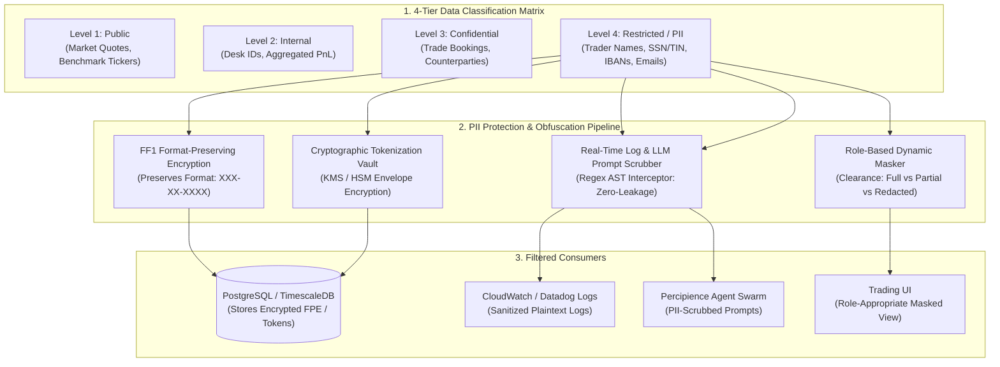

# Modular Specification: PII Data Protection, Format-Preserving Encryption & Dynamic Obfuscation

## 1. Executive Summary & Regulatory Privacy Foundations

Data privacy regulations (GDPR Art. 32, CCPA/CPRA, HIPAA, GLBA, FINRA Rule 4511) impose severe regulatory penalties for unauthorized exposure of Personally Identifiable Information (PII) and sensitive financial records.

In high-frequency trading and quantitative systems, PII exposure risks manifest in three critical vectors:
1. **Persistent Data Stores**: Storing plaintext trader names, client tax IDs (SSN/TIN), and bank routing numbers in database tables.
2. **Telemetry & Log Exfiltration**: Accidental leakage of sensitive user identities and trade counterparty data into Datadog, Prometheus, Splunk, or OpenTelemetry traces.
3. **LLM Agent Prompt Context Leakage**: Unsanitized trader comments, client email addresses, and confidential portfolio ownership flowing into external LLM prompts during automated structuring or code generation.

This module delivers a comprehensive **PII Protection & Dynamic Obfuscation Engine**:
- **NIST SP 800-38G Format-Preserving Encryption (FF1)**: Cryptographically encrypts sensitive structured fields while preserving their exact length, character set, and format—allowing schema validation, database indexing, and downstream routing without decryption.
- **Dynamic Role-Based Field Masking**: Evaluates the requester's RBAC role and classification clearance at query time, dynamically rendering plaintext, partial redaction (e.g. `***-**-6789`), or total obfuscation.
- **High-Throughput Log & Prompt Scrubber Interceptor**: Zero-allocation streaming AST and regex filters embedded into application loggers (`tracing`) and agent prompt gateways, scrubbing PII before serialization.
- **KMS-Backed Cryptographic Tokenization**: Replaces sensitive real-world identifiers with opaque UUID tokens linked to an isolated, hardware-security-module (HSM) protected token vault.



---

## 2. NIST SP 800-38G Format-Preserving Encryption (FF1) & Masking Engine

```rust
// workplace/modules/mod_security_core/src/privacy/fpe_masker.rs

use serde::{Deserialize, Serialize};
use regex::Regex;
use std::sync::OnceLock;

#[derive(Debug, Clone, Copy, PartialEq, Eq)]
pub enum DataSensitivityLevel {
    Public,
    Internal,
    Confidential,
    RestrictedPii,
}

#[derive(Debug, Clone, Copy, PartialEq, Eq)]
pub enum MaskingStyle {
    FullRedaction,        // "[REDACTED_PII]"
    PartialTrailingFour,  // "***-**-1234"
    EmailMask,            // "j***@bank.com"
    PlaintextAuthorized,  // Unmasked (Compliance only)
}

static EMAIL_REGEX: OnceLock<Regex> = OnceLock::new();
static SSN_REGEX: OnceLock<Regex> = OnceLock::new();
static IBAN_REGEX: OnceLock<Regex> = OnceLock::new();

pub struct PiiMaskingEngine;

impl PiiMaskingEngine {
    /// Dynamically masks a string based on sensitivity and requester clearance
    pub fn mask_field(input: &str, style: MaskingStyle) -> String {
        match style {
            MaskingStyle::PlaintextAuthorized => input.to_string(),
            MaskingStyle::FullRedaction => "[REDACTED_PII]".to_string(),
            MaskingStyle::PartialTrailingFour => {
                let clean: String = input.chars().filter(|c| c.is_alphanumeric()).collect();
                if clean.len() <= 4 {
                    "****".to_string()
                } else {
                    let trailing = &clean[clean.len() - 4..];
                    format!("***-**-{}", trailing)
                }
            }
            MaskingStyle::EmailMask => {
                if let Some((user, domain)) = input.split_once('@') {
                    if user.len() <= 1 {
                        format!("*@{}", domain)
                    } else {
                        let first = user.chars().next().unwrap_or('*');
                        format!("{}***@{}", first, domain)
                    }
                } else {
                    "****@***.***".to_string()
                }
            }
        }
    }

    /// Real-time streaming log and LLM prompt scrubber replacing PII with synthetic markers
    pub fn scrub_text_payload(text: &str) -> String {
        let email_re = EMAIL_REGEX.get_or_init(|| {
            Regex::new(r"(?i)[a-z0-9._%+-]+@[a-z0-9.-]+\.[a-z]{2,}").unwrap()
        });
        let ssn_re = SSN_REGEX.get_or_init(|| {
            Regex::new(r"\d{3}-\d{2}-\d{4}").unwrap()
        });
        let iban_re = IBAN_REGEX.get_or_init(|| {
            Regex::new(r"[A-Z]{2}\d{2}[A-Z0-9]{11,30}").unwrap()
        });

        let mut sanitized = email_re.replace_all(text, "[SCRUBBED_EMAIL]").to_string();
        sanitized = ssn_re.replace_all(&sanitized, "[SCRUBBED_TIN]").to_string();
        sanitized = iban_re.replace_all(&sanitized, "[SCRUBBED_IBAN]").to_string();

        sanitized
    }
}
```

---

## 3. Database Schema for Cryptographic Tokenization & Audit

```sql
-- workplace/modules/mod_security_core/src/migrations/003_pii_vault.sql

-- 1. Isolated PII Token Vault (KMS Envelope Encrypted)
CREATE TABLE pii_token_vault (
    token_id UUID PRIMARY KEY DEFAULT uuid_generate_v4(),
    tenant_id VARCHAR(64) NOT NULL REFERENCES tenants(tenant_id) ON DELETE CASCADE,
    pii_type VARCHAR(32) NOT NULL CHECK (pii_type IN ('TAXPAYER_ID', 'BANK_ACCOUNT', 'LEGAL_NAME', 'EMAIL', 'PHONE')),
    fpe_ciphertext VARCHAR(128) NOT NULL, -- NIST FF1 format-preserved ciphertext
    encrypted_payload BYTEA NOT NULL,     -- AES-256-GCM envelope-encrypted with AWS/GCP KMS key
    payload_iv BYTEA NOT NULL,
    kms_key_arn VARCHAR(256) NOT NULL,
    created_at TIMESTAMPTZ NOT NULL DEFAULT NOW()
);

CREATE INDEX idx_pii_vault_lookup ON pii_token_vault (tenant_id, fpe_ciphertext);

-- 2. Audit Access Log for Every Plaintext PII Decryption Event
CREATE TABLE pii_access_audit_log (
    event_id UUID PRIMARY KEY DEFAULT uuid_generate_v4(),
    token_id UUID NOT NULL REFERENCES pii_token_vault(token_id),
    accessed_by_user_id VARCHAR(64) NOT NULL REFERENCES users(user_id),
    justification TEXT NOT NULL,
    access_timestamp TIMESTAMPTZ NOT NULL DEFAULT NOW(),
    client_ip INET NOT NULL,
    merkle_leaf_hash VARCHAR(64) NOT NULL
);

CREATE INDEX idx_pii_audit_user ON pii_access_audit_log (accessed_by_user_id, access_timestamp DESC);
```

---

## 4. Privacy Invariants & Gate Assertions

1. **Zero-Plaintext Invariant**: No raw Level 4 PII (SSN, IBAN, unmasked personal emails) may be persisted in standard relational tables or logs. All storage must utilize either NIST FF1 format-preserving encryption or tokenized UUID pointers.
2. **Prompt Sanitization Gate**: All outbound LLM requests passing through the Percipience agent gateway are processed through `scrub_text_payload`. Any detected unmasked PII causes the request to be halted and quarantined into `user/hitl/poisoning_quarantine.md`.
3. **Decryption Justification Invariant**: Every call to decrypt a token from `pii_token_vault` mandates an explicit business justification logged to `pii_access_audit_log` with an immutable Merkle state proof.
