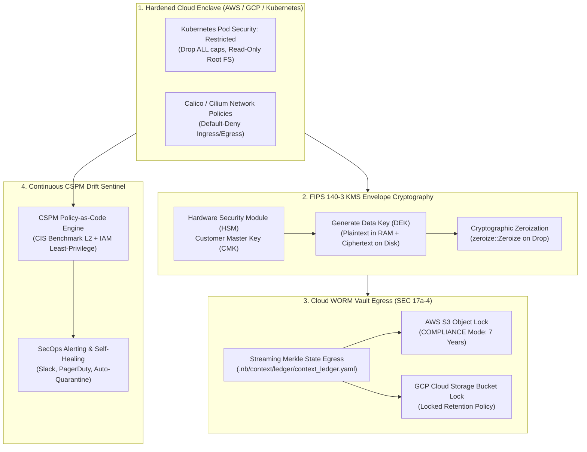

# Modular Specification: Cloud Security Posture, KMS Envelope Encryption & Immutable WORM Compliance

## 1. Executive Summary & Defense-in-Depth Cloud Architecture

Deploying financial models, trading systems, and sensitive quantitative workloads into public clouds (AWS, GCP, Azure, Hybrid) requires continuous hardening across the infrastructure, container, and cryptographic layers.

This module enforces **comprehensive enterprise cloud defense-in-depth**:
1. **Automated Cloud Security Posture Management (CSPM)**: Real-time drift detection and policy-as-code audits against the CIS Cloud Benchmarks, Kubernetes Pod Security Standards (`Restricted` baseline), and automated IAM least-privilege analysis.
2. **KMS Hardware Envelope Encryption (FIPS 140-3 Level 3)**: Envelope encryption strategy utilizing cloud Hardware Security Modules (AWS KMS, GCP Cloud KMS, Azure Key Vault, HashiCorp Vault). Master Keys (CMKs) never leave hardware boundaries; transient Data Encryption Keys (DEKs) are generated, utilized in memory, and cryptographically zeroized (`zeroize` Rust trait).
3. **Immutable Cloud WORM Vault Egress (SEC Rule 17a-4 / FINRA Rule 4511)**: Continuous streaming mirroring of all cryptographic Merkle ledger blocks and audit events to Write-Once-Read-Many (WORM) storage with strict Legal Hold and Compliance Lock flags preventing truncation or deletion even by cloud account root credentials.
4. **End-to-End Compliance Mapping**: Programmatically maps platform controls to SOC2 Type II (Trust Services Criteria), ISO/IEC 27001:2022, GDPR Article 32, HIPAA Security Rule, and PCI DSS v4.0.



---

## 2. KMS Envelope Encryption Rust Implementation

```rust
// workplace/modules/mod_security_core/src/compliance/envelope_crypto.rs

use aes_gcm::{
    aead::{Aead, KeyInit, OsRng},
    Aes256Gcm, Nonce,
};
use zeroize::{Zeroize, ZeroizeOnDrop};

/// Transient in-memory Data Encryption Key (DEK) that zeroizes automatically upon drop
#[derive(Zeroize, ZeroizeOnDrop)]
pub struct TransientDataEncryptionKey {
    key_bytes: [u8; 32],
}

impl TransientDataEncryptionKey {
    pub fn new(raw_bytes: [u8; 32]) -> Self {
        Self { key_bytes: raw_bytes }
    }

    /// Encrypts sensitive payload using AES-256-GCM authenticated cipher
    pub fn encrypt(&self, plaintext: &[u8]) -> Result<(Vec<u8>, [u8; 12]), String> {
        let cipher = Aes256Gcm::new_from_slice(&self.key_bytes)
            .map_err(|e| format!("Cipher init error: {}", e))?;

        let mut nonce_bytes = [0u8; 12];
        use rand::RngCore;
        OsRng.fill_bytes(&mut nonce_bytes);
        let nonce = Nonce::from_slice(&nonce_bytes);

        let ciphertext = cipher
            .encrypt(nonce, plaintext)
            .map_err(|e| format!("Encryption failure: {}", e))?;

        Ok((ciphertext, nonce_bytes))
    }
}
```

---

## 3. Regulatory Compliance Matrix & Evidence Mapping

| Regulatory Standard | Mandated Requirement | Technical Implementation in Security Mesh | Verification Evidence |
| :--- | :--- | :--- | :--- |
| **SEC Rule 17a-4(f)** | Books and records must be stored in non-rewriteable, non-erasable (WORM) format. | Automated WORM egress mirroring to AWS S3 Object Lock (`COMPLIANCE` mode with legal hold). | S3 `RetentionPeriod` audit receipt, SHA-256 Merkle chain verification. |
| **FINRA Rule 4511** | Preserved records must be easily accessible and verifiable for at least six years. | Cryptographic index mapping in TimescaleDB + Parquet data lake with 7-year retention locks. | Verification gate `gate_worm_egress_audit`. |
| **GDPR Article 32** | Pseudonymisation and encryption of personal data; continuous confidentiality. | NIST SP 800-38G Format-Preserving Encryption (FF1) + KMS-backed isolated token vault. | Automated PII scrubber, zero-plaintext storage assertions. |
| **SOC2 Type II (CC6.1)** | Logical access controls prevent unauthorized access to customer data. | Multi-tenant Row-Level Security (RLS) + FIDO2/WebAuthn adaptive MFA + Four-Eyes dual control. | Automated RBAC matrix linter, non-self approval verification. |
| **NIST SP 800-207** | Continuous Zero-Trust verification of every transaction and service connection. | SPIFFE/SPIRE SVID mTLS certificate rotation every 60 minutes + Redis Bloom filter token revocation. | Envoy ingress handshake logs, mTLS mutual cipher tests. |
