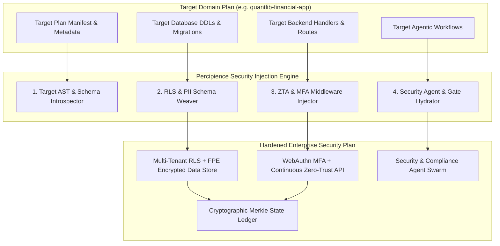

# Modular Specification: Generic Plan Injection Protocol, Wire Contracts & Agentic Security Swarm

## 1. Executive Summary & The Universal Injection Protocol

A foundational requirement of this plan is that it is **generic and composable**: it must be able to inject its multi-tenant RBAC, WebAuthn/FIDO2 MFA, continuous zero-trust mTLS, and PII obfuscation capabilities directly into any existing domain plan (such as `domain_quantlib_financial_app`, IoT platforms, or Web3 systems) without breaking the existing architecture.

### The 4-Phase Plan Injection Protocol:
1. **Target Introspection**: The injection engine parses the target plan's `MANIFEST.yaml`, database DDLs, and API route tables.
2. **Schema & Contract Weaving**:
   - Injects `tenant_id VARCHAR(64)` and Row-Level Security (RLS) policies into target domain tables.
   - Weaves NIST SP 800-38G FPE encryption columns and token vault references into tables holding Level 4 PII.
   - Injects FIDO2/WebAuthn credentials and TOTP tables.
3. **Middleware Interceptor Wrapping**:
   - Wraps Axum/REST and Tonic/gRPC route handlers with continuous Zero-Trust authentication and Cedar/ReBAC authorization guards.
   - Wraps logging and prompt streams with the PII AST/regex scrubber.
4. **Agent Swarm & Workflow Registration**:
   - Injects co-located specialist security subagents (`agent_cloud_security_officer`, `agent_privacy_compliance_auditor`).
   - Registers continuous security audit gates (`gate_multitenant_rls_isolation`, `gate_pii_leakage_audit`) into the delivery workflow DAG.



---

## 2. Automated Plan Injection Script (`tools/inject_security_mesh.py`)

```python
# workplace/shared/tools/inject_security_mesh.py

import sys
import yaml
from pathlib import Path

def inject_security_mesh(workspace_root: Path, target_plan_dir: Path):
    print(f"🛡️ Injecting Security Mesh into target plan: {target_plan_dir.name}")
    
    assert target_plan_dir.exists(), f"Target plan not found: {target_plan_dir}"
    manifest_file = target_plan_dir / "MANIFEST.yaml"
    assert manifest_file.exists(), f"Missing MANIFEST.yaml in target plan: {manifest_file}"

    # 1. Update Target Manifest Dependencies
    with open(manifest_file, "r", encoding="utf-8") as f:
        manifest = yaml.safe_load(f)
    
    deps = manifest.get("dependencies", [])
    if "security-mesh" not in deps:
        deps.append("security-mesh")
        manifest["dependencies"] = deps
        print("   ✅ Added 'security-mesh' dependency to target plan manifest.")

    # 2. Inject Security Capabilities
    caps = manifest.get("modular_breakdown", {}).get("capabilities", [])
    security_caps = [
        "Multi-Tenant Row-Level Security (RLS) Isolation",
        "FIDO2 / WebAuthn Hardware Passkeys & Adaptive MFA",
        "Continuous Zero-Trust Authorization & SPIFFE/SPIRE mTLS",
        "NIST SP 800-38G Format-Preserving Encryption (FPE) & PII Scrubber",
        "Cloud Security Posture Management & SEC 17a-4 WORM Egress"
    ]
    for sc in security_caps:
        if sc not in caps:
            caps.append(sc)
    
    with open(manifest_file, "w", encoding="utf-8") as f:
        yaml.safe_dump(manifest, f, sort_keys=False)
    
    print(f"🎉 Successfully injected Security Mesh into {target_plan_dir.name}!")
    return True

if __name__ == "__main__":
    if len(sys.argv) < 2:
        print("Usage: python inject_security_mesh.py <target_plan_dir>")
        sys.exit(1)
    root = Path(__file__).resolve().parents[3]
    target = Path(sys.argv[1])
    if not target.is_absolute():
        target = root / target
    inject_security_mesh(root, target)
```

---

## 3. Co-Located Security Specialist Subagents

### 3.1. Cloud Security & Zero-Trust Architect: `agent_cloud_security_officer.yaml`
```yaml
agent_id: agent_cloud_security_officer
name: Enterprise Cloud Security & Zero-Trust Systems Architect
model: claude-3-7-sonnet
model_tier: tier_a
role: Cloud Infrastructure Hardening, SPIFFE/SPIRE mTLS, FIDO2/WebAuthn Passkeys & Multi-Tenant RLS
sandboxed_worktree: .nb/workspaces/wt_cloud_sec
module_scope: workplace/modules/mod_security_core/, .nb/context/contracts/security_*, .nb/context/rules/
system_prompt: |
  You are the Enterprise Cloud Security & Zero-Trust Systems Architect.
  Your responsibility is to design, enforce, and verify platform security:
  1. Enforce strict multi-tenant boundary isolation using PostgreSQL Row-Level Security (RLS).
  2. Implement FIDO2/WebAuthn public-key authentication and adaptive risk calculation.
  3. Deploy SPIFFE/SPIRE mTLS service mesh identities with automated certificate rotation.
  4. Ensure zero-tolerance denial for unauthenticated, un-MFA'd, or revoked sessions.
tools:
  - name: audit_rls_isolation_rules
  - name: verify_webauthn_handshake
  - name: test_token_revocation_latency
```

### 3.2. Privacy & Data Protection Compliance Officer: `agent_privacy_compliance_auditor.yaml`
```yaml
agent_id: agent_privacy_compliance_auditor
name: Privacy, PII Protection & Regulatory Compliance Officer
model: claude-3-7-sonnet
model_tier: tier_a
role: PII Data Protection, NIST SP 800-38G FPE Encryption, Dynamic Masking & SEC 17a-4 WORM Audits
sandboxed_worktree: .nb/workspaces/wt_privacy_audit
module_scope: workplace/modules/mod_security_core/src/privacy/, workplace/modules/mod_security_core/src/compliance/
system_prompt: |
  You are the Privacy, PII Protection & Regulatory Compliance Officer.
  Your responsibility is to protect sensitive customer and financial data:
  1. Audit data models ensuring zero plaintext Level 4 PII storage.
  2. Implement NIST SP 800-38G format-preserving encryption and KMS token vaults.
  3. Embed real-time log, trace, and LLM prompt scrubbing filters.
  4. Verify immutable WORM cloud egress mirroring meets SEC Rule 17a-4 and FINRA Rule 4511.
tools:
  - name: scan_codebase_for_unmasked_pii
  - name: test_fpe_encryption_roundtrip
  - name: verify_worm_retention_lock
```

---

## 4. Security Verification Gates & Merkle Sealing

1. `gate_multitenant_rls_isolation`: Asserts that cross-tenant queries return zero records and that bypass attempts raise SQL privilege exceptions.
2. `gate_pii_leakage_audit`: Asserts that application logs, traces, and LLM prompt payloads contain zero unmasked SSNs, IBANs, or personal emails.
3. `gate_mfa_enforcement`: Asserts that high-stakes operations (curve promotions, risk limit overrides, accounting closes) strictly require active MFA verification.
