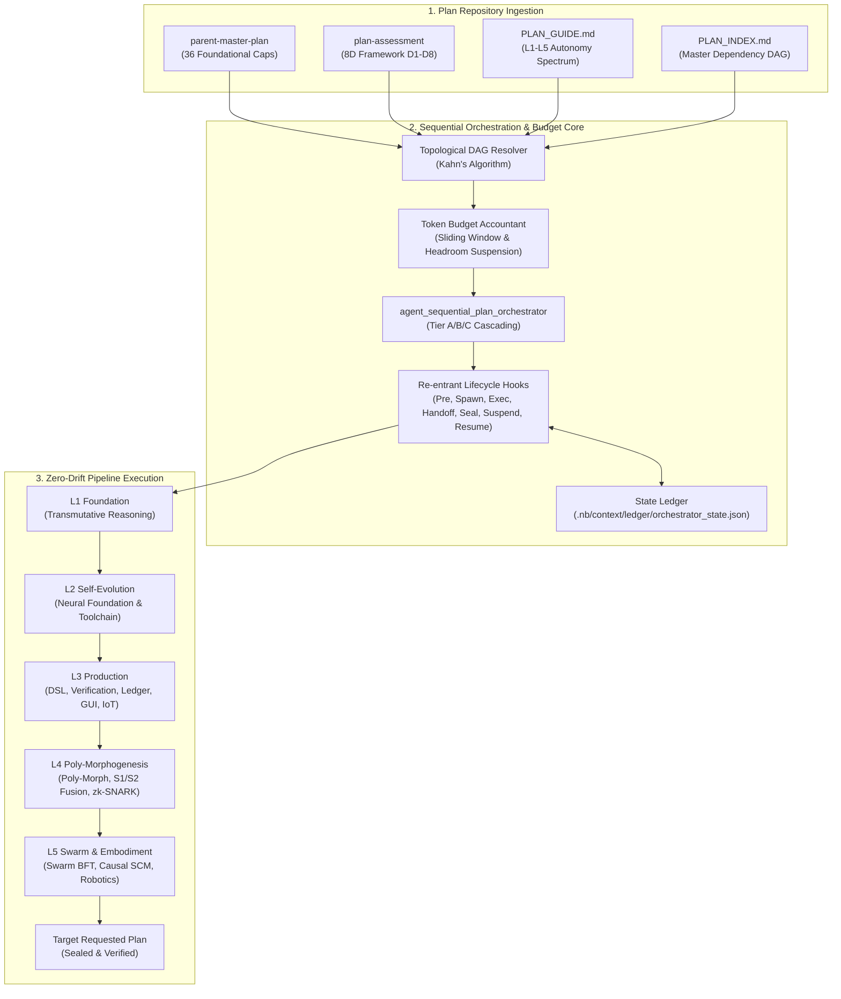
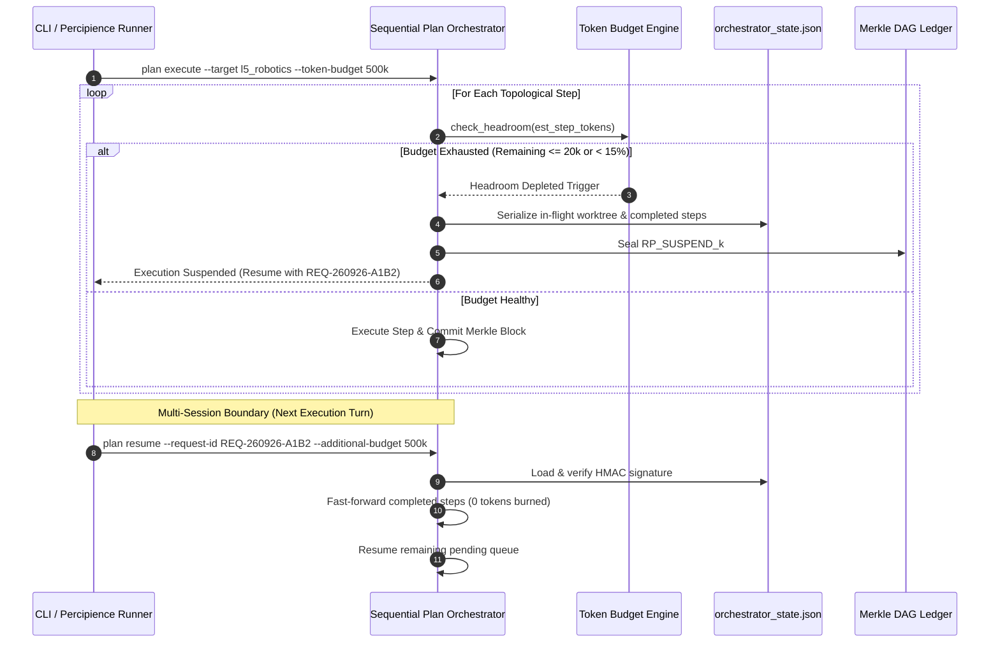

# Sequential Plan Implementation & Zero-Drift Orchestration Framework (Concise Agentic Specification)

**Plan ID**: `master_sequential_plan_orchestrator`  
**Capability Rating**: `Master Orchestration (L1→L5 Sequential Pipeline, Token Budgeting & Re-Entrant Resumption)`  
**Version**: `2.0.0`  
**Status**: `Planned`  
**Target Token Cost**: `~3,500 tokens`  

---

## 1. Executive Summary & Strategic Objectives

The **Sequential Plan Implementation & Zero-Drift Orchestration Framework** defines the unified automation machinery to ingest `.nb/plan/master/parent-master-plan`, `.nb/plan/master/plan-assessment`, `.nb/plan/PLAN_GUIDE.md`, and `.nb/plan/PLAN_INDEX.md`, and autonomously execute the complete suite of plans across the L1→L5 autonomy spectrum sequentially up to any target user-requested plan.

It introduces **Token Budget Management** for phased plan delivery and a **Deterministic Re-Entrant Resumption Protocol** allowing multi-turn execution sessions to suspend gracefully on budget headroom exhaustion and resume with zero token waste from where it was stopped.



---

## 2. Mathematical Formalization & Anti-Drift Invariants

### 2.1 Composite 6-Vector Semantic Parity Metric ($S_{SP}$)
To prevent hallucination, structural drift, and behavioral deviation across sequential transitions, every plan increment must satisfy:

$$\mathcal{G}_{SP} = \mathbb{I}(S_{SP} \ge 0.95) \land \mathbb{I}(S_{\text{Contract}} = 1.00) \land \mathbb{I}(S_{\text{SupplyChain}} = 1.00)$$

Where $S_{SP}$ is computed via the weighted linear combination:

$$S_{SP} = 0.20 S_{\text{AST}} + 0.25 S_{\text{Contract}} + 0.20 S_{\text{Behavior}} + 0.15 S_{\text{Handover}} + 0.10 S_{\text{Doc}} + 0.10 S_{\text{SupplyChain}}$$

| Vector | Metric Definition | Evaluation Engine | Hard Threshold |
|---|---|---|---|
| $S_{\text{AST}}$ | Normalized Tree-Sitter AST symbol overlap between spec and source | `ast_optimizer.py` | $\ge 0.90$ |
| $S_{\text{Contract}}$ | JSON Schema Draft-07 / OpenAPI 3.1 contract strict validation | `contract_compatibility_checker.py` | $\equiv 1.00$ |
| $S_{\text{Behavior}}$ | Bounded unit/integration test suite pass rate ($\frac{T_{\text{pass}}}{T_{\text{total}}}$) | `autonomous_cicd.py` | $\equiv 1.00$ |
| $S_{\text{Handover}}$ | Cryptographic HMAC-SHA256 `HandoffToken` signature & state continuity | `handoff_validator.py` | $\equiv 1.00$ |
| $S_{\text{Doc}}$ | AST-to-Mermaid Living Documentation sync score in `workplace/docs/` | `living_doc_engine.py` | $\ge 0.95$ |
| $S_{\text{SupplyChain}}$ | CycloneDX/SPDX SBOM dependency vulnerability score ($1.00 - \text{CVE}_{\text{score}}$) | `dependency_cve_sentinel.py` | $\equiv 1.00$ |

---

## 3. Token Budget Gating & Deterministic Resumption Engine

### 3.1 Token Headroom Invariant & Graceful Suspension
Real-time token spend ($T_{\text{consumed}}$) is tracked during execution. If the available token budget drops below safety headroom ($T_{\text{headroom}} \le 20,000$ tokens or $< 15\%$ remaining), the orchestrator triggers `suspend_hook`:

1. Freezes active Git worktree branch (`subagent_<plan_id>_<ts>`).
2. Persists exact execution graph, partial AST skeletons, and Merkle block hashes to `.nb/context/ledger/orchestrator_state.json`.
3. Emits signed cryptographic checkpoint state ($RP_{\text{SUSPEND}\_k}$) with exact CLI resumption directive.

### 3.2 Zero-Token Recomputation Fast-Forward on Resume
When invoked with `./bin/percipience plan resume --request-id <ID>`, the orchestrator:
1. Verifies the cryptographic HMAC signature of `orchestrator_state.json`.
2. Queries the Merkle ledger for all completed plans, skipping them instantly with **0 LLM tokens recomputed**.
3. Restores in-flight worktree and executes remaining steps against the granted token budget.



---

## 4. Specialist Agent Specification (`agent_sequential_plan_orchestrator`)

```yaml
agent_id: "agent_sequential_plan_orchestrator"
role: "Master Sequential Plan Implementation, Token Budget & Zero-Drift Supervisor"
authority_tier: "ORCHESTRATOR"
model_tiering:
  tier_a_reasoning: "claude-3-7-sonnet"     # Dependency resolution, contract diffing, invariant verification
  tier_b_throughput: "claude-3-5-haiku"     # AST parsing, scaffolding, diff serialization
  tier_c_deterministic: "offline_rules"    # Merkle hashing, SHA-256 caching, token accounting
execution_constraints:
  max_recursion_depth: 2
  max_tdd_retries: 3
  worktree_isolation: true
  worktree_prefix: ".nb/workspaces/subagent_seq_orch_"
  parity_gate_threshold: 0.95
  token_budget_per_plan_tokens: 150000
  token_headroom_margin_tokens: 20000
  auto_suspend_on_budget_exhaustion: true
```

---

## 5. Operations & CLI Commands

```bash
# 1. Start sequential execution with a fixed token budget (e.g. 500k tokens)
./.nb/bin/percipience plan execute \
  --target l5_robotics_kinematics \
  --mode sequential_strict \
  --token-budget 500000

# 2. Check current status, spent tokens, and active checkpoint state
./.nb/bin/percipience status --audit-orchestrator-state

# 3. Seamlessly resume from where execution stopped with an additional token budget
./.nb/bin/percipience plan resume \
  --request-id REQ-260926-A1B2 \
  --additional-budget 500000
```
