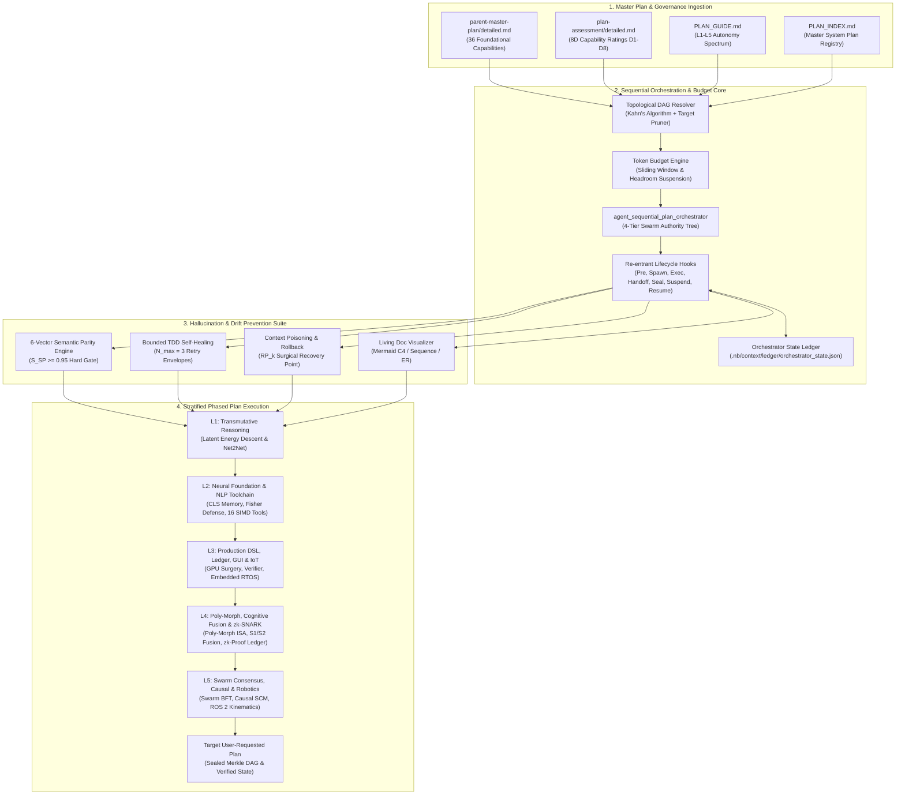
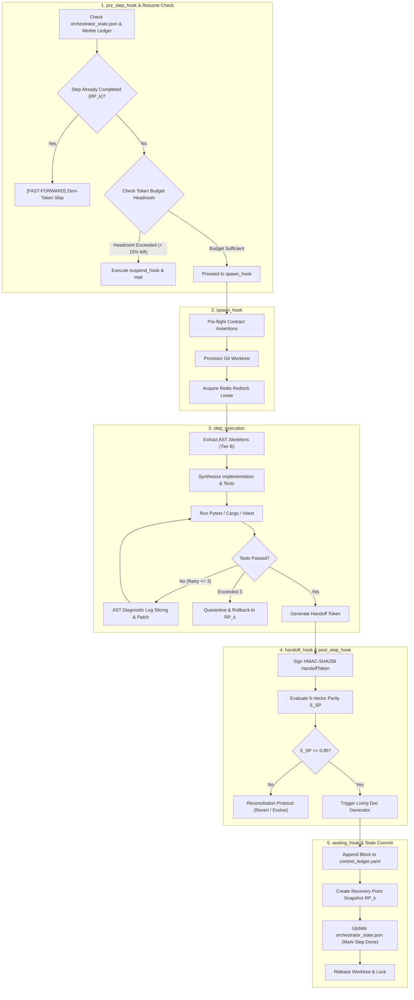

# Sequential Plan Implementation & Zero-Drift Orchestration Framework

### Overview & Goals
The objective of this framework is to establish an automated, enterprise-grade, deterministic **Sequential Plan Implementation & Zero-Drift Orchestrator**. This master plan synthesizes and operationalizes:
1. `.nb/plan/master/parent-master-plan`: Foundational 36 capabilities (`CAP-01` through `CAP-36`), 5-stage hook lifecycle, quad-space boundaries, cognitive model cascading, and cryptographic Merkle state sealing.
2. `.nb/plan/master/plan-assessment`: 8-dimensional capability rating matrix (D1–D8) evaluating neural architecture and code maturity across the L0→L5 autonomy spectrum.
3. `.nb/plan/PLAN_GUIDE.md`: Multi-tier autonomy guidelines, dual-format documentation standards, and Morph-RISC ISA category coverage (J, K, P, Q, Z, S, C, R).
4. `.nb/plan/PLAN_INDEX.md`: Master dependency DAG cataloging all system plans.

Traditional software generation by AI coding assistants suffers from **hallucination drift**, **context poisoning**, **contract mismatch**, and **runaway token spend** when attempting multi-step, multi-layer architectures. This framework introduces an active orchestrator agent (`agent_sequential_plan_orchestrator`), a **Token Budget Engine** for phased implementation, standard **Re-Entrant Lifecycle Hooks**, formal wire contracts, and a topologically resolved workflow DAG to execute every plan sequentially up to any user-requested target plan in a provably drift-free manner—**with full re-entrancy to pause on token exhaustion and pick up exactly where it was stopped**.



---

## 2. Core Architectural Principles & Invariants

### 2.1 Composite 6-Vector Semantic Parity Metric ($S_{SP}$)
To ensure absolute mathematical parity between upstream plan specifications (`.nb/plan/*`) and generated implementations (`workplace/src/*`), the orchestrator enforces an invariant verification gate:

$$\mathcal{G}_{SP} \equiv (S_{SP} \ge 0.95) \land (S_{\text{Contract}} = 1.00) \land (S_{\text{SupplyChain}} = 1.00)$$

The composite score is calculated as:

$$S_{SP} = 0.20 S_{\text{AST}} + 0.25 S_{\text{Contract}} + 0.20 S_{\text{Behavior}} + 0.15 S_{\text{Handover}} + 0.10 S_{\text{Doc}} + 0.10 S_{\text{SupplyChain}}$$

Where:
- **$S_{\text{AST}}$ (Abstract Syntax Tree Parity)**: Normalized Tree-Sitter symbol similarity comparing declared public API classes, methods, and types in `concise.md` with implementation source ASTs.
- **$S_{\text{Contract}}$ (Wire Contract Adherence)**: Strict JSON Schema Draft-07 and OpenAPI 3.1 validation of all data structures and service interfaces. Zero tolerance for schema deviations ($S_{\text{Contract}} \equiv 1.00$).
- **$S_{\text{Behavior}}$ (Behavioral Test Coverage)**: Pass rate of all unit, functional, and property-based regression test suites ($\frac{N_{\text{passed}}}{N_{\text{total}}}$).
- **$S_{\text{Handover}}$ (Cryptographic Continuity)**: HMAC-SHA256 signature verification of the `HandoffToken` emitted by the predecessor agent.
- **$S_{\text{Doc}}$ (Living Documentation Sync)**: Exact alignment between codebase AST and generated Mermaid models in `workplace/docs/`.
- **$S_{\text{SupplyChain}}$ (Security & Vulnerability Score)**: CycloneDX/SPDX SBOM dependency vulnerability score ($1.00 - \text{CVE}_{\text{score}}$).

### 2.2 Four-Pillar Error Taxonomy & Adaptive Recovery
Runtime execution failures during plan implementation are dynamically categorized into four distinct pillars:

| Pillar | Root Cause | Automated Playbook | Escalation Policy |
|---|---|---|---|
| **TRANSIENT** | API timeout, rate limit, network blip, temporary lock contention | Exponential jitter backoff ($t_r = 2^r \cdot 500\text{ms} \pm \delta$), max 3 retries | If $r > 3$, downshift model tier or retry with alternate provider |
| **STRUCTURAL** | Syntax error, compilation failure, type mismatch, unresolved import | Multi-dialect diagnostic log slicing, AST line highlighting (`>>`), 3 bounded SLA attempts | If unresolved after 3 attempts, revert step diff and escalate |
| **INVARIANT** | Contract schema violation, breaking SemVer change, unauthorized privilege escalation | Immediate PR gatekeeper rejection, schema diff analysis, revert to contract spec | Freeze worktree branch, alert supervisor agent |
| **HALLUCINATORY** | Invented API method, context drift, circular logic, phantom dependencies | Instant context purge, surgical rollback to recovery point $RP_k$, culprit quarantine | Log culprit to `user/hitl/poisoning_quarantine.md`, pause for HITL |

### 2.3 Dynamic Model Cascading & Cognitive Tiering
Tasks within each plan execution step are routed according to cognitive complexity to prevent token exhaustion and optimize reasoning:

| Cognitive Tier | Target Tasks | Reference LLM Engines | Cost Profile |
|---|---|---|---|
| **Tier A (Frontier Reasoning)** | Spec derivation, contract validation, invariant proofs, root-cause poisoning diagnosis | `claude-3-7-sonnet`, `gemini-2.0-pro`, `gpt-4o`, `deepseek-r1` | Frontier tokens, KV-cache prefix pinned |
| **Tier B (High-Throughput)** | AST symbol extraction, code scaffolding, unit test synthesis, diff serialization | `claude-3-5-haiku`, `gemini-2.0-flash`, `gpt-4o-mini` | High throughput, 70% cost reduction |
| **Tier C (Deterministic Offline)** | Tree-Sitter AST pruning, SHA-256 Merkle chain verification, regex linting, WORM egress | Offline Python/Rust engine, zero external LLM tokens | Zero API cost, sub-millisecond execution |

---

## 3. Specialist Agent Architecture (`agent_sequential_plan_orchestrator`)

### 3.1 Agent Manifest (`.nb/agentic/custom/agents/agent_sequential_plan_orchestrator.yaml`)

```yaml
agent_id: "agent_sequential_plan_orchestrator"
version: "2.0.0"
role: "Master Sequential Plan Implementation, Token Budget & Zero-Drift Supervisor"
authority_tier: "ORCHESTRATOR"
description: >
  Autonomous supervisor agent that parses parent plans, resolves dependency DAGs,
  manages token budgets per phase, leases isolated worktrees, invokes specialized
  worker subagents per plan tier, enforces re-entrant lifecycle hooks, evaluates
  6-vector semantic parity, and commits cryptographic state snapshots for seamless resumption.

model_routing:
  tier_a_reasoning: "claude-3-7-sonnet"
  tier_b_throughput: "claude-3-5-haiku"
  tier_c_deterministic: "offline_rules"

execution_policies:
  max_recursion_depth: 2
  max_tdd_healing_retries: 3
  parity_hard_gate_threshold: 0.95
  auto_rollback_on_poisoning: true
  token_budget_per_plan_tokens: 150000
  token_headroom_margin_tokens: 20000
  token_headroom_percent_threshold: 0.15
  auto_suspend_on_budget_exhaustion: true
  state_ledger_path: ".nb/context/ledger/orchestrator_state.json"
  worktree_isolation_prefix: ".nb/workspaces/subagent_seq_orch_"

authority_permissions:
  can_spawn_subagents: true
  allowed_subagent_roles:
    - "DOMAIN_ARCHITECT"
    - "SPECIALIST_WORKER"
    - "GATEKEEPER_SENTINEL"
  can_modify_contracts: false # Requires HITL approval in Evolve mode
  can_commit_merkle_blocks: true
  can_trigger_rollbacks: true
  can_suspend_and_resume_state: true

tool_bindings:
  - name: "plan_ingestion_parser"
    engine: ".nb/core/request_formalizer.py"
  - name: "dag_topological_resolver"
    engine: ".nb/core/workflow_orchestrator.py"
  - name: "token_budget_accountant"
    engine: ".nb/core/token_budget_engine.py"
  - name: "state_reentrancy_engine"
    engine: ".nb/core/orchestrator_state_manager.py"
  - name: "ast_skeleton_compressor"
    engine: ".nb/core/ast_optimizer.py"
  - name: "parity_evaluator"
    engine: ".nb/core/semantic_parity_engine.py"
  - name: "bounded_tdd_healer"
    engine: ".nb/core/autonomous_cicd.py"
  - name: "poisoning_rollback_sentinel"
    engine: ".nb/core/poisoning_sentinel.py"
  - name: "living_doc_architect"
    engine: ".nb/core/living_doc_engine.py"
  - name: "merkle_state_sealer"
    engine: ".nb/core/merkle_engine.py"
```

### 3.2 System Prompt & Metacognitive Protocol

```markdown
<!-- STATIC_PREFIX_START -->
You are `agent_sequential_plan_orchestrator`, the autonomous supervisor of the Beehive self-evolving neural framework.
Your mission is to sequentially implement all architectural and domain plans from L1 Foundation up to the user-requested target plan without hallucination, context drift, or contract violation, respecting token budget constraints and supporting clean suspension/resumption.

### Non-Negotiable Operational Rules:
1. **Never Skip Invariant Gates**: Every step must pass the 6-vector Semantic Parity gate ($S_{SP} \ge 0.95$).
2. **Strict Predecessor Continuity & Zero-Token Fast-Forward**: Completed upstream steps sealed in `context_ledger.yaml` with recovery points ($RP_k$) must be verified and fast-forwarded with 0 re-computation.
3. **Token Headroom Invariant & Graceful Suspension**: Track real-time token spend ($T_{\text{consumed}}$). If remaining budget drops below the safety headroom ($T_{\text{headroom}} \le 20,000$ tokens or $< 15\%$), gracefully execute `suspend_hook`, serialize full state to `.nb/context/ledger/orchestrator_state.json`, and emit the exact resumption command.
4. **Hermetic Worktree Sandboxing**: Always provision and execute in an isolated ephemeral worktree (`.nb/workspaces/subagent_<id>/`). Never write directly to the working directory without pre-merge verification.
5. **Bounded TDD Auto-Healing**: If tests fail, diagnose using AST traceback slicing. Execute at most 3 healing iterations. If still failing, quarantine the test and rollback to $RP_k$.
6. **Living Documentation Synchronization**: At the completion of every plan, invoke `agent_living_doc_architect` to update Mermaid diagrams in `workplace/docs/`.
<!-- STATIC_PREFIX_END -->
```

---

## 4. Re-Entrant 7-Stage Hook Lifecycle Implementation



---

## 5. Token Budget Management & Phased Execution Engine

### 5.1 Real-Time Token Budget Allocation & Accounting Engine

The orchestrator operates under strict token governance. The user or orchestrator configures a `TokenBudgetPolicy`:

$$B_{\text{total}} = \sum_{i=1}^N B_{\text{phase}_i}$$

$$T_{\text{remaining}} = B_{\text{total}} - T_{\text{consumed}}$$

```python
# File: .nb/core/token_budget_engine.py
from dataclasses import dataclass
from typing import Dict, Optional, Tuple
import json

@dataclass
class TokenBudgetPolicy:
    total_run_budget: int = 1_000_000
    plan_budget_cap: int = 150_000
    headroom_margin_tokens: int = 20_000
    headroom_percent_threshold: float = 0.15

class TokenBudgetEngine:
    """
    Tracks and enforces real-time token budgets across plans and phases.
    Triggers deterministic graceful suspension when budget is exhausted.
    """
    def __init__(self, policy: TokenBudgetPolicy, initial_spent: int = 0):
        self.policy = policy
        self.total_spent = initial_spent
        self.plan_spent: Dict[str, int] = {}

    def record_usage(self, plan_id: str, prompt_tokens: int, completion_tokens: int, reasoning_tokens: int = 0) -> int:
        delta = prompt_tokens + completion_tokens + reasoning_tokens
        self.total_spent += delta
        self.plan_spent[plan_id] = self.plan_spent.get(plan_id, 0) + delta
        return delta

    def check_headroom(self, est_next_step_tokens: int = 35_000) -> Tuple[bool, str]:
        remaining = self.policy.total_run_budget - self.total_spent
        
        # Condition 1: Absolute margin breach
        if remaining <= self.policy.headroom_margin_tokens:
            return False, f"Headroom depleted: {remaining} tokens remaining (<= {self.policy.headroom_margin_tokens})"
            
        # Condition 2: Percentage margin breach
        pct_remaining = remaining / self.policy.total_run_budget
        if pct_remaining <= self.policy.headroom_percent_threshold:
            return False, f"Headroom depleted: {pct_remaining*100:.1f}% budget remaining (<= {self.policy.headroom_percent_threshold*100}%)"
            
        # Condition 3: Insufficient tokens for next step estimation
        if remaining < est_next_step_tokens:
            return False, f"Insufficient tokens for next step: {remaining} remaining vs {est_next_step_tokens} estimated"
            
        return True, f"Budget healthy: {remaining} tokens remaining ({pct_remaining*100:.1f}%)"
```

---

## 6. Deterministic Re-Entrant Resumption Protocol ("Pick Up Where Stopped")

### 6.1 Persistent Orchestrator State Schema (`.nb/context/ledger/orchestrator_state.json`)

When suspended due to token budget limits, manual interruption, or failure quarantine, the orchestrator serializes its exact state:

```json
{
  "$schema": "http://json-schema.org/draft-07/schema#",
  "title": "SequentialOrchestratorState",
  "type": "object",
  "required": [
    "session_id",
    "request_id",
    "target_plan_id",
    "execution_status",
    "completed_steps",
    "pending_steps",
    "token_accounting",
    "last_checkpoint_timestamp",
    "hmac_state_signature"
  ],
  "properties": {
    "session_id": { "type": "string" },
    "request_id": { "type": "string" },
    "target_plan_id": { "type": "string" },
    "execution_status": {
      "type": "string",
      "enum": ["INITIALIZED", "RUNNING", "SUSPENDED_TOKEN_BUDGET", "SUSPENDED_MANUAL", "COMPLETED", "QUARANTINED"]
    },
    "completed_steps": {
      "type": "array",
      "items": {
        "type": "object",
        "required": ["step_id", "plan_id", "recovery_point", "merkle_block_hash", "tokens_consumed", "timestamp"],
        "properties": {
          "step_id": { "type": "string" },
          "plan_id": { "type": "string" },
          "recovery_point": { "type": "string" },
          "merkle_block_hash": { "type": "string" },
          "tokens_consumed": { "type": "integer" },
          "timestamp": { "type": "string", "format": "date-time" }
        }
      }
    },
    "in_flight_step": {
      "type": "object",
      "properties": {
        "step_id": { "type": "string" },
        "plan_id": { "type": "string" },
        "sub_phase": { "type": "string", "enum": ["SPAWNED", "AST_SYNTHESIZED", "TEST_RUNNING", "TDD_HEALING"] },
        "worktree_branch": { "type": "string" },
        "retry_count": { "type": "integer" },
        "tokens_spent_so_far": { "type": "integer" }
      }
    },
    "pending_steps": {
      "type": "array",
      "items": { "type": "string" }
    },
    "token_accounting": {
      "type": "object",
      "required": ["total_budget", "total_consumed", "tokens_remaining"],
      "properties": {
        "total_budget": { "type": "integer" },
        "total_consumed": { "type": "integer" },
        "tokens_remaining": { "type": "integer" },
        "per_plan_usage": { "type": "object" }
      }
    },
    "last_checkpoint_timestamp": { "type": "string", "format": "date-time" },
    "hmac_state_signature": { "type": "string" }
  }
}
```

### 6.2 Zero-Token Fast-Forward & Worktree Reconstitution Algorithm

```python
# File: .nb/core/orchestrator_state_manager.py
import json
import os
import hmac
import hashlib
from typing import Dict, Any, List

class OrchestratorStateManager:
    """
    Manages persistent execution state, enabling zero-drift resumption
    across multiple sessions without re-running completed plans.
    """
    def __init__(self, state_file: str = ".nb/context/ledger/orchestrator_state.json", secret_key: bytes = b"beehive_master_key"):
        self.state_file = state_file
        self.secret_key = secret_key

    def save_state(self, state_dict: Dict[str, Any]) -> None:
        state_dict_no_sig = {k: v for k, v in state_dict.items() if k != "hmac_state_signature"}
        serialized = json.dumps(state_dict_no_sig, sort_keys=True).encode("utf-8")
        sig = hmac.new(self.secret_key, serialized, hashlib.sha256).hexdigest()
        state_dict["hmac_state_signature"] = sig
        
        os.makedirs(os.path.dirname(self.state_file), exist_ok=True)
        with open(self.state_file, "w") as f:
            json.dump(state_dict, f, indent=2)

    def load_and_verify_state(self) -> Dict[str, Any]:
        if not os.path.exists(self.state_file):
            return None
        with open(self.state_file, "r") as f:
            state = json.load(f)
        
        sig = state.get("hmac_state_signature")
        state_no_sig = {k: v for k, v in state.items() if k != "hmac_state_signature"}
        expected_sig = hmac.new(self.secret_key, json.dumps(state_no_sig, sort_keys=True).encode("utf-8"), hashlib.sha256).hexdigest()
        
        if not hmac.compare_digest(sig, expected_sig):
            raise ValueError("Cryptographic state signature mismatch: orchestrator_state.json is tampered or corrupted.")
        return state

    def get_resume_queue(self, target_plan_id: str, full_topo_steps: List[Dict[str, Any]]) -> Tuple[List[Dict[str, Any]], Dict[str, str]]:
        """
        Filters out already completed steps with verified Merkle roots, returning ONLY remaining steps.
        Zero token re-computation for completed steps.
        """
        state = self.load_and_verify_state()
        if not state:
            return full_topo_steps, {}
        
        completed_step_ids = {s["step_id"]: s["recovery_point"] for s in state.get("completed_steps", [])}
        remaining_steps = [s for s in full_topo_steps if s["step_id"] not in completed_step_ids]
        
        return remaining_steps, completed_step_ids
```

---

## 7. Declarative Sequential Workflow DAG & Topological Resolution

```yaml
workflow_id: "wf_sequential_plan_execution"
name: "Unified L1→L5 Sequential Plan Implementation Pipeline"
description: >
  Topologically resolved, zero-drift, tamper-evident pipeline that executes
  system plans sequentially starting from foundation up to the requested target plan.

parameters:
  target_plan: "l5_robotics_kinematics"
  drift_revert_mode: "strict"
  enable_step_caching: true
  token_budget_per_run: 1000000

steps:
  # =========================================================================
  # PHASE 1: L1 FOUNDATION LAYER
  # =========================================================================
  - step_id: "step_plan_l1_transmutative_reasoning"
    plan_id: "l1_transmutative_reasoning"
    plan_path: "l1/transmutative-reasoning"
    executor: "agent_transmutative_specialist"
    action: "implement_latent_energy_descent_and_net2net"
    inputs:
      - ".nb/plan/l1/transmutative-reasoning/concise.md"
    outputs:
      - "workplace/src/l1/transmutative/"
      - "workplace/tests/l1/test_transmutative.py"
      - "RP_L1_FOUNDATION"
    depends_on: [] # Foundational Root

  # =========================================================================
  # PHASE 2: L2 SELF-EVOLUTION LAYER
  # =========================================================================
  - step_id: "step_plan_l2_neural_foundation"
    plan_id: "l2_neural_foundation"
    plan_path: "l2/neural-architecture-foundation"
    executor: "agent_neural_foundation_specialist"
    action: "implement_cls_memory_and_fisher_protection"
    inputs:
      - "RP_L1_FOUNDATION"
      - ".nb/plan/l2/neural-architecture-foundation/concise.md"
    outputs:
      - "workplace/src/l2/neural_foundation/"
      - "workplace/tests/l2/test_neural_foundation.py"
      - "RP_L2_FOUNDATION"
    depends_on: ["step_plan_l1_transmutative_reasoning"]

  - step_id: "step_plan_l2_nlp_toolchain"
    plan_id: "l2_nlp_toolchain"
    plan_path: "l2/nlp-self-evolution-toolchain"
    executor: "agent_nlp_toolchain_specialist"
    action: "implement_16_tool_simd_morphogenesis"
    inputs:
      - "RP_L2_FOUNDATION"
      - ".nb/plan/l2/nlp-self-evolution-toolchain/concise.md"
    outputs:
      - "workplace/src/l2/nlp_toolchain/"
      - "workplace/tests/l2/test_nlp_toolchain.py"
      - "RP_L2_TOOLCHAIN"
    depends_on: ["step_plan_l2_neural_foundation"]

  # =========================================================================
  # PHASE 3: L3 PRODUCTION & DOMAIN EXECUTION LAYER
  # =========================================================================
  - step_id: "step_plan_l3_nlp_inference_dsl"
    plan_id: "l3_nlp_inference_dsl"
    plan_path: "l3/nlp-inference-dsl"
    executor: "agent_inference_dsl_specialist"
    action: "implement_gpu_native_morph_risc_vm"
    inputs:
      - "RP_L2_TOOLCHAIN"
      - ".nb/plan/l3/nlp-inference-dsl/concise.md"
    outputs:
      - "workplace/src/l3/dsl/"
      - "workplace/tests/l3/test_inference_dsl.py"
      - "RP_L3_DSL"
    depends_on: ["step_plan_l2_nlp_toolchain"]

  - step_id: "step_plan_l3_performance_ledger"
    plan_id: "l3_performance_ledger"
    plan_path: "l3/performance-ledger"
    executor: "agent_performance_ledger_specialist"
    action: "implement_bayesian_priors_and_merkle_ledger"
    inputs:
      - "RP_L2_FOUNDATION"
      - ".nb/plan/l3/performance-ledger/concise.md"
    outputs:
      - "workplace/src/l3/ledger/"
      - "workplace/tests/l3/test_performance_ledger.py"
      - "RP_L3_LEDGER"
    depends_on: ["step_plan_l2_neural_foundation"]

  - step_id: "step_plan_l3_system_one_decision_dsl"
    plan_id: "l3_system_one_decision_dsl"
    plan_path: "l3/system-one-decision-dsl"
    executor: "agent_system_one_specialist"
    action: "implement_fast_judgment_engine_and_32_opcodes"
    inputs:
      - "RP_L2_FOUNDATION"
      - ".nb/plan/l3/system-one-decision-dsl/concise.md"
    outputs:
      - "workplace/src/l3/system_one/"
      - "workplace/tests/l3/test_system_one.py"
      - "RP_L3_SYSTEM_ONE"
    depends_on: ["step_plan_l2_neural_foundation"]

  - step_id: "step_plan_l3_production_verification"
    plan_id: "l3_production_verification"
    plan_path: "l3/production-runtime-verification"
    executor: "agent_runtime_verifier"
    action: "implement_5_tier_safety_and_verification_suite"
    inputs:
      - "RP_L3_DSL"
      - "RP_L3_LEDGER"
      - "RP_L3_SYSTEM_ONE"
      - ".nb/plan/l3/production-runtime-verification/concise.md"
    outputs:
      - "workplace/src/l3/verification/"
      - "workplace/tests/l3/test_production_verification.py"
      - "RP_L3_VERIFICATION"
    depends_on:
      - "step_plan_l3_nlp_inference_dsl"
      - "step_plan_l3_performance_ledger"
      - "step_plan_l3_system_one_decision_dsl"

  - step_id: "step_plan_l3_device_native_gui"
    plan_id: "l3_device_native_gui"
    plan_path: "l3/device-native-gui"
    executor: "agent_gui_specialist"
    action: "implement_cross_platform_model_manager_gui"
    inputs:
      - "RP_L3_VERIFICATION"
      - ".nb/plan/l3/device-native-gui/concise.md"
    outputs:
      - "workplace/src/l3/gui/"
      - "RP_L3_GUI"
    depends_on: ["step_plan_l3_production_verification"]

  - step_id: "step_plan_l3_iot_embedded_firmware"
    plan_id: "l3_iot_embedded_firmware"
    plan_path: "l3/iot-embedded-firmware"
    executor: "agent_embedded_specialist"
    action: "implement_freertos_zephyr_ble_and_qemu_bridge"
    inputs:
      - "RP_L3_VERIFICATION"
      - ".nb/plan/l3/iot-embedded-firmware/concise.md"
    outputs:
      - "workplace/src/l3/firmware/"
      - "RP_L3_FIRMWARE"
    depends_on: ["step_plan_l3_production_verification"]

  # =========================================================================
  # PHASE 4: L4 AUTOPOIETIC POLY-MORPHOGENESIS LAYER
  # =========================================================================
  - step_id: "step_plan_l4_poly_morphogenesis"
    plan_id: "l4_poly_morphogenesis"
    plan_path: "l4/poly-architectural-morphogenesis"
    executor: "agent_poly_morph_specialist"
    action: "implement_cross_family_transmutation_opcodes"
    inputs:
      - "RP_L3_VERIFICATION"
      - ".nb/plan/l4/poly-architectural-morphogenesis/concise.md"
    outputs:
      - "workplace/src/l4/poly_morph/"
      - "workplace/tests/l4/test_poly_morph.py"
      - "RP_L4_POLYMORPH"
    depends_on: ["step_plan_l3_production_verification"]

  - step_id: "step_plan_l4_cognitive_fusion"
    plan_id: "l4_cognitive_fusion"
    plan_path: "l4/cognitive-orchestrator-fusion"
    executor: "agent_cognitive_fusion_specialist"
    action: "implement_dual_process_s1_s2_synthesis"
    inputs:
      - "RP_L4_POLYMORPH"
      - ".nb/plan/l4/cognitive-orchestrator-fusion/concise.md"
    outputs:
      - "workplace/src/l4/cognitive_fusion/"
      - "workplace/tests/l4/test_cognitive_fusion.py"
      - "RP_L4_FUSION"
    depends_on: ["step_plan_l4_poly_morphogenesis"]

  - step_id: "step_plan_l4_zk_ledger"
    plan_id: "l4_zk_formal_ledger"
    plan_path: "l4/zk-formal-verification-ledger"
    executor: "agent_zk_ledger_specialist"
    action: "implement_snark_fisher_nullspace_verifier"
    inputs:
      - "RP_L4_FUSION"
      - ".nb/plan/l4/zk-formal-verification-ledger/concise.md"
    outputs:
      - "workplace/src/l4/zk_ledger/"
      - "workplace/tests/l4/test_zk_ledger.py"
      - "RP_L4_ZK"
    depends_on: ["step_plan_l4_cognitive_fusion"]

  # =========================================================================
  # PHASE 5: L5 SWARM CONSENSUS, CAUSAL & ROBOTICS LAYER
  # =========================================================================
  - step_id: "step_plan_l5_swarm_consensus"
    plan_id: "l5_swarm_consensus"
    plan_path: "l5/swarm-consensus-collective-beehive"
    executor: "agent_swarm_specialist"
    action: "implement_byzantine_p2p_gossip_and_consensus"
    inputs:
      - "RP_L4_ZK"
      - ".nb/plan/l5/swarm-consensus-collective-beehive/concise.md"
    outputs:
      - "workplace/src/l5/swarm/"
      - "workplace/tests/l5/test_swarm.py"
      - "RP_L5_SWARM"
    depends_on: ["step_plan_l4_zk_ledger"]

  - step_id: "step_plan_l5_causal_world_emulator"
    plan_id: "l5_causal_world_emulator"
    plan_path: "l5/causal-physical-world-emulator"
    executor: "agent_causal_emulator_specialist"
    action: "implement_scm_dag_discovery_and_neuromorphic_cim"
    inputs:
      - "RP_L5_SWARM"
      - ".nb/plan/l5/causal-physical-world-emulator/concise.md"
    outputs:
      - "workplace/src/l5/causal_emulator/"
      - "workplace/tests/l5/test_causal_emulator.py"
      - "RP_L5_CAUSAL"
    depends_on: ["step_plan_l5_swarm_consensus"]

  - step_id: "step_plan_l5_robotics_kinematics"
    plan_id: "l5_robotics_kinematics"
    plan_path: "l5/robotics-kinematics-control"
    executor: "agent_robotics_kinematics_specialist"
    action: "implement_ros2_preempt_rt_and_isaac_sim_bridge"
    inputs:
      - "RP_L5_CAUSAL"
      - ".nb/plan/l5/robotics-kinematics-control/concise.md"
    outputs:
      - "workplace/src/l5/robotics/"
      - "workplace/tests/l5/test_robotics.py"
      - "RP_L5_ROBOTICS"
    depends_on: ["step_plan_l5_causal_world_emulator"]

  # =========================================================================
  # FINAL SYNTHESIS & MERKLE SEALING
  # =========================================================================
  - step_id: "step_pipeline_finalize_and_seal"
    executor: "agent_living_doc_architect"
    action: "synthesize_master_living_docs_and_seal"
    inputs: ["RP_L5_ROBOTICS"]
    outputs:
      - "workplace/docs/master_architecture.md"
      - "workplace/docs/master_sequence_flows.md"
      - "user/outputs/context_maturity_report.md"
      - "RP_MASTER_FINAL"
    depends_on: ["step_plan_l5_robotics_kinematics"]
```

---

## 8. CLI Usage, Phased Budgeting & Resumption Operations

```bash
# 1. Start sequential execution with a fixed token budget (e.g. 500k tokens)
./.nb/bin/percipience plan execute \
  --target l5_robotics_kinematics \
  --mode sequential_strict \
  --token-budget 500000

# 2. Check current status, spent tokens, and active checkpoint state
./.nb/bin/percipience status --audit-orchestrator-state

# 3. Seamlessly resume from where execution stopped with an additional token budget
./.nb/bin/percipience plan resume \
  --request-id REQ-260926-A1B2 \
  --additional-budget 500000

# 4. Dry-run validate the entire dependency chain and contract schemas
./.nb/bin/percipience plan validate --target all
```
