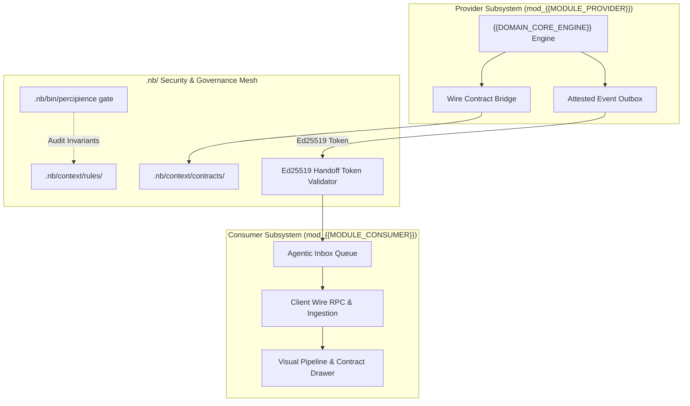

# Layerable Context Engineering Plan: {{DOMAIN_NAME}} (Concise Specification)

### Executive Overview & Domain Grounding

This document is the **Canonical Concise Plan Specification** for **{{DOMAIN_NAME}}**, designed to overlay onto the **Parent Master Framework** (`.nb/plan/master/parent-master-plan/concise.md`). It provides a token-optimized representation ($60\text{--}80\%$ token reduction) for AI agent context injection, defining core capabilities, wire contracts, visual pipeline stages, and security boundaries:

1. **{{DOMAIN_CAPABILITY_1}}**: Runtime architecture, communication protocols, and execution interfaces.
2. **{{DOMAIN_CAPABILITY_2}}**: Domain state models, transactional boundaries, and idempotency guarantees.
3. **{{DOMAIN_CAPABILITY_3}}**: Non-negotiable architectural invariants, security rules, and latency/memory budgets.
4. **{{DOMAIN_CAPABILITY_4}}**: Automated verification harness, visual pipeline DAG, and mock simulation loopback.



---

## 1. Visual Pipeline DAG & Handled Stage Contracts

The domain workflow executes as an acyclic DAG visible across IntelliJ/PyCharm, VSCode, and SaaS Portal surfaces. Each stage enforces explicit handled contracts viewable via the interactive inspection drawer:

| Stage ID | Stage Name | Assigned Executor | Handled Contract | Inputs / Outputs |
| :--- | :--- | :--- | :--- | :--- |
| `stage_validate_contracts` | Schema & Rule Sentinel | `agent_contract_sentinel` | `{{DOMAIN_WIRE_CONTRACT_1}}.yaml` | Input: Raw AST / Output: Validation Receipt |
| `stage_build_provider` | Compile & Verify Provider | `agent_{{SPECIALIST_AGENT_1}}` | `{{DOMAIN_WIRE_CONTRACT_2}}.json` | Input: Domain Spec / Output: Provider Artifact |
| `stage_verify_consumer` | Consumer Loopback Test | `agent_{{SPECIALIST_AGENT_2}}` | `{{DOMAIN_WIRE_CONTRACT_1}}.yaml` | Input: Provider Artifact / Output: Test Evidence |
| `stage_security_seal` | Security Mesh Gatekeeper | `platform.gatekeeper` | `handoff_token_attestation` | Input: Test Evidence / Output: Signed Merkle Block |

---

## 2. Quad-Space Clean Boundary Mapping

- **Governance & Context (`.nb/`)**:
  - Contracts: `.nb/context/contracts/{{DOMAIN_WIRE_CONTRACT_1}}.yaml`, `{{DOMAIN_WIRE_CONTRACT_2}}.json`
  - Invariant Rules: `.nb/context/rules/{{DOMAIN_INVARIANT_RULE_1}}.md`, `{{DOMAIN_INVARIANT_RULE_2}}.md`
  - Specialist Agents: `.nb/agentic/custom/agents/agent_{{SPECIALIST_AGENT_1}}.yaml`, `agent_{{SPECIALIST_AGENT_2}}.yaml`
  - Pipeline Workflows: `.nb/agentic/custom/workflows/{{DELIVERY_WORKFLOW}}.yaml`
- **Implementation Space (`workplace/`)**:
  - Core Modules: `workplace/modules/mod_{{MODULE_PROVIDER}}/`, `workplace/modules/mod_{{MODULE_CONSUMER}}/`
  - Integration Tests: `workplace/tests/test_{{DOMAIN_SLUG}}_space.py` (100% contract coverage)
- **User Layer (`user/`)**:
  - Inputs: `user/inputs/{{DOMAIN_SLUG}}_spec.yaml`
  - Outputs & Receipts: `user/outputs/{{DOMAIN_SLUG}}_verification_receipt.json`
  - Quarantine: `user/hitl/poisoning_quarantine.md` (surgical rollback audit ledger)
- **Ephemeral Sandboxes**: Isolated Git worktrees for safe, hermetic subagent tasks.

---

## 3. Dynamic Tier Action Matrix & Security Entitlements

| Entitlement Tier | Permitted Actions & UI Controls | Tool Exposure Scope | Domain Capabilities |
| :--- | :--- | :--- | :--- |
| **Free Community** (`plan_free`) | 🚀 Bootstrap, 🚦 Gatekeeper, 🛡️ Merkle Audit, ⚡ Token Summary | Read-only Safe Tools | Schema syntax validation, AST pruning |
| **Team Tier** (`plan_team`) | + 🌿 Worktrees, 🤖 Agent Registry, 🔄 Anti-Drift Check | Safe Tools + Custom Agents | Multi-agent handoffs, mock simulation loops |
| **Business Tier** (`plan_business`) | + 📦 Sealed NBPack, 🌐 Visual Pipeline Drawer, 🧠 Parity Report | Full Platform APIs + Encrypted Packaging | Interactive contract inspection, automated fuzzing |
| **Enterprise Dedicated** (`plan_enterprise`) | + 🐝 Swarm Triad, 🔒 Private VPC Enclave, 📜 WORM Audit Vault | Unrestricted APIs + Air-gapped Mesh | Full hardware/cloud emulation, custom sentinels |

---

## 4. FinOps Token Budget & Model Allocation

- **Context Optimization**: AST skeleton compression guarantees $\ge 60\%$ prompt token savings.
- **Model Tiering Strategy**:
  - **Tier A (Deep Reasoning)**: `claude-3-7-sonnet / pro` reserved for architecture, contract creation, and security audits.
  - **Tier B (Fast Execution)**: `claude-3-5-haiku / flash` assigned to unit testing, mock loopbacks, and lint sentinels.
- **Budget Sentinel**: Hard cap of `18,000` tokens per invocation turn with automated cache utilization tracking.

---

## 5. CLI Governance & Verification Commands

```bash
# 1. Update line counts & SHA-256 hashes
python3 .nb/plan/scripts/sync_plan_versions.py

# 2. Execute automated DAG, schema v3.0, and hash validation gates
bash .nb/plan/scripts/validate.sh

# 3. Run regression integration tests
pytest workplace/tests/test_{{DOMAIN_SLUG}}_space.py -v

# 4. Package into sealed .nbpack envelope
./.nb/bin/percipience layer pack \
  --plan .nb/plan/{{LAYER}}/{{DOMAIN_SLUG}}/concise.md \
  --output .nb/bundles/{{DOMAIN_SLUG}}_domain.nbpack
```
