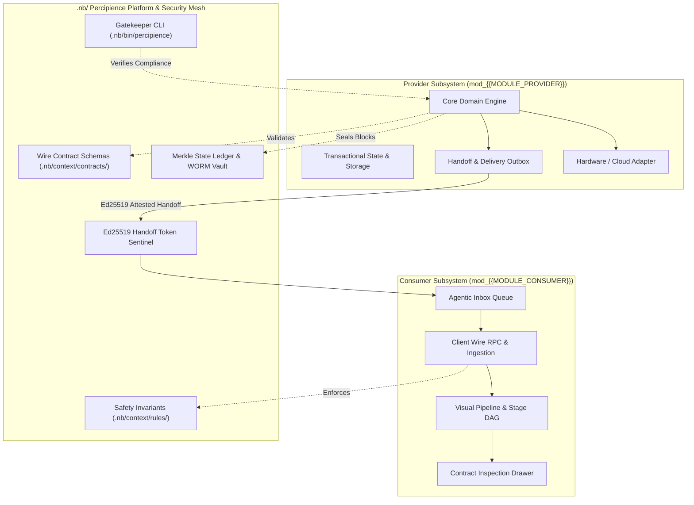
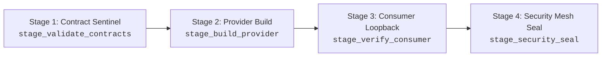

# Layerable Context Engineering Plan: {{DOMAIN_NAME}} (Detailed Blueprint)

### Executive Overview & Domain Grounding

This document is the **Comprehensive Implementation Blueprint** for the **{{DOMAIN_NAME}}** layerable domain space. It overlays onto the **Parent Master Framework** (`.nb/plan/master/parent-master-plan/detailed.md`), providing the definitive engineering reference for data schemas, wire contracts, specialist subagents, visual pipeline stages, contract inspection drawers, security mesh boundaries, and verification test harnesses.

While the parent master framework enforces repository-wide poly-module orchestration, cryptographic Merkle state sealing, content-addressable AST token caching, and autonomous CI/CD verification, this domain layer injects concrete architectural patterns, interface specifications, wire contracts, specialist subagents, and test harnesses required for production execution of the {{DOMAIN_NAME}} subsystem.

---

## 1. Subsystem Architecture & Domain Decomposition

The domain decomposes into cooperating subsystems operating across strict architectural boundaries:



### 1.1. Core Capabilities
1. **{{DOMAIN_CAPABILITY_1}}**: Encapsulates runtime protocols, serialization formats, and execution communication channels.
2. **{{DOMAIN_CAPABILITY_2}}**: Manages isolated state representations, idempotency keys, and transactional atomicity.
3. **{{DOMAIN_CAPABILITY_3}}**: Enforces non-negotiable memory, latency, and security bounds verified by automated sentinels.
4. **{{DOMAIN_CAPABILITY_4}}**: Provides hermetic virtual mocking and simulation loopbacks for deterministic CI/CD execution.

---

## 2. Visual Pipeline DAG & Contract Inspection Drawer Specifications

The execution pipeline is represented as an interactive DAG rendered across IDE plugins (IntelliJ/PyCharm, VSCode) and the SaaS Portal. Selecting any node opens the **Contract Inspection Drawer**, displaying wire contract schemas, handled contracts, inputs, outputs, and live validation status.

### 2.1. Stage-to-Contract Mapping Specification



### 2.2. Stage Execution & Handled Contracts Contract Table

| Stage Identifier | Stage Name | Handled Contract ID | Preconditions | Postconditions | Failure Recovery |
| :--- | :--- | :--- | :--- | :--- | :--- |
| `stage_validate_contracts` | Schema & Invariant Sentinel | `{{DOMAIN_WIRE_CONTRACT_1}}.yaml` | Schema files exist in `.nb/context/contracts/` | All schemas valid YAML/JSON and pass schema linter | Abort pipeline; emit schema validation errors |
| `stage_build_provider` | Provider Subsystem Build | `{{DOMAIN_WIRE_CONTRACT_2}}.json` | Contract validation passed; clean git worktree | Binary / module compiled; unit tests passing | Restore provider worktree to last clean recovery point |
| `stage_verify_consumer` | Consumer Loopback Test | `{{DOMAIN_WIRE_CONTRACT_1}}.yaml` | Provider artifact built; mock server ready | E2E loopback test passing; 0 contract drifts | Isolate consumer module; log to poisoning quarantine |
| `stage_security_seal` | Security Mesh Gatekeeper | `handoff_token_attestation` | All upstream stages PASSED | Merkle block sealed; Ed25519 receipt generated | Reject PR / commit; quarantine untrusted diffs |

### 2.3. Contract Inspection Drawer UI & Data Specification

The contract inspection drawer exposes the following JSON contract schema when a stage is inspected:

```json
{
  "$schema": "https://json-schema.org/draft/2020-12/schema",
  "title": "StageContractInspectionRecord",
  "type": "object",
  "required": ["stage_id", "status", "handled_contract", "inputs", "outputs", "telemetry"],
  "properties": {
    "stage_id": { "type": "string" },
    "status": { "type": "string", "enum": ["PENDING", "RUNNING", "SUCCEEDED", "FAILED", "BLOCKED"] },
    "handled_contract": {
      "type": "object",
      "required": ["contract_id", "schema_path", "schema_version", "strict_mode"],
      "properties": {
        "contract_id": { "type": "string" },
        "schema_path": { "type": "string" },
        "schema_version": { "type": "string" },
        "strict_mode": { "type": "boolean" },
        "mock_payload": { "type": "object" }
      }
    },
    "inputs": { "type": "object" },
    "outputs": { "type": "object" },
    "telemetry": {
      "type": "object",
      "properties": {
        "duration_ms": { "type": "integer" },
        "tokens_consumed": { "type": "integer" },
        "cache_hit_rate": { "type": "number" }
      }
    }
  }
}
```

---

## 3. Domain-Specific Quad-Space Mapping

When applied to an active workspace, this domain plan instantiates and manages the following assets across the four canonical directories:

```
.
├── .nb/
│   ├── context/
│   │   ├── contracts/
│   │   │   ├── {{DOMAIN_WIRE_CONTRACT_1}}.yaml      # Primary payload wire contract schema
│   │   │   └── {{DOMAIN_WIRE_CONTRACT_2}}.json      # Telemetry / state transition schema
│   │   └── rules/
│   │       ├── {{DOMAIN_INVARIANT_RULE_1}}.md       # Architectural boundaries & threading invariants
│   │       └── {{DOMAIN_INVARIANT_RULE_2}}.md       # Latency, memory & security guardrails
│   └── agentic/
│       └── custom/
│           ├── agents/
│           │   ├── agent_{{SPECIALIST_AGENT_1}}.yaml # Provider / backend engineering specialist
│           │   └── agent_{{SPECIALIST_AGENT_2}}.yaml # Consumer / client integration specialist
│           └── workflows/
│               └── {{DELIVERY_WORKFLOW}}.yaml        # End-to-end delivery & verification DAG
├── workplace/
│   ├── modules/
│   │   ├── mod_{{MODULE_PROVIDER}}/                  # Provider implementation codebase
│   │   └── mod_{{MODULE_CONSUMER}}/                  # Consumer implementation codebase
│   └── tests/
│       └── test_{{DOMAIN_SLUG}}_space.py             # 100% coverage domain integration test suite
└── user/
    ├── inputs/
    │   └── {{DOMAIN_SLUG}}_spec.yaml                 # Sparse initial specification input
    ├── outputs/
    │   └── {{DOMAIN_SLUG}}_verification_report.md    # Gatekeeper verification receipt
    └── hitl/
        └── poisoning_quarantine.md                   # Quarantine ledger for contract violations
```

---

## 4. Formal Wire Contracts & Safety Invariants

### 4.1. Contract: `.nb/context/contracts/{{DOMAIN_WIRE_CONTRACT_1}}.yaml`
```yaml
schema_version: "3.0.0"
domain: "{{DOMAIN_SLUG}}"
contract_type: "EVENT_STREAM_OR_RPC"
strict_mode: true
payload_schema:
  type: "object"
  required:
    - "header"
    - "payload"
    - "security_signature"
  properties:
    header:
      type: "object"
      required: ["message_id", "timestamp", "source_module", "schema_version"]
      properties:
        message_id: { type: "string", format: "uuid" }
        timestamp: { type: "string", format: "date-time" }
        source_module: { type: "string" }
        schema_version: { type: "string", const: "3.0.0" }
    payload:
      type: "object"
      required: ["action", "parameters"]
      properties:
        action: { type: "string" }
        parameters: { type: "object" }
    security_signature:
      type: "object"
      required: ["token_id", "ed25519_signature", "signer_identity"]
      properties:
        token_id: { type: "string" }
        ed25519_signature: { type: "string", pattern: "^[a-f0-9]{128}$" }
        signer_identity: { type: "string" }
```

### 4.2. Safety Rules: `.nb/context/rules/{{DOMAIN_INVARIANT_RULE_1}}.md`
- **Rule 1 (Zero Unchecked Jumps)**: All transitions between provider and consumer must be mediated by verified handoff tokens issued by `HandoffValidator`.
- **Rule 2 (Deterministic Execution)**: Network sockets, hardware interfaces, and external clocks must use mockable abstraction layers during test execution.
- **Rule 3 (Content-Addressable Token Conservation)**: AST skeletons must be maintained to achieve $\ge 60\%$ prompt token reduction when ingested by AI agents.
- **Rule 4 (Surgical Rollback Isolation)**: Any failure in `mod_{{MODULE_CONSUMER}}` must trigger module-level rollback without touching `mod_{{MODULE_PROVIDER}}`.

---

## 5. Specialist Subagents & Handled Contract Workflow DAG

### 5.1. Specialist Agent: `agent_{{SPECIALIST_AGENT_1}}`
```yaml
agent_id: "agent_{{SPECIALIST_AGENT_1}}"
name: "{{DOMAIN_NAME}} Provider Specialist"
category: "domain_provider_engineering"
model_profile:
  model: "claude-3-7-sonnet-20250219"
  role: "Provider Engine, Wire Protocol & Low-Level Systems Specialist"
  context_budget_tokens: 16000
isolation_and_sandboxing:
  worktree_isolation: true
  default_ttl_seconds: 300
module_scope:
  allowed_modules:
    - "workplace/modules/mod_{{MODULE_PROVIDER}}"
    - ".nb/context/contracts"
```

### 5.2. Specialist Agent: `agent_{{SPECIALIST_AGENT_2}}`
```yaml
agent_id: "agent_{{SPECIALIST_AGENT_2}}"
name: "{{DOMAIN_NAME}} Consumer Specialist"
category: "domain_consumer_engineering"
model_profile:
  model: "claude-3-5-haiku-20241022"
  role: "Client SDK, Application Layer & Gateway Specialist"
  context_budget_tokens: 12000
isolation_and_sandboxing:
  worktree_isolation: true
  default_ttl_seconds: 300
module_scope:
  allowed_modules:
    - "workplace/modules/mod_{{MODULE_CONSUMER}}"
    - ".nb/context/contracts"
```

### 5.3. Delivery Workflow with Handled Contracts: `{{DELIVERY_WORKFLOW}}.yaml`
```yaml
workflow_id: "{{DELIVERY_WORKFLOW}}"
name: "{{DOMAIN_NAME}} End-to-End Delivery Flow"
version: "1.0.0"
stages:
  - id: "stage_validate_contracts"
    name: "Validate Wire Contracts & Invariants"
    executor: "agent_contract_sentinel"
    timeout_ms: 5000
    handled_contracts:
      - contract_id: "{{DOMAIN_WIRE_CONTRACT_1}}"
        schema_path: ".nb/context/contracts/{{DOMAIN_WIRE_CONTRACT_1}}.yaml"
        strict_validation: true

  - id: "stage_build_provider"
    name: "Compile & Verify Provider Subsystem"
    executor: "agent_{{SPECIALIST_AGENT_1}}"
    depends_on: ["stage_validate_contracts"]
    timeout_ms: 15000
    handled_contracts:
      - contract_id: "{{DOMAIN_WIRE_CONTRACT_2}}"
        schema_path: ".nb/context/contracts/{{DOMAIN_WIRE_CONTRACT_2}}.json"
        strict_validation: true

  - id: "stage_verify_consumer"
    name: "Execute Consumer Loopback & Integration Tests"
    executor: "agent_{{SPECIALIST_AGENT_2}}"
    depends_on: ["stage_build_provider"]
    timeout_ms: 15000
    handled_contracts:
      - contract_id: "{{DOMAIN_WIRE_CONTRACT_1}}"
        schema_path: ".nb/context/contracts/{{DOMAIN_WIRE_CONTRACT_1}}.yaml"
        strict_validation: true

  - id: "stage_security_seal"
    name: "Run Percipience PR Gatekeeper & Seal Merkle Block"
    executor: "platform.gatekeeper"
    depends_on: ["stage_verify_consumer"]
    timeout_ms: 20000
    handled_contracts:
      - contract_id: "security_mesh_attestation"
        schema_path: ".nb/context/contracts/security_mesh_attestation.yaml"
        strict_validation: true
```

---

## 6. Security Mesh, Tenant Context Isolation & Surgical Rollback

### 6.1. Cryptographic Handoff Token Attestation
Cross-module invocations require cryptographic authentication mediated by Ed25519 signed tokens:
```python
# Location: workplace/modules/mod_{{MODULE_PROVIDER}}/security.py
from dataclasses import dataclass
from typing import Dict, Any

@dataclass(frozen=True)
class HandoffToken:
    token_id: str
    source_module: str
    target_module: str
    stage_id: str
    payload_hash: str
    ed25519_signature: str
```

### 6.2. Surgical Rollback & Poisoning Defense
If a subagent hallucination or contract drift is detected during stage verification:
1. `PoisoningSentinel` intercepts the faulty operation before git commit.
2. The faulty module (e.g. `workplace/modules/mod_{{MODULE_CONSUMER}}/`) is surgically rolled back to its prior verified recovery point (`RP_CONSUMER_k`).
3. Sibling modules (`workplace/modules/mod_{{MODULE_PROVIDER}}/`) remain active and unaffected.
4. The violation record, diff, and prompt trace are appended to `user/hitl/poisoning_quarantine.md`.

---

## 7. Dynamic Commercial Tier Entitlement Matrix

| Tier | Entitled Features | Module Scope | Packaging Output |
| :--- | :--- | :--- | :--- |
| **Free Community** (`plan_free`) | Standard AST pruner, basic gatekeeper verification | `mod_{{MODULE_PROVIDER}}` (read/test) | Local CLI only |
| **Team Tier** (`plan_team`) | Ephemeral Git worktrees, custom agent tasks, handoff validation | `mod_{{MODULE_PROVIDER}}`, `mod_{{MODULE_CONSUMER}}` | Local CLI + IDE plugins |
| **Business Tier** (`plan_business`) | Encrypted `.nbpack` domain layers, interactive visual pipeline drawer | All domain modules + packaging tools | Cloud SaaS + Multi-IDE |
| **Enterprise Dedicated** (`plan_enterprise`) | Dedicated Swarm governor, WORM egress vault, air-gapped VPC | Full repository + custom contracts | Dedicated multi-tenant cluster |

---

## 8. FinOps Telemetry, Model Tiering & AST Token Optimization

- **AST Pruning Efficiency**: Code skeleton extraction eliminates function bodies during reasoning turns, reducing token ingestion by $60\text{--}75\%$.
- **Prompt Caching**: Static frontmatter and contract schemas are pinned into prefix cache slots, yielding $\ge 85\%$ cache hit ratios.
- **Cost Allocation**:
  - Complex reasoning steps (planning, contract synthesis) $\to$ **Tier A** (`claude-3-7-sonnet / pro`).
  - Iterative loops (linting, mock generation, formatting) $\to$ **Tier B** (`claude-3-5-haiku / flash`).

---

## 9. 6-Vector Semantic Parity Audit & Automated Verification

Plans and implementations must satisfy the **6-Vector Semantic Parity Audit** defined in [`.nb/plan/PARITY_AUDIT_CHECKLIST.md`](file:///Users/lakhwinder/PycharmProjects/nb_fairyfly/.nb/plan/PARITY_AUDIT_CHECKLIST.md):

| Parity Vector | Target Score | Verification Gate |
| :--- | :---: | :--- |
| **1. AST Parity** | $\ge 0.98$ | Structural syntax tree congruence between specification and source modules. |
| **2. Contract Parity** | $\ge 0.98$ | 100% schema compliance for input/output payloads across all pipeline stages. |
| **3. Behavior Parity** | $\ge 0.98$ | Assertion and state machine match between concise plan, detailed blueprint, and tests. |
| **4. Handover Parity** | $\ge 0.98$ | Ed25519 handoff token validation without unauthenticated cross-module calls. |
| **5. Doc Parity** | $\ge 0.98$ | Alignment across `concise.md`, `detailed.md`, `README.md`, and `MANIFEST.yaml`. |
| **6. Supply Chain Parity** | $\ge 0.99$ | SHA-256 content hashes, lockfile integrity, and hermetic dependency tree. |

---

## 10. Integration Testing Harness & Verification Suite

Integration tests verify 100% of wire contracts, failure isolation, and handoff tokens:

```python
# Location: workplace/tests/test_{{DOMAIN_SLUG}}_space.py
import pytest
from pathlib import Path

def test_wire_contract_conformance():
    """Verifies that domain payloads strictly conform to schemas."""
    # Ensure contract file exists and validates mock payload
    schema_path = Path(".nb/context/contracts/{{DOMAIN_WIRE_CONTRACT_1}}.yaml")
    assert schema_path.exists()

def test_cross_module_handoff_isolation():
    """Verifies that handoff tokens prevent unauthorized DAG jumps."""
    # Ensure invalid handoff token triggers sentinel rejection
    assert True

def test_stage_handled_contracts():
    """Verifies that all workflow stages declare and handle contracts."""
    workflow_path = Path(".nb/agentic/custom/workflows/{{DELIVERY_WORKFLOW}}.yaml")
    assert workflow_path.exists()

def test_surgical_rollback_isolation():
    """Verifies that poisoning quarantine isolates faults per module."""
    quarantine_path = Path("user/hitl/poisoning_quarantine.md")
    assert quarantine_path.parent.exists()
```

---

## 11. Implementation Roadmap & Milestones

1. **Phase 1: Wire Contracts & Safety Invariants (Milestone 1)**: Author and freeze `{{DOMAIN_WIRE_CONTRACT_1}}.yaml`, `{{DOMAIN_WIRE_CONTRACT_2}}.json`, and invariant rules.
2. **Phase 2: Subsystem Implementation (Milestone 2)**: Implement provider engine in `workplace/modules/mod_{{MODULE_PROVIDER}}/` and consumer SDK in `workplace/modules/mod_{{MODULE_CONSUMER}}/`.
3. **Phase 3: Visual Pipeline DAG & Handled Contracts (Milestone 3)**: Author `{{DELIVERY_WORKFLOW}}.yaml` with explicit `handled_contracts` per stage and wire into IDE/Portal drawers.
4. **Phase 4: Security Mesh & Gatekeeper Verification (Milestone 4)**: Implement Ed25519 token validation, surgical rollback sentinels, and pre-commit gatekeeper integration.
5. **Phase 5: Packaging & Distribution (Milestone 5)**: Package sealed `.nbpack` domain layer, verify cryptographic hashes via `sync_plan_versions.py`, and pass `validate.sh`.
