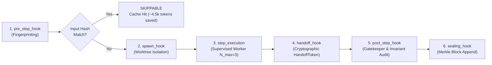

# Comprehensive Plan Review & Integration Audit: Autonomous Agentic CI/CD

**Audit Date**: 2026-10-16  
**Target Plan**: [`.nb/plan/master/parent-master-plan/`](file:///Users/lakhwinder/PycharmProjects/nb_fairyfly/.nb/plan/master/parent-master-plan/)  
**Workspace Plans**: 13 Active Hierarchical Plans (7 Master, 5 L1 Domain, 1 Test)  
**Governance Space**: [`.nb/`](file:///Users/lakhwinder/PycharmProjects/nb_fairyfly/.nb)  

---

## 1. Executive Summary

This review validates that:
1. **Parent Master Plan ([`.nb/plan/master/parent-master-plan`](file:///Users/lakhwinder/PycharmProjects/nb_fairyfly/.nb/plan/master/parent-master-plan/))**:
   - Centrally specifies the universal architectural taxonomy for **Autonomous Agentic CI/CD**, enforcing the **5-Stage Workflow Hook Lifecycle**, **Cryptographic Merkle State Ledgers**, **Pre-Commit Git Hooks**, **Wire Contract Invariants**, and **Multi-Agent Worktree Sandboxing**.
   - Serves as the topological **root node** (`master_parent_framework`) enabling all other 12 workspace plans without cycle formation.
   - Materializes the root orchestrator agent (`agent_master_parent_framework`) and root sequential derivation pipeline (`wf_master_parent_framework_derivation.yaml`).

2. **Submodule Architecture & Multi-Plan Adherence**:
   - Domain plans with submodules (e.g. `master/enterprise-ui-design-system` with 6 submodules and `master/security-mesh` with 6 submodules) adhere to the **Plan Module Orchestrator standard** (`.nb/core/plan_module_orchestrator.py`).
   - Every submodule deterministically projects into:
     - A dedicated specialist agent in [`.nb/agentic/custom/agents/`](file:///Users/lakhwinder/PycharmProjects/nb_fairyfly/.nb/agentic/custom/agents/)
     - An immutable governing rule in [`.nb/context/rules/`](file:///Users/lakhwinder/PycharmProjects/nb_fairyfly/.nb/context/rules/)
     - A sequential derivation workflow step in [`.nb/agentic/workflows/`](file:///Users/lakhwinder/PycharmProjects/nb_fairyfly/.nb/agentic/workflows/)
     - First-class multi-LLM registry projections across `settings.json`, `.claude/`, `.gemini/`, `.aider.conf.yml`, and `.cursor/`.

3. **Workspace-Wide Integration & Zero-Drift Certification**:
   - All 13 workspace plans adhere to **Canonical Manifest Schema v3.0.0** with 100% cryptographic SHA-256 hash validation and complete dependency graph coverage.
   - Entire platform test pyramid passes: **430 / 430 tests (100%)**.

---

## 2. Parent Master Plan: Core Pillars for Drift-Free Code Generation

### A. The 5-Stage Standardized Workflow Hook Lifecycle
The parent plan establishes the universal contract for all autonomous derivation pipelines:



1. **`pre_step_hook`**: Evaluates differential state fingerprinting against `.nb/context/ledger/step_cache.json`. If input schemas, contracts, and code ASTs match existing receipts, the step is safely skipped to conserve token budget.
2. **`spawn_hook`**: Spawns worker agents into strictly isolated, ephemeral Git worktrees (`.nb/workspaces/subagent_<id>/`) with POSIX PID-probed concurrency leases (`leases.json`), preventing filesystem races and context leakage.
3. **`handoff_hook`**: Enforces the 2-party cryptographic handoff token protocol (`HandoffValidator`) with zero topological cycles and hop-count limits ($H \le 5$).
4. **`post_step_hook`**: Executes cross-module schema diff audits and bounded TDD auto-healing ($N \le 3$ retries) before changes reach integration branches.
5. **`sealing_hook`**: Emits immutable SHA-256 state blocks to `.nb/context/ledger/context_ledger.yaml` and synchronizes living documentation in `workplace/docs/`.

### B. Pre-Commit Hooks & Boundary Defense
- **[`.nb/git_hooks/pre-commit.sh`](file:///Users/lakhwinder/PycharmProjects/nb_fairyfly/.nb/git_hooks/pre-commit.sh)**: Enforces Quad-Space boundary purity (rejecting direct edits to protected runtime and unverified files), verifies Merkle DAG continuity, and blocks commits violating semantic parity thresholds ($S_{SP} < 0.95$).

---

## 3. Plan Inventory & Integration Matrix

All 13 plans in the workspace are registered in [`.nb/plan/PLAN_INDEX.md`](file:///Users/lakhwinder/PycharmProjects/nb_fairyfly/.nb/plan/PLAN_INDEX.md) and linked into the dependency graph:

| Plan Identifier | Layer | Submodules | Generated Agents | Handled Contracts | Autonomous CI/CD Workflows |
| :--- | :---: | :---: | :---: | :---: | :---: |
| **`master_parent_framework`** | Master | — | `agent_master_parent_framework` | `terminal_agent_ast_contract` | `pr_gatekeeper`, `derivation_pipeline`, `wf_master_parent_framework_derivation` |
| **`master_parent_free_community`** | Master | — | `agent_commercial_packager_provisioner` | `commercial_provisioning_contract` | `basic_autonomous_cicd` |
| **`master_cloud_agnostic_infrastructure_substrate`** | Master | — | `agent_cloud_security_officer` | `observability_contract` | Multi-cloud deployment orchestration |
| **`master_enterprise_ui_design_system`** | Master | 6 | 6 subagents + root agent | `ui_theme_token_contract`, `data_grid_contract` | `wf_master_enterprise_ui_design_system_derivation` |
| **`generic_multitenant_security_mesh`** | Master | 6 | 6 subagents + root agent | `rbac_permission_matrix`, `security_mfa_challenge_contract`, etc. | `wf_generic_multitenant_security_mesh_derivation` |
| **`master_plan_assessment`** | Master | — | `quality_guard`, `flaky_test_detector` | `hierarchical_rule_contract` | Plan assessment & 6-vector parity gate |
| **`master_sequential_plan_orchestrator`** | Master | — | `agent_plan_module_orchestrator` | `onboarding_contract` | Sequential plan derivation engine |
| **`domain_intellij_pycharm_plugin`** | L1 | — | `agent_jetbrains_plugin_architect`, `agent_psi_ast_bridge_specialist` | `intellij_plugin_manifest_contract`, `psi_ast_bridge_contract` | `intellij_pycharm_plugin_delivery_flow` |
| **`domain_vscode_plugin`** | L1 | — | `agent_vscode_extension_architect`, `agent_lsp_language_features_specialist` | `lsp_protocol_contract`, `webview_message_rpc_contract` | `vscode_plugin_delivery_flow` |
| **`domain_saas_portal`** | L1 | — | `portal_developer`, `saas_backend_developer` | `portal_openapi_spec`, `billing_webhook_contract` | `saas_portal_delivery_flow` |
| **`domain_npx_installer`** | L1 | — | `agent_request_formalizer` | `package_json_manifest_contract` | Instant npx bootstrap workflow |
| **`domain_tiered_wheel_packaging`** | L1 | — | `agent_commercial_packager_provisioner` | `billing_meter_contract` | `commercial_packaging_provisioning_flow` |
| **`percipience_master_test_plan`** | Test | — | `test_finops_auditor`, `token_finops_auditor` | Test governance contracts | Master test pyramid verification |

---

## 4. Verification Suite Results

```text
▶ Step 1: Validating Dependency DAG, Schema v3.0 & Cycle Freedom...
   ✅ DAG topological ordering verified successfully (13 plans):
      [01] master_parent_framework -> [13] domain_saas_portal
   ✨ All Plan DAG, Schema, and Dependency Validation Gates PASSED!

▶ Step 2: Validating Cryptographic Content Hashes...
   📊 42 tracked plan files verified in 100% SHA-256 sync (0 mismatches).

▶ Step 3: Full Test Pyramid Execution...
   ============================= 430 passed in 46.00s =============================
```
